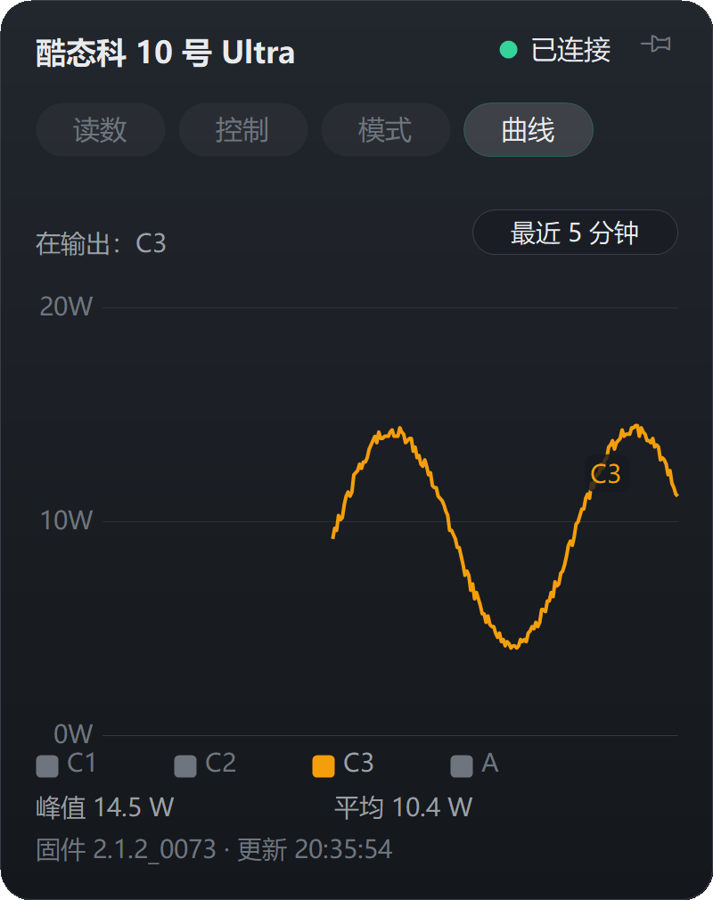

# Changelog

This project first ran on just one of my own machines and was later put on GitHub, so
what follows is organized by "what was done" rather than by release; the version numbers just
kept climbing so they line up with the file versions inside the installers.

## 0.5.7 — 2026-11-28

The chart tab now answers "C3 is the only port delivering — how do I see that on the curve".

- **The subtitle names the ports that are delivering**: "delivering: C3", or "delivering: C1, C3" for several;
  the old "one line per port, tap the pill to change the span" only shows when nothing is delivering
  (`PanelWindow.ChartSubtitle`)
- **Each line is labelled with its port name at its end**: C1 / C2 / C3 (C3+A when merged) / A in the line
  colour, stacked at least 13 dip apart, moved to the left of the point near the right edge, on a translucent
  backing so the line crossing underneath does not swallow the text (`NameOf(int)` replaces the hard-coded
  `LineNames`)
- The third name follows the merge state: **C3+A** when C3 and A are folded together, plain **C3** otherwise
- The render self-test gained `--render-solo-c3` (`PowerHistory.SeedDemo(bool c3Only)`) to produce the
  "only C3 is delivering" screenshot

## 0.5.6 — 2026-11-27

Two things only: **the context menu went back to being a real Windows menu** (the self-drawn one had
submenu items that could not be clicked), and **an incomplete config no longer throws the whole file away**.

- **Fixed "submenu items do nothing"** (`src/CuktechTrayAot/MenuWindow.cs` deleted, `NativeMenu.cs` added)
  - Root cause: the self-drawn menu let the root menu hold the mouse capture for its submenus, but `WinBase`
    releases capture unconditionally on `WM_LBUTTONUP`. The moment you let go, capture was gone; mouse
    messages then went to the submenu window, whose `OnLeftDown` / `OnMouseMove` start with
    `if (!IsRoot) return;` — so no submenu row ever reacted, and "click outside to close" broke too
  - Replaced with the system menu: `CreatePopupMenu` builds the tree, `TrackPopupMenuEx(TPM_RETURNCMD)`
    returns the chosen id in one call, and callbacks run by id. Submenu expansion, keyboard, Esc,
    click-outside, high DPI and accessibility all belong to user32, so it looks and behaves like every
    other tray app (the reference was the native menu TranslucentTB uses)
  - The entries are the same `MenuEntry` set: `MF_CHECKED` for toggles, `MNS_RADIOCHECK` dots for
    one-of-many rows, `MF_GRAYED` for disabled rows, a leading "● " on the row that has news, and the
    bold "显示功率面板" row is still the default item
- **An incomplete config is no longer discarded** (`src/CuktechTray/Settings.cs`)
  - `Load()` used to return the file contents only when `IsComplete` (MAC + token present) was true and
    otherwise started from `new Settings()`: that forgot the accepted privacy notice, the dragged taskbar
    position, the chart duration and the update-check switch, so the consent gate popped up again on the
    next launch. Now only the login fields are refilled; everything else survives
  - It also explains why `--menu-demo` kept hitting the consent gate on the dev machine
- Docs: the menu section, the feature row, the architecture note and the dependency table in both
  READMEs now say "system menu"; `docs/shot-menu-aot.png` was replaced with a real screen capture of the
  native menu (light theme)
- Version 0.5.5 → **0.5.6**
## 0.5.5 — 2026-11-27

On the Windows side this version only touches one sentence — **the privacy notice now matches what the
program actually does**; the real new work is on macOS (0.1.8: CSV export, update check on launch).

- **One self-contradiction removed**: since 0.5.4 the app quietly checks for updates eight seconds after
  launch, but the privacy notice you must accept on first launch still said "only when you press
  「检查更新」 does it reach GitHub". That stopped being true in 0.5.4, and that text is what the user agreed to.
  Section three now reads "启动时会在后台查一次更新（默认开，右键菜单里能关），只拉公开的发布列表"
  (`src/CuktechTrayAot/ConsentWindow.cs`, and the wizard's 「隐私说明」 message box in `WizardWindow.cs`)
- macOS 0.1.8 ships alongside this one: capture CSV export and the update check on launch (see the entry below)
- Version 0.5.4 → **0.5.5**

## macOS 0.1.8 — 2026-11-27

This brings the two things from Windows 0.5.4 over to the Mac: **CSV export for single-port
capture**, and **an update check that runs by itself on startup and puts a red dot in the menu bar**.

- **Capture results export to CSV** (`mac/Sources/CuktechCore/Capture.swift`, `mac/Sources/CuktechTray/CaptureResultWindow.swift`)
  - Every second of capture records voltage / current / watts / loaded into a `CaptureSample`
    (7200 entries ≈ 2 hours); idle samples are recorded too, so gaps stay gaps
  - The result window gains an "导出 CSV" button that opens an `NSSavePanel`; the default name is
    `cuktech-capture-<port>-<yyyyMMdd-HHmmss>.csv`, the same rule as on Windows
  - Written as UTF-8 **with BOM** (without it Excel mangles the Chinese header), formatted with
    `en_US_POSIX` — on a French or German system the comma decimal separator would shift every column
  - Capture itself still writes nothing; a file only appears after pressing "export CSV"
- **Update check runs on startup** (`mac/Sources/CuktechTray/TrayController.swift`, `AppSettings.swift`)
  - On by default (`checkUpdatesOnStart`), **8 seconds after launch** — Bluetooth gets to connect first
  - New version found: a small red dot after the wattage in the menu bar, and the context-menu row becomes
    "检查更新…（有 X）" with a leading red dot; the automatic check **never opens a dialog**
  - Pressing "检查更新…" yourself shows "new version X / go download / later", or "already the latest"
  - No dot in icon mode: that image is a template and any colour you add gets tinted by the system
  - When nothing is paired yet, the check puts back "还没配对，右键「重新配对…」走一遍向导" instead of
    claiming a connection
- New tests `testCsvExport` / `testSampleCap` (`mac/Tests/CuktechCoreTests/CaptureTests.swift`):
  exact header, CRLF, decimal places, idle row ending in 0, 7200-entry cap
- Version 0.1.7 → **0.1.8**

## 0.5.4 — 2026-11-27

This one rounds the panel out into a full set: **a chart tab for the power history**, **CSV export for
single-port capture**, **an update check that runs by itself on startup and shows a red dot on the tray icon**,
and the "I can't move the taskbar number to the right" report from
[issue #7](https://github.com/Blank2007/cuktech-ultra-tray/issues/7) — that position is now a four-way choice.

- **Fourth panel tab: chart** (`src/CuktechTrayAot/PanelWindow.cs`, new `src/CuktechTrayAot/PowerHistory.cs`)
  - One line per port (C1 blue / C2 green / C3+A amber / A violet); the vertical axis picks a round top
    in 20 W steps (`NiceMax`)
  - Four spans: tap the pill in the top right to cycle **1 / 5 / 15 / 30 minutes**; also in the right-click
    menu under "功率曲线时长", stored as `ChartSeconds` in `settings.json`
  - **Memory only**: 1 Hz × 30 minutes = a 1800-point cap (`PowerHistory.Capacity`, roughly 72 KB), oldest
    dropped first. Nothing is written to disk — this tab is for "what did the last few minutes look like";
    if you want the data, use single-port capture
  - An unplugged / idle port, and the one that got folded into C3+A, records **-1**, so the line **breaks**
    there instead of drawing straight across; a port with no output at all in the window isn't drawn (its
    legend entry is just dimmed), which stops an all-zero port from adding a line that looks like an axis
  - Samples closer than 0.4 s apart are skipped: the device sometimes pushes twice in a row and that would
    only add duplicate points
- **Single-port capture exports CSV** (`src/CuktechTray/Capture.cs`, `src/CuktechTrayAot/CaptureWindow.cs`)
  - Every second of capture also records voltage / current / watts / loaded into a `List<CaptureSample>`
    (7200 entries ≈ 2 hours)
  - The window buttons became two rows: "start / stop" + "close" on top, "copy summary" + "**export CSV**"
    below (the window grows from 482 to 534 high)
  - Saved to `Documents\CuktechTray\cuktech-capture-<port>-<yyyyMMdd-HHmmss>.csv`, UTF-8 **with BOM**
    (without it Excel mangles the Chinese header), numbers always `InvariantCulture` (a comma decimal
    separator would shift every column)
  - Capture itself still writes nothing; a file only appears when you press "export CSV"
- **Update check runs on startup** (`src/CuktechTrayAot/TrayApp.cs`)
  - On by default, **8 seconds after launch** (let Bluetooth connect first): `CheckUpdatesOnStart`,
    switchable from the menu
  - New version found: a **red badge** on the tray icon's top-right corner (`WattIcon.DrawBadge`), the menu
    entry becomes "检查更新…（有 0.5.5）" with a **small red dot** (`MenuEntry.DotItem` /
    `MenuWindow.DrawDot`), plus one balloon
  - The automatic check never blocks with a dialog: only pressing "检查更新…" yourself shows
    "already the latest" or offers to replace now; if you're up to date the badge quietly disappears
- **Taskbar number couldn't be moved right ([issue #7](https://github.com/Blank2007/cuktech-ultra-tray/issues/7))**
  (`src/CuktechTrayAot/TaskbarWindow.cs`)
  - Position is now a choice: **auto** (left of Start) / **centre** / **right** (left of the tray) /
    **custom left offset**, stored in `TaskbarPlace` + `TaskbarLeftDip`
  - Four sizes: small / medium / large / custom width (`TaskbarWidthDip`, 56..160 dip). The font scales with
    the width (11 × width / 84), so widening never clips the text
  - The real cause: after docking, the old code called SetWindowPos once without a z-order and then never
    touched it again, so dragging it into the tray area put it behind `TrayNotifyWnd` — it looked like it
    refused to move. Every re-layout now raises it to the front of its siblings
  - `WM_CAPTURECHANGED` finishes the drag, so losing the capture no longer leaves it stuck "dragging"
  - Custom numbers are typed into a new `src/CuktechTrayAot/NumberWindow.cs` (integers only, with bounds)
- **No Bluetooth loop before pairing**: with an empty Mac, `DeviceClient` used to throw
  `MAC 格式应为 AA:BB:CC:DD:EE:FF` every round, filling the log and holding the adapter; the loop only starts
  once the wizard has paired the device (`TrayApp._clientStarted`)
- **Two new self-check entry points** (`src/CuktechTrayAot/Program.cs`): `--probe-capture-csv` writes the
  demo samples to a CSV to verify header and column count; `--render ... --render-demo` now also renders the
  chart page (`tmp-demo-chart-*.png`)
- `tools/check-ui.ps1` baselines were re-recorded (two chart images added, capture window now 360×534);
  the chart page is compared by size only, not by pixel hash — its footer carries a live "updated hh:mm:ss" and its
  points come from the clock, so two renders are genuinely different images
- Version 0.5.3 → **0.5.4**

## 0.5.3 — 2026-11-26

This one fixes a **click misalignment** in the device settings window, and pulls out the root cause of that whole class of bug.

- **Symptom** (reported by a user): clicking the "Idle screen off" switch actually toggled the "Orientation lock" row below it,
  and clicking the "Orientation lock" row did nothing at all
- **Root cause**: `src/CuktechTrayAot/DeviceSettingsWindow.cs` **wrote the same coordinate formula twice** — once for drawing
  (`Paint`, `Rows1Y + RowH` for idle screen off, `Rows1Y + 2 * RowH` for orientation lock, both correct) and once for hit testing
  (`BuildHots`, which started counting from the first row and was therefore one row short: the first row `Rows1Y` is
  "Screen timeout", which only has chips and no switch). The whole hit table sat **32 dip above** what was drawn
- **Fix**: `BuildHots` now uses `Rows1Y + RowH` / `Rows1Y + 2 * RowH` for those two switches, row for row with the drawing
- **Root cause removed**: six new rectangle helpers — `ScreenChipRect`, `SwitchRect`, `LangChipRect`,
  `CountdownChipRect`, `ProtocolChipRect`, `ButtonRect` — are now the **single** source for both drawing and hit testing,
  scaled through `R()` (design dip -> device pixels). This was the only window in the whole tree that had two copies
- **`DrawSwitchRow` takes an explicit `Kind`**: it used to infer the kind from `rowY`
  (`rowY == Rows1Y + RowH ? Idle : ... : Usb`), so inserting a row between them would silently fall through to `Kind.UsbSwitch`
  and reproduce the same "click A, trigger B" bug
- **New self-check `--probe-hits`**: dumps all 25 hit rectangles at scale 1 (`DeviceSettingsWindow.WriteHitProbe`), to be used
  together with `--render-settings`. After the refactor both were compared before/after: hit rects identical line by line,
  rendered PNG byte-for-byte identical (same SHA256)
- Eight other self-drawn windows were audited the same way (panel, control page, mode page, per-port capture, about,
  privacy notice, pairing wizard, context menu); all of them share the same rectangle methods (`MenuWindow` even draws and
  hit-tests from the same `_rows` table), so no second misalignment exists
- Version 0.5.2 -> **0.5.3**

## macOS 0.1.7 — 2026-11-26

Fixes [issue #6](https://github.com/Blank2007/cuktech-ultra-tray/issues/6):
[@editwe](https://github.com/editwe) reported that with the glass panel on, 0.1.6 on macOS 26/27 washed the dark panel out to
a mid grey so the `.secondary` text was nearly unreadable, and that window-snap screenshots could not frame the panel.

- **Root cause** (his analysis, and the code confirms it): 0.1.6 used `NSGlassEffectView` behind `#available(macOS 26.0, *)`,
  but inside an `NSPopover`'s ordinary container that view **cannot sample the window behind it** and degenerates into a neutral
  translucent layer; at the same time `backdropOpacity` dropped the SwiftUI solid backdrop to **0.55** on 26+, so a light window
  behind turned the panel mid grey and the dim text disappeared
- **The glass layer is a plain `NSVisualEffectView` again** (`.popover` material, `.behindWindow` blending): that is what 13-15
  always used, and 26/27 sample correctly through it as well. No more system-version branching
  (`GlassSupport.swift` was rewritten, `hasLiquidGlass` is gone)
- **Backdrop stays readable**: `backdropOpacity` returns **0.9** when glass is on (was 0.55 on 26+), so secondary text keeps its contrast
- **Glass is off by default now** (`AppSettings.glassPanel` defaults to `false`, and a missing key decodes to `false`):
  0.1.6 turned it on for everyone, which is why fresh and upgraded installs both hit this. An explicit `true` in an existing
  config still wins, and the tray menu toggles it
- **About the screenshot issue**: not reproducible on our side (the CI macOS runners have no Bluetooth hardware, so they can only
  verify compilation and that the UI comes up). Going by the `CGWindowListCopyWindowInfo` check from #6, the process has only the
  popover window, and dropping `NSGlassEffectView` removes the extra glass layer — please try window-snap capture again
- Version 0.1.6 -> **0.1.7**

## 0.5.2 — 2026-11-25

This one fixes a hole I dug myself: **a panel position remembered off-screen was restored as-is, so the panel
never came back into view**.

- **The saved position is clamped before showing** (`ShowAtClamped` / `ClampKeepVisible` in
  `src/CuktechTrayAot/PanelWindow.cs`): `MonitorFromPoint` picks the nearest monitor and the position is pulled back
  into its work area; when that happens the log gets `[panel] 记住的位置在屏幕外 -495,1072 → 挪到 0,1035` and the
  corrected coordinates are written back to `settings.json`
- **Dragging is clamped too**: dragging used to push absolute coordinates straight into `SetWindowPos`, so the panel
  could be dragged fully off-screen (that is exactly how this broke); it now stops at the edge, keeping 60 dip visible
- **New tray item "Reset panel position (back to the bottom-right corner)"**: clears the stored position in one click
- Worth noting: with `PanelPinned` true and a stale off-screen `PanelX`/`PanelY`, the panel vanished **on every start**,
  not occasionally; 0.5.1's always-on-top switch only touches z-order and does not move the window, so it is unrelated
- Version 0.5.1 -> **0.5.2**

## 0.5.1 — 2026-11-25

Two things this round: the **per-port capture stats** now match macOS, and the panel gains an
**always-on-top** switch. One wasted second also went away: toggling a port used to wait a full second
before trusting the ACK.

- **Capture gains average / peak columns** (`src/CuktechTrayAot/CaptureWindow.cs`, `src/CuktechTray/Capture.cs`):
  voltage, current and power, average on the left, peak on the right. Until now only average power and a voltage
  range were shown, so "how high did the current actually spike" meant staring at the live number
- **Peak current only counts loaded samples**: the 5 V standby on an idle port no longer inflates it
- **Average voltage / current share the power integration rule**: across a tier change the pre-jump value is used,
  so average voltage x average current agrees with average power instead of inventing a 12.5 V midpoint
- **Unplugging no longer counts as a tier change**: only two consecutive loaded samples differing by 0.5 V or more
  are counted, so the tier counter stops over-reporting
- **The voltage range only covers loaded samples**: idle 5 V and post-unplug 0 V stay out of min/max
- Empty readings show "-" rather than `0.00` (thresholds 0.05 V / 0.005 A), and the summary gained average voltage
  and average current lines
- **Panel always on top** (tray menu -> "面板始终在最前"): the panel now stays above other windows. That is a
  different thing from "pin panel to desktop", which only stops it auto-hiding; both checks can be on at once and
  the state is stored as `PanelAlwaysOnTop` in `settings.json`
- **Toggling a port waits one second less**: `src/CuktechMible/MibleSession.cs` returns as soon as the SET ACK
  arrives. Measured locally, one mask write went from **1215 ms to 179 ms**; callers already read the value back,
  so nothing about success detection changed
- Version 0.5.0 -> **0.5.1**

## macOS 0.1.6 — 2026-11-25

This brings in the half of community member [@editwe](https://github.com/editwe)
[PR #5](https://github.com/Blank2007/cuktech-ultra-tray/pull/5) that had not been merged yet (he filed it as 0.1.5
and 0.1.6; 0.1.4 content went into 0.1.3 last round), plus a few interaction rewrites inspired by
[@a1287448852](https://github.com/a1287448852) derivative [CuktechMac10Ultra](https://github.com/a1287448852/CuktechMac10Ultra)
- see the credits below.

- **Reconnection is steadier**: a single central, stale connections dropped before connecting, and during the scan
  an already-connected charger is **adopted** via `retrieveConnectedPeripherals` (that case used to just time out),
  with a second adoption attempt after the scan timeout
- **Wake from sleep reconnects**: a `NSWorkspace.didWakeNotification` observer reconnects on its own
- **`peripheralId` is remembered** so the same charger is found by identifier instead of guessed from RSSI; the field
  must be optional, otherwise an old `config.json` fails to decode and wipes the stored MAC and token
- **Capture gains average / peak voltage and current**, same rules as Windows 0.5.1, and the result window now shows
  two columns; `--capture-demo` renders a sample result
- **Panel always on top**: a tray menu check sets `NSWindow.level = .floating`, independent of pinning
- **The menu bar item stops jittering**: fixed 58 pt width plus a content-fingerprint redraw (only redraws when the
  reading or colour actually changes). Previously a one-digit change shifted it, and `mac/README.md` had even
  documented that as "do not raise the font size" - now it is described as it is. The tray menu can turn it off
- **Glass panel**: `NSGlassEffectView` on macOS 26, falling back to a vibrancy view on 13-15; only the panel
  background changes, and the tray menu can turn it off (on by default)
- Version 0.1.3 -> **0.1.6**; the `Capture` tests cover the new rules (unplug is not a tier change, cross-tier
  average voltage 11.75, ...)

## 0.5.0 — 2026-11-25

The features in this release came from someone else. Community member
[@editwe](https://github.com/editwe) built device settings, per-port capture, a pinned panel and an about
window in [PR #4](https://github.com/Blank2007/cuktech-ultra-tray/pull/4) for macOS; this release ports them to
Windows over the same protocol.

- **Device settings** (new window, `src/CuktechTrayAot/DeviceSettingsWindow.cs`), in three groups: screen
  (screen timeout / idle screen-off / orientation lock / language), ports (per-port countdown shutoff for C1-A
  plus USB-A low-current mode) and fast-charge protocols (which handshakes each port may negotiate).
  Every write is SET, read back, compare; a mismatch reports "the device only accepted 0x..."
- **The protocol mask is read-modify-write**: bits 3 and 11 of the PIID 21 mask are reserved and hard-wired by
  firmware, so the current value is read first and only the target bits are changed. If that baseline cannot be
  read the write is **refused** rather than risking other bits
- **Anything that cannot be read is disabled**: when the settings cannot be read at all (just disconnected,
  unsupported firmware) the controls are dimmed and the status line says the charger is not connected. "Not read"
  is never shown as "off" - the same mistake as reporting a port with no data as idle in 0.4.7
- **Countdown shutoff** cycles through 0 / 15 / 30 / 60 / 120 / 240 minutes; the read-back may be the remaining
  time rather than the configured value, so this one is logged but not treated as a failure
- **Per-port capture** (new window, `src/CuktechTrayAot/CaptureWindow.cs`): pick a port, it samples once a second,
  and stopping gives you Wh, average power, peak, voltage range, voltage changes and why it ended, with a
  copyable summary. The algorithm lives in `src/CuktechTray/Capture.cs`, shared with future shells
- **The integration is deliberately conservative**: trapezoidal within one voltage tier; when the tier changes
  (adjacent samples differ by 0.35 V or more) that second is integrated at the pre-jump power - averaging would
  invent a non-existent 12.5 V state between 5 V and 20 V and roughly double the energy. Gaps longer than 4 s are
  skipped, and the average divides by **seconds actually delivering power**, not total elapsed time
- **End conditions are checked before sampling**: 30 s with no output means no load, 30 s with no readings means
  no data, a dropped link means disconnected, and pressing stop means stopped. All four are recorded in the result
- **About** (new window, `src/CuktechTrayAot/AboutWindow.cs`): version, project page, tested firmware and who
  helped with this release. Opening it makes **no network request**; only "Check for updates" talks to GitHub
    (it compares release asset names rather than tags, same rule as the self-updater)
- The tray menu gains "Device settings", "Per-port capture" and "About". The three custom-drawn windows share one
  modal gate (`TrayApp._modalOpen`) so stacking them cannot make Esc close the wrong one
- One false alarm cleared up: the 0.4.8 `--selftest` printed a single `[start]` line and exited, which was not a
  crash - another instance held the single-instance mutex and the process yielded by design. Self-check arguments
  now expect `--standalone`
- Version 0.4.8 -> **0.5.0**; `README.en.md` gains the matching three sections and screenshots

## macOS 0.1.3 — 2026-11-25

Merges the community [PR #4](https://github.com/Blank2007/cuktech-ultra-tray/pull/4) by
[@editwe](https://github.com/editwe): the device settings panel, per-port capture, a pinnable panel and the
About / update check, all in one go (he shipped them as three versions on his branch, 0.1.2 / 0.1.3 / 0.1.4).
Everything lands as a single macOS **0.1.3** here, with his three changelog sections folded into this one.
Windows **0.5.0** implements the same features over the same protocol (see the section above).

### Device settings panel

The panel footer's "设置" (or "设备设置…" in the right-click menu) opens a window with the things that used to
require the Mi Home app; edits are written straight to the charger and stay in sync there:

- **Screen**: screen-off timeout (1/5/10/30 minutes, always on), idle screen-off, orientation lock
- **Power**: USB-A low-current mode; per-port **fast-charge protocol switches** (C1/C2: PD / PPS / UFCS,
  C3/A: UFCS / SCP) — turning one off tells the charger not to negotiate that protocol
- **Countdown**: 15/30 minutes, 1/2/4 hours per port, cutting that port automatically (0 = off)
- Each port also shows the **protocol and wattage actually negotiated right now** (PIID 17/18, e.g. "PD 70W"),
  which is what explains the switches above it

The panel reads every item with its **own GET and leaves it empty when unanswered**: firmwares differ in what
they support, so the UI says "设备没答这一项" and disables that control. An unanswered read is **never** treated
as "off" — that would make people think the value is 0 and write an unknown value on the first click. The
protocol switches (PIID 21) are a 32-bit mask and, like the port switches, are **read-modify-written**: the
baseline is read first and the write is refused if it fails (so other ports / protocols are not switched off by
accident), then read back and compared — an ACK alone does not count as success.

### Per-port capture

- Every port row has a **waveform button**: one click starts reading that port once a second; the header shows
  elapsed time, Wh so far and average watts live, the button turns red, another click stops it
- Capture **ends** after 30 s with no output from that port, 30 s with no data at all, a dropped link, or a
  manual stop. A small window then shows Wh, average and peak power, active duration, voltage range with
  rail-change count, and sample count. The numbers live **in memory only** — closing the window discards them,
  nothing is written to disk or to the log
- **Sample counts add up now**: 30 seconds used to yield only 25 samples, because each round was
  "sample, then sleep 1 s" while one GET round trip takes 0.1–0.3 s, making a round 1.2 s. Ticks are now
  scheduled at absolute times (sample n lands n seconds after the start) and the end check moved ahead of the
  sample, so 30 s is exactly 30 samples
- Energy is **integrated per rail**: trapezoidal while the voltage stays put, and on a rail change the power
  from *before* the step is used for that last second. Averaging 5V→20V as 12.5V would overstate that second
  by more than double; the conservative choice under-reports slightly but never inflates

### Panel, menu bar and About

- **The panel can be pinned**: a pin in the top right corner. Unpinned it closes when you click outside;
  pinned it stays through app switches as a small always-on widget
- "Click outside closes it" got a safety net: `.transient` relies on the popover window resigning key, but a
  menu bar app often **is not active** when its panel opens, so that event never arrives and the panel sticks
  around. Mouse-down events are now watched as well (one global, one local), with the status item's own rect
  excluded so "close it" is not first treated as "clicked outside" and then reopened on mouseUp
- **Clicking the status item again closes the panel** instead of opening it twice (no flash)
- The panel got tighter — the empty gap at the bottom is gone and the height drops from 486 to 424 — and gained
  an **About** entry in the footer ("重新连接" on the left, "关于 / 退出" on the right); the right-click item
  became simply "关于"
- With "menu bar shows the wattage" turned off, the menu bar shows a **bolt icon** instead of a "W"
  (SF Symbol `bolt.fill` + `isTemplate`, so it inverts on light and dark menu bars); hovering still shows
  the live reading
- The About window carries the version, the GitHub link and the **update check**: it holds only the version and
  two buttons, and **only pressing "检查更新" unfolds the result row** (top edge stays put, the window grows
  downward) with an inline "Download" when a newer build exists. **Opening the window sends no request**; one
  GitHub request happens only on that click (the unauthenticated API allows 60 requests per hour per IP, and
  an automatic check would burn that quota just to glance at a version number). It compares the release asset
  name `CuktechTray-<version>-mac.zip` and **ignores the tag** — tags follow the Windows version (v0.4.x), so
  comparing tags would report "new version available" on every check; on a 403 it converts
  `x-ratelimit-reset` into local time and says when to retry
- One "looks broken" detail fixed: right after the panel opens and before the app is active, the system switch
  renders as an **inactive grey-green** and only turns blue after a click inside the panel. The switch is drawn
  by us now, so its colour no longer depends on window activation
- **The polling interval moved to the footer**: it used to sit on the right of the "charging mode" header
  ("every 1 s"), and two unrelated things on one line read as "the charging mode switches every second". It is
  the app's own refresh rate, nothing to do with the charger, so it now sits next to "重新连接" and says
  "读数 1 秒"; the header instead says "点一下切换", making it clear those four tiles are buttons rather than
  live indicators. Changes apply immediately and are written back to `pollInterval` in `config.json`
- The current mode also gets a **check mark** next to the green border, so it reads as the charger's current
  gear rather than a button you just pressed. "Does the gear switch by itself?" was checked too: two screenshots
  five seconds apart are pixel-identical, firmware 2.1.2_0079 does not change it on its own

### Two things that had to be settled while merging

- PR #4 brought its own channel lock (`channelBusy` plus a 20 ms spin-retry) on top of the
  `DeviceSession.withTransactionLock(urgent:)` / `AsyncCommandMutex` pair from 0.1.2 (PR #3). Two locks mean
  two independent queues for the same command channel, so PR #4's lock was removed entirely and everything goes
  through the 0.1.2 one: UI writes (switches / modes / settings / protocols) take the urgent path together with
  `urgentControlCount` (checked before every polled read, so a user click gets out of the way immediately),
  while polling and each capture tick queue in the background. A lock body only ever sends one command, so
  there is no nested acquisition and no chance of self-deadlock
- PR #4's `TrayController.setPort` took 1..4 and subtracted 1, while the 0.1.2 panel already passes
  `PortSlot.zeroBasedIndex` (0..3). Stacked together that meant "clicking C1 switches C2" and "clicking A
  reports the port index must be 0~3". The merged code uses 0..3 end to end on the switch path; capture still
  uses 1..4 (`PortSlot.index`) because `DeviceSession.startCapture` works in 1..4

### Tests and version

- New `Tests/CuktechCoreTests/CaptureTests.swift` (integration, the rail-change second, the 30 s end
  conditions) and `DeviceSettingsTests.swift` (protocol bit offsets, PIID 17/18 unpacking, and the inverted
  screen-timeout values where 1 means 5 minutes and 5 means 1 minute)
- New files: `Sources/CuktechCore/Capture.swift`, `DeviceSettings.swift`,
  `Sources/CuktechTray/SettingsWindow.swift`, `AboutWindow.swift`, `CaptureResultWindow.swift`
- Version 0.1.2 → **0.1.3**; the author's three original sections are on
  [PR #4](https://github.com/Blank2007/cuktech-ultra-tray/pull/4)

## macOS 0.1.2 — 2026-11-25

The macOS build catches up with the two Windows changes (merged ports, privacy consent) and **merges the community PR**.
Thanks to [@a1287448852](https://github.com/a1287448852) for
[PR #3](https://github.com/Blank2007/cuktech-ultra-tray/pull/3) and to
[@KingGxxT](https://github.com/KingGxxT) for
[issue #1](https://github.com/Blank2007/cuktech-ultra-tray/issues/1).

- **C3 and A are shown as one merged port**: the rule and the wording match Windows 0.4.7 — the owner row is labelled
  `C3+A`, the other row no longer says "idle" but shows a dimmed `merged into C3+A` (with a dimmed `—` where its wattage
  used to be), and the total is counted once. `DeviceSnapshot` gained
  `pairMerged` / `mergedOwner` / `rowName` / `rowDetail` / `rowWattsText`
- **The privacy notice must be agreed to on first launch**: `Sources/CuktechTray/PrivacyWindow.swift`
  (`PrivacyText` / `PrivacyView` / `PrivacyGate`) shows a modal window with exactly two ways out — "Agree and continue"
  writes `privacyAccepted = true` and starts normally, "Disagree, quit" calls `exit(0)` without writing anything.
  `Esc` and the close button do not dismiss it. Non-interactive paths (`--version` / `--selftest` /
  `--wizard-demo`) skip the gate so CI keeps working
- `AppSettings.privacyAccepted` is decoded with a hand-written `decodeIfPresent`: an older `config.json` without the field
  does not throw the whole configuration away
- **Four fixes from PR #3**: (1) the port switch index was off by one (`PortSlot.index` is 1…4 while
  `setPortEnabled` validated 0..<4, so USB-A reported "port index must be 0~3"); new `PortSlot.zeroBasedIndex`.
  (2) a Swift actor is re-entrant across `await`, so polling and manual control could send commands concurrently; new
  `AsyncCommandMutex` and `DeviceSession.withTransactionLock(urgent:)`, with failures / reconnects / stops all going
  through `teardownLink()`. (3) A SET answers with a single `op=0x01` ACK that carries no new value, so we return on it
  instead of waiting out a fixed delay. (4) The disconnected "—" / 0.0 W is no longer hard-coded grey but lets the menu
  bar invert it automatically — finally readable on a dark desktop
- This release also fixes a truncated read-back: `MibleSession.receiveResponse` now accepts only `op = 0x03` for GET and
  `op = 0x01` for SET, so a SET ACK sharing the siid/piid cannot cut the real GET result short
- Version 0.1.1 → **0.1.2**; `Tests/CuktechCoreTests/ModelsTests.swift` gained five merged-power cases
- `mac/README.md` gained three sections: the merged C3+A reading, the first-launch consent, and the full privacy text

## 0.4.7 — 2026-11-25

Two pieces of feedback in one release: **the port readings were wrong** — with C3 and A both plugged in, the Mi Home app
shows one merged wattage while we labelled the port that reports nothing as "Idle", which looks broken; and **the privacy
note had to be agreed to up front** — 0.4.6 only put a small line and a dialog inside the wizard, while what was asked for
was "you must agree the first time you open it before it does anything".
Thanks to [@KingGxxT](https://github.com/KingGxxT) for
[issue #1](https://github.com/Blank2007/cuktech-ultra-tray/issues/1): one screenshot plus "C3 and A should be shown merged,
the official firmware does not distinguish them either and just shows idle" nailed the problem.

- **C3 and A are shown as one merged port**: the two outlets share a single power meter, and the firmware reports
  `state = 0x11` on it when it merges them (`src/CuktechMible/MiotCodec.cs:109` has documented
  `0x00 idle / 0x01 single port / 0x11 C3+A merged` all along — the UI simply never used it)
  - Rule: if either C3 or A reports `state == 0x11` and has data, the pair counts as merged
  - Read tab: the row that carries the numbers is labelled `C3+A`; the other row no longer claims "Idle" but says
    "merged into C3+A" in grey
  - The control tab's live-reading column does the same, while the two switches stay independently clickable
  - The total is counted once: `Snapshot.TotalWatts` only adds the owner row when merged
  - With nothing merged, not a pixel changes
- **A privacy notice you must agree to on first launch**: a new standalone window
  (`src/CuktechTrayAot/ConsentWindow.cs`, 500×546) with four sections — what the QR login does / where the data lives /
  what this program never does / how to clean up. Body text wraps on measured pixel width and prefers to break at a space
  (otherwise `%LOCALAPPDATA%\CuktechTray` gets cut in half)
  - "Agree and continue" writes `PrivacyAccepted: true` into `settings.json` and never asks again
  - "Disagree, quit", `Esc`, or closing the window exits the process — **nothing written, Bluetooth untouched**
  - Existing installs see it once on upgrade (the field did not exist before 0.4.7)
- `--render-consent` renders that screen straight to a PNG (for checking layout); new images
  `docs/shot-consent.png` and `docs/shot-panel-merged.png`
- README: the privacy section now says the first launch shows this screen, and the read tab documents the merged display
- Version 0.4.6 → 0.4.7; `dist/CuktechTray.exe` is 10,898,944 bytes, FileVersion 0.4.7.0

## macOS 0.1.1 — 2026-11-25

A macOS-only release: **0.1.0 could not connect to the charger at all on real hardware**, and the bug was in the
advertisement parser. Thanks to [@editwe](https://github.com/editwe) for PR
[#2](https://github.com/Blank2007/cuktech-ultra-tray/pull/2) — correct root cause plus a regression test built from
bytes captured off a real device. **Windows is untouched in this release** and stays on 0.4.6.

- **Fixed the connection failure**: `MiBeaconAdvertisement.parse` required the first two bytes to be `95 FE`
  (the service-UUID header), but macOS hands over the **bare payload** through
  `CBAdvertisementDataServiceDataKey` (`10 59 | 0E 66 | 00 | 30 8B 31 73 CD 3C` = frame control / productId /
  counter / little-endian MAC), so the guard always failed and the scan result stayed empty — the menu bar showed
  `—` forever while the log kept saying "no advertisement for MAC …". Both layouts are accepted now; the MAC bit in
  the frame control is still what decides whether a MAC is present
- Bluetooth readiness wait on first launch **10 s → 30 s**: state stays `unknown` until the permission dialog is
  dismissed, and 10 s was tight enough that users were declared "can't connect" right as the dialog appeared
- **Left click on the menu bar opens the panel, right click shows the menu** (the menu used to be attached to the
  status item, so left click could only ever show the menu — the opposite of what the README says)
- The app icon is now **drawn at build time** (`mac/scripts/make-icon.swift` → `iconutil` → `.icns`); no binary in
  git. The gradient fills solid colour row by row instead of using NSGradient/CGGradient, whose dithering bloated the
  icns from 132 KB to 1.2 MB
- New `Tests/CuktechBleTests` (advertisement-parsing regressions from real-device bytes: with/without the UUID
  header, MAC bit clear, truncated); **the macOS CI job now runs `swift test` too** — previously only the Linux job
  ran tests, and this suite only compiles on macOS, so it would never have executed
- mac/README gained a "troubleshooting" table (nine symptoms → cause)

## 0.4.6 — 2026-11-25

Fixes a bug a real user hit: **right after a successful QR pairing the wizard showed the English sentence**
`Reflection-based serialization has been disabled for this app`. That is a NativeAOT trap — the SDK turns reflection-based
JSON serialization off for AOT publishes, and the pairing path used it in two places. This version also adds a privacy note
to the wizard, and macOS gets its own version number.

- Fixed the pairing failure: the `/v2/home/home_device_list` body is built with `MiCrypto.JsonToken()`, which used
  `JsonSerializer.Serialize(raw)` internally; under AOT that call throws `NotSupportedException: Reflection-based serialization has been disabled for this app`.
  Replaced with a hand-written escaper `MiCrypto.JsonQuote()` (quotes / backslash / control characters / `\u00XX`, CJK kept as is);
  the `JsonSerializer.Serialize(did)` in the `blt_get_beaconkey` path now uses `MiCrypto.JsonQuote(did)` too
- `--selftest` gained AOT-specific checks: seven JSON-escaping assertions plus a settings source-generation round-trip, one `[aot] … ok` line each;
  it also prints `[aot] json-reflection-enabled=False`, so "reflection serialization really is off under AOT" ends up in the log
- The bug survived a whole release because local testing always used a saved `settings.json` and skipped the login path —
  the pairing path had never been exercised on a real AOT build. The self-test now covers it
- The wizard's first screen has a privacy-note line (opens a full dialog): scanning only exchanges this charger's Mac + token
  once with Xiaomi Cloud, credentials stay on this machine, normal operation reads power over Bluetooth with no network,
  and which two files to delete to clean up
- The legacy standalone installer `CuktechTray-Setup.exe` was rebuilt once (68 MB, embedding this very AOT binary) purely to
  exercise the in-place-upgrade path; it is **not uploaded with the release** — install/uninstall still happen inside the main exe
- Version 0.4.5 → 0.4.6

### macOS (own versioning from 0.1.0)

macOS no longer shares the Windows version number; it starts at **0.1.0**: `CuktechTray-0.1.0-mac.zip`.
The two platforms move at different speeds, and tying them to one number only mixes unrelated entries in the changelog.
macOS also got the privacy note in this version (a paragraph on the welcome screen plus a "see the full note" dialog).

## 0.4.5 — 2026-11-23

The UI and the feature set are identical to 0.4.4. What changed here is the evidence: the promo assets stop reusing older captures, the tray icon is rendered by the program itself, and the menu is captured from the real thing.

- New `--render-icons`: the drawing inside `WattIcon` was split out as `public static Bitmap CreateBitmap(int size, Color accent)`, so the shell can render both icons (green = connected, grey = disconnected) straight to a 608×256 transparent PNG at `docs/shot-tray-icons.png` instead of relying on a 125%-scaled screenshot
- `--menu-demo` now writes "已连接 · 总 6.0 W" before showing the menu, so the captured header no longer says "not connected / connecting…"
- README gained two images: `docs/shot-menu-aot.png` under "Tray menu" (real capture of the self-drawn menu) and `docs/shot-tray-icons.png` under "Tray icon" (both languages)
- New `--render-taskbar`: the taskbar digits are rendered to a transparent PNG with the same font (Segoe UI Bold 11 pt × scale) and the same colour rules (`WattStyle.Total`) the runtime uses, then composited over a real taskbar capture.
  The old README taskbar image was a 0.2.2 demo capture and even had the wrong colour — 6.0 W is light blue under the current buckets, the old picture drew it green
- README "Power on the taskbar" got a new image and new wording: `docs/shot-taskbar.png` plus a colour-bucket table (grey / light blue / green / amber / red) explaining why the 6.0W in the picture is light blue (both languages)
- The two stale promo assets (the 0.2/0.3 "five icon styles" matrix and the 0.3.3 WinForms menu capture) were replaced with the 0.4.4 originals (the video project is not part of this repo)
- The download lines used to hard-code `CuktechTray-0.4.0.exe` / 9.19 MB; they now say `CuktechTray-<version>.exe` / 10.4 MB so they stop going stale on every release
- Version 0.4.4 → 0.4.5; **no functional or visual change** — upgrading from 0.4.4 looks exactly the same

## 0.4.4 — 2026-11-23

The connected pill in the top bar drops its fill; the dot and the label stay. The top bar also gets room to breathe.

- It used to be a 30%-opacity green fill + status dot + 已连接. What was actually wanted was no tinted fill — the label was
  meant to stay (an intermediate build dropped the label as well; the answer was "I did not tell you to delete the text")
- No fill, no outline now: an 8 px dot plus the original 11.5f status label, right-aligned exactly where it was
- Breathing room: the status sits 6 px → 10 px away from the pin
- The title row and the tab row were only 4 px apart and looked glued together, so the tabs moved down 8 px (38 → 46) and
  the big number, divider, header, four reading rows and footer all follow by 8 — panel 320×396 → **320×404**
- Version 0.4.3 → 0.4.4; the three panel screenshots are re-rendered

## 0.4.2 — 2026-11-23

Two complaints: black squares in the corners, and everything felt cramped. Both fixed here.

### The black corners

- Cause: the rounded look was only a rounded-rectangle background painted inside a still-rectangular window.
  The double buffer is a screen-compatible DDB with no alpha channel, so whatever the paint did not cover stayed at the
  cleared colour — visually, "four black corners padding a rounded panel"
- The window itself is now clipped to a rounded region with `SetWindowRgn` + `CreateRoundRectRgn`, same as the menu and the wizard
  (the region radius uses exactly the same integer as the painted background, so the anti-aliased edge cannot leak a half pixel)
- `--render` output now has transparent corners too, so the diagnostic PNGs no longer carry a dark square into docs or video assets

### Spacing

- Panel design size 320x360 → **320x396**, row pitch 42 → 48, footer moved down 36
- Mode cards 44 → 50 tall with a 58 px pitch (was 52); card title and hint each shifted down 3 px
- The one-line captions on the control and mode pages sit 8 px lower, back in line with the taller header
- Zebra band 32 → 36 tall, following the new row pitch

### Misc

- Version 0.4.1 → 0.4.2; `docs/shot-panel.png` and `docs/shot-control.png` re-rendered for the new layout

## 0.4.1 — 2026-11-23

Moving to the native shell in 0.4.0 left the setup wizard behind in the old one, so first-time use still meant
downloading 0.3.3 to pair. This release brings it back, and aligns the three panel pages pixel-for-pixel with 0.3.3.

### Wizard

- New `src/CuktechTrayAot/WizardWindow.cs`: welcome / scan / pick-device pages, 425 lines, hand-drawn at a 460x520 design size
- The QR code is fetched from the Mi Home server and drawn on the spot; picking a device writes MAC + token into `settings.json` and reconnects without restarting
- When `settings.json` has no credentials the wizard pops up 0.8 s after start; tray menu → "Reconfigure device…" runs the same code
- `--setup` on the command line opens it directly (`--wizard-demo` is the same thing, used for self-checks)
- Verified on real hardware: 460x520 design lands as 575x650 physical at 125% scaling, mean per-pixel difference 0.89 against the offscreen render;
  after clicking "Scan with the Mi Home app" the QR area really showed a code (15% dark modules), so the Mi Home cloud path works in the AOT build too

### Interface

- The subtitle on the mode and control pages moved 4 logical pixels each, so all 12 text rows now line up exactly with 0.3.3
- `docs/aot-demo-*.png` redrawn: they used to be rendered at 2.5x, whose font quantization does not match the 1.25x of real hardware and looked like a discrepancy;
  now they are rendered at 1.25x and upscaled by 2, sharing the 0.3.3 screenshot baseline
- Added `docs/shot-wizard.png` / `docs/shot-wizard-scan.png`: the wizard's welcome and scan pages captured on real hardware (the latter with a live QR code)

### Engineering

- `--render-wizard`: renders the three wizard pages to 575x650 PNGs under `docs/` so layout can be checked without a visible screen
- Fixed backslashes being eaten in the render output path (it used to surface only as `GDI+ A generic error occurred`)

## 0.4.0 — 2026-11-23

Nothing was dropped; two things happened: the "72 MB self-contained exe" became a "9.19 MB native exe",
and both the installer and self-update were folded into the main program — **one exe is the portable build,
the installer, and its own updater**.

### Size

- The portable build went from 72,715,094 bytes (69.3 MiB) down to **9,633,792 bytes (9.19 MiB)** — 1/7.55 of the old size — and it still needs no .NET runtime on the target machine.
- The installer went from 132,813,041 bytes (126.7 MiB) to "just those 9.19 MiB": the separate `CuktechTray-Setup.exe` is no longer needed.
- Once installed, later upgrades no longer download an installer: the program checks GitHub, downloads, verifies and replaces itself — 9 MB and change, end to end.
- Why: most of that 72 MB was the whole .NET runtime plus the JIT compiler, not the program itself. NativeAOT compiles everything to win-x64 native code up front, so none of it ships.
- The pdb is still tens of megabytes, but it is not part of the release.

### Implementation

- New `src/CuktechTrayAot/`: 13 files, 4,967 lines — a bare Win32 + GDI+ shell. Window classes, the message loop, the tray icon, the three-tab panel, the taskbar digits and the rounded dark context menu are all drawn by hand; WinForms is gone.
- The business layer was not rewritten: `Models` / `Settings` / `DeviceClient` / `SelfTest` / `UpdateCheck` / `WattStyle` / `LogSink`, plus `src/CuktechMible/` and `src/probe-cs/WinRtMibleLink.cs`, are shared through `<Compile Include>` in the csproj.
- Behaviour matches 0.3.3: tray wattmeter, four-port readings, the control and mode tabs, taskbar digits, the context menu (rounded / translucent / green checks), run-at-startup, update check and `--selftest` are all there. `--selftest` passes on real hardware (exit code 0, 3.7 s authentication, identical port readings).

### UI

- The tray icon no longer draws wattage — it is a status badge now: green when connected, gray when not.
  The power figure lives on the taskbar strip where it is always visible; stacking a number on the icon as well
  was a second place to read the same thing, and it forced a repaint per frame. The hover tooltip still carries
  "total X W" plus per-port detail.
- Icon styles collapsed from five to one (`WattIcon.cs` 247 → 107 lines), and the "tray icon style" submenu is gone.
- Fixed the pin button in the panel's top-right corner being clickable but invisible (font name was misspelled
  `Microsoft MDL2 Assets`; GDI silently fell back to a font without the glyphs).
- The pin button lines up with the "connected" chip; the "current" chip on
  the mode page is more opaque; the hint line on all three pages sits on the same baseline.
- Re-checked every page pixel by pixel against the 0.3.3 on-screen captures: bold weight moved from 600 to 700
  (600 actually selected Segoe UI Semibold), the double-buffer bitmap dropped its alpha channel so ClearType works
  again (it used to degrade to grayscale and look washed out), and the pin / "switched off / idle" grays were
  reverted to their 0.3.3 values.
- A second pass fixed three real mismatches: font sizes round up now (GDI+ turned 13×1.25 into 17 px; rounding down
  to 16 shrank the title and tab captions by a notch), translucent fills no longer go through gamma-corrected
  blending (the tab chip background was one step brighter than 0.3.3 — `CompositingQuality` is back to default),
  and coordinate scaling truncates again like `(int)(v * _s)` (rounding accumulated a 2 px offset across the tab
  spacing); the table header uses `Microsoft YaHei UI` again (a linked fallback font has a different ascent and
  lifted the header by 2 px) and the pin button is back to 20×20 with no outline. Difference against the 0.3.3
  on-screen capture of the read page is down to 772 pixels (0.1% of the frame).
- `1` / `2` / `3` jump straight to the read / control / mode page (previously only `Tab` cycled and `Esc` closed).

### Installation

- The program now carries `Installer.cs`: the tray menu's "Install on this PC…" copies the running exe to
  `%LOCALAPPDATA%\Programs\CuktechTray`, creates a Start-menu shortcut and writes the HKCU uninstall entry plus an
  optional run-at-startup value. Afterwards the menu reads "Uninstall from this PC…".
- Current user only (HKCU + user profile) — **no administrator rights, no UAC prompt**. Installs over an existing 0.3.x directory.
- `settings.json` travels along, so there is no re-pairing after installing.
- Uninstall validates the target first (it must contain `CuktechTray.exe` and must not be Windows / Program Files /
  the user profile root / the desktop), then removes shortcuts, the registry entry and the directory. When the program
  itself lives in that directory, a temporary copy plus `MOVEFILE_DELAY_UNTIL_REBOOT` removes the last file.
- Shortcuts go through `CoCreateInstance` and a raw `IShellLinkW` / `IPersistFile` vtable instead of `[ComImport]`
  (built-in COM interop is shaky under NativeAOT).
- A shortcut that cannot be written is a warning, not a failed install, so antivirus or a locked-down folder does not veto everything.
- CLI equivalents: `--install [--dir=<path>] [--autostart] [--desktop] [--silent]`, `--uninstall [--silent]`.

### Updates

"Check for updates" in the context menu is no longer "here is a new version, go download it" — it installs it:

- After finding a new release it picks the `CuktechTray-<version>.exe` asset (skipping `-Setup-`) and downloads it to
  `CuktechTray.exe.download` next to the exe (same volume, so the final rename is atomic).
- **SHA256 is computed while downloading**; both the byte count and the digest published by the GitHub API must match
  before anything is replaced. A mismatch deletes the `.part` file and leaves the current exe untouched.
- **A running exe cannot be replaced** (the image is mapped; even renaming is refused), so the program copies itself to
  `%TEMP%\CuktechTray-update-<pid>.exe` and lets that copy wait for the main process to exit, then:
  back up to `CuktechTray.exe.old` → overwrite → start the new build → drop the backup → schedule itself for deletion.
- If the overwrite fails, the `.old` file is restored. The helper retries up to 60 times, 500 ms apart, which is enough
  time for antivirus to release a handle.
- The main process drops Bluetooth before exiting and leaves through the normal `ExitApp` path, so the new build
  reconnects to the charger on its own (about 4 seconds).
- When in-place updating is impossible it falls back to the release page — and decides **before downloading**: no usable
  asset, no size published, or a non-writable exe directory (e.g. `Program Files`).
- Measured: the 72,715,094-byte 0.3.3 asset downloaded from GitHub in **7.35 s** with a matching SHA256; a deliberately
  wrong digest produced "SHA256 mismatch" and removed the partial file.
- Automatic updates only work between releases that ship an identically named asset, so **0.4.0 has to be installed
  manually once**; from then on it can update itself.

### Tooling

- `--shortcut-test <lnk path>`: creates a single .lnk and reads it back, touching no system folder.
- `build.ps1 -Aot`: one command for the AOT single file; the script wires up lld-link and the xwin library paths itself (no Visual Studio needed).
- `build.ps1 -Aot -Publish`: also copies the result over `dist\CuktechTray.exe`.
- `run.ps1 -Aot [-Panel]`: launch the AOT build (optionally opening the panel).
- `--render <dir>`: creates no windows at all and paints all three pages straight into 400x450 PNGs, so layout can be regression-tested even on a locked desktop.
- `--render --render-demo`: same, but fed a fake "connected" snapshot, so the operable colour scheme and switch states can be checked without the device.
- `--update-selftest <dir>`: file-level check of "back up → overwrite → a missing payload must not clobber the target"; no network, no child processes.
- `--update-download-test <dir> --url= --sha= --size=`: one real download with SHA256 verification, used to test the proxy/direct fallback.
- `--apply-update=<target> --payload=<new file> --pid=<old process>`: the update helper itself (normally started by the program; do not call by hand).

### Known

- Restore warns `NU1903`: `Microsoft.DotNet.ILCompiler` 8.0.32 has a known high-severity advisory `GHSA-p3jp-9v83-76w9`; it will clear with a later .NET 8 SDK.
- `LNK4099` during linking (missing MSVC-internal pdbs) is noise.
- The `setup/` WinForms wizard is legacy now (62.9 MB host + 63.8 MB payload) and will not be maintained;
  installing and uninstalling are done by the program itself. For 0.4.6 it was rebuilt once (68 MB, embedding that version's main
  exe) just to verify the in-place upgrade, but it **never ships in a release**, and that release route should not come back.

## 0.3.3 — 2026-11-22

The context menu got a new look, and "is this switch on or not" turned into something you can just see.

### Tray menu

- **Rounded corners + acrylic translucency**: the context menu was repainted with DWM's rounded-corner attribute plus the acrylic variant of `SetWindowCompositionAttribute`,
  the base colour was set to the menu's own dark gray (30,34,41) at F2 alpha, and the item spacing was switched to Win11's proportions (5 px top and bottom, 24 px on the left reserved for the check).
  It comes close to the semi-transparent menu in TranslucentTB; Win11 24H2 only gives popup windows a translucent tint rather than real blur, so it is "see-through", not "frosted glass".
- **A green check on the left of items that are on**: toggle items such as `Pin panel to desktop` / `Show power on taskbar` / `Start with Windows` get a green check while they are on and stay blank while they are off,
  so you no longer have to click in to find out the current state. The check is drawn by the program itself (with `ShowImageMargin = false`, ToolStrip's built-in check margin no longer takes effect),
  painted on the menu background layer and repainted once more when the mouse passes over.
- The submenus (Charge mode / Icon style) get the same skin too, check marks and rounded corners included.

### Implementation

- New `MenuEffect.cs`: `Apply(ToolStripDropDown)` puts the rounded corners and the acrylic on the menu window and registers it in the `IsBlurred` set; the renderer uses that to decide
  "it is translucent already, don't lay an opaque background underneath"
- `Skin()` in `UiTheme.cs` now does four things: set the renderer, set the font, assign Padding by item type, and attach the effect to the menu
- `UiTheme.Skin()` must be called after every menu item has been added — it walks the items to set the spacing, and calling it too early just gets an empty list

## 0.3.2 — 2026-11-22

The "charge mode" from the Mi Home app is now built in, in the panel and in the tray menu.

### Added

- **Charge mode (scene mode)**: the panel gained a third tab, "Mode", with four profiles — AI / Digital ecosystem / Single port / Balanced
  (protocol SIID 2 / PIID 5, values 1–4). Clicking a card applies it immediately; after the write one GET reads the value back and verifies it, and the bottom line reports
  "switched to X (device reads N)"; if the device and the request disagree it raises an error instead of pretending it worked.
  All four round-tripped on real hardware (it was sitting on Single port 3 → writing 1 / 3 / 4 / 2 each read back the same value), and 3 was written back afterwards.
- Switching to the "Mode" tab reads the real value from the device first, no cached value pretending.
- The tray right-click menu gained a "Charge mode" submenu, four check-marked items that follow the current profile; the whole entry is greyed out when the charger is not connected.

### Fixed

- The GET reply for scene mode is a single byte (`op=0x03 type=16 raw=03`), and going through `MiotMessage.UIntValue` reads it as 0;
  you must read `ValueBytes[0]`. Copying how the four-port switches were written silently reads "don't know" — I walked into this once.

## 0.3.1 — 2026-11-20

Two things: the "it is charging, yet it never connects" trap is plugged, and update checking was added.

### Fixed

- **The real reason it could not connect to the charger**: connecting called `BluetoothLEDevice.FromBluetoothAddressAsync` directly to get the device object,
  but Windows' BLE device cache expires — restarting the Bluetooth service, swapping adapters, leaving it a day, or powering the device off for a while all clear it.
  With an empty cache that call returns `null` every single time, **whether or not the charger is anywhere near**, so the log filled with
  `FromBluetoothAddressAsync returned null` every 8 seconds and could keep that up all day (my own log had it for 22 hours, 8683 times).
  What it does now: if the device cannot be fetched the first time, it runs one round of active advertising scanning (at most 8 s) to get it into the system cache, then fetches again, retrying at most 5 times.
  Measured in the "null for 22 hours" state, a single scan and it authenticated immediately.
- The error when no device can be scanned was reworded as well: "cannot find this device: make sure the charger is powered, within Bluetooth range, and that no phone is holding its connection",
  which beats the old exception that carried nothing but an English API name.

### Added

- **Check for updates**: tray context menu → "Check for updates…", which asks GitHub Releases once; if there is a newer version it pops up the version number and asks whether to open the download page.
  It only goes online when you click it — startup, connecting to the charger and polling readings never touch the network.
  - .NET 8's HttpClient does not read the system proxy settings (a direct connection to api.github.com from mainland China mostly gets no JSON back), so the program reads
    `HKCU\Software\Microsoft\Windows\CurrentVersion\Internet Settings` from the registry itself, tries once through the proxy and once direct if that fails.
  - It also works from the command line: `CuktechTray.exe --check-update`, which prints the current version, the latest version and which route it took.

## 0.3.0 — 2026-11-20

Readings and controls are one window now, and a drawing bug that made the switch invisible at all is fixed.

### Power Panel

- **Two separate windows merged into one**: previously "read the power" was the panel and "flip the switches" was a separate control-page window, so switching between them took two clicks;
  the panel now has a 24 px tab strip under its title — **Read / Control** — and switching tabs does not change the window, does not move it and does not re-authenticate
- Panel height went from 328 to 360 px (the extra 32 px is exactly the tab strip); the width stays at 320 px
- Every coordinate on the Read tab moved down 32 px; row heights, font sizes, color bars and zebra striping are all unchanged
- Switching to the Control tab **does not break the panel's collapse-on-blur / pin / `Esc` behavior** — both tabs behave exactly the same

### Control Page (now the panel's second tab)

- Each row gives up 48×28 px on its right for a **pill switch**: on = green track + white knob, off = gray track + knob on the left
- The tab got a hint line at the top: "click the switch on the right and the charger cuts / restores power immediately, no Save needed" — the control page used to require "Apply"
- The column headers became Port / Live reading / Switch
- **With the charger disconnected the switches are dimmed** (the track turns dark green and the knob turns gray): the state is still readable, but they don't respond — with no device state to read we don't write anything into the device
- Write failures, being busy and device rejections are all explained in the bottom line

### Fixed

- **The switch never drew at all**: the rounded-rectangle radius was passed as `height / 2`, and GDI+'s `AddArc` degenerates around a 1:2 aspect ratio,
  so the whole path came out empty — a pixel scan confirmed that area held nothing but the background color, with no white knob. It now computes
  `Math.Min(width, height) / 2` first and clamps the knob diameter, and after the rewrite it draws correctly
- The switch sat **8 px out of vertical alignment** with the row text beside it: the switch rectangle used to be `row top + 7 px`; it is now derived
  from "the row text occupies 22 px and is vertically centered" — the switch center belongs at row top + 11 px, i.e. rectangle y = row top − 3 px

### Added and Changed

- The meaning of `--control` changed: it no longer opens a separate window, it **flips the panel straight to the control page as it appears**
  (with `--tray-only --control` only the control page opens; the behavior is unchanged)
- New context menu entry "**Show control page (4 ports)**" that jumps straight to that tab
- The standalone `ControlForm.cs` was deleted

## 0.2.3 — 2026-11-17

UI polish + dark context menus.

### Power Panel

- The connection status in the top-right corner is now a **semi-transparent pill** (status-colored dot + text) instead of a bare line of text, so connected / disconnected is obvious at a glance
- The four data rows got **zebra striping**, and each row now starts with a **power color bar**: the color rules match the wattage number (gray when disconnected, pale blue <20 W,
  green 20–60 W, yellow 60–100 W, red ≥100 W)
- The `W` unit next to the big number is now centered on the digits (it used to sit 6 px high)
- The pin button got a hover background so "pin / unpin" looks clickable
- Bottom padding increased from 6 px to 14 px

### Control Page

- A **connection status dot** was added in front of the subtitle in the header (green = connected, gray = not connected)
- Each port card now has a **status color bar** on its left edge: gray when powered off, dim while idle / reading, green while outputting
- The card border brightens when the pointer is over its switch
- The footer hint was shortened to "auto-refresh every N seconds · switches take effect immediately, independently"

### Context Menus

- The tray menu and the panel context menu switched to a **dark skin**: background `#1E2229`, hover `#343A46`, green check marks, dark separators
- Menu font is Microsoft YaHei UI 9.5 throughout
- This only affects this program's own menus; the system-wide appearance is left alone

### Added

- New command-line switch `--control` that opens the control page right after launch (combined with `--tray-only` the panel no longer pops up)

## 0.2.2 — 2026-11-17

The little power readout in the taskbar is finally clean.

### Fixed

- **Ghosting from two stacked layers of digits**: the root cause was that the window keyed out its
  background in one flat pass, while the taskbar background is a gradient, so the punched-out edge
  overlapped the real icons underneath. The window is now drawn per-pixel with alpha — only the text
  is solid and everything else is fully transparent — and the ghosting is gone. The investigation is
  written up in section 12 of [docs/taskbar-component.md](docs/taskbar-component.md)

### Added

- The digits in the taskbar **can be dragged left and right**; releasing the mouse remembers the position, and it is still there on the next boot
- New "Reset taskbar number position" entry in the context menu, returning it to the left of the Start button
- New `TaskbarLeftDip` setting: a negative value means automatic placement

### Changed

- Automatic placement now hugs the left side of the Start button instead of sitting on top of the row of app icons next to the tray icons

## 0.2.1 — 2026-11-17

Transitional release. Only two small issues between the taskbar widget and the panel z-order on Win11 24H2 were fixed; the UI is unchanged.

## 0.2.0 — 2026-11-17

### Added

- **Control page**: one switch per port (C1 / C2 / C3 / A) that can both cut and restore power;
  every write is followed by a read-back verification, and failures are explained in the status line
  at the bottom. There are also "Refresh" and "Auto-refresh"
- **Installer**: a WinForms wizard (welcome → choose folder → install → finish) with the main
  program embedded; it ships with an uninstaller that removes the startup entry, the desktop /
  Start menu shortcuts, and the uninstall registry key
- Assembly version numbers now follow the release version (every exe used to be hardcoded to 0.1.0, so old and new builds were indistinguishable)

### Fixed

- "After unlocking the screen / switching users, the panel still sits on top of other windows": root cause and fix are in [docs/zorder-fix.md](docs/zorder-fix.md)

## 0.1.0

The first version that actually worked:

- Xiaomi MIoT BLE authentication (HKDF + HMAC + AES-CCM); measured authentication time 3.7–4.6 s
- Polls voltage / current / power on all four ports every second and displays the summed total power
- The tray icon draws the power number directly, colored by wattage; five icon styles to choose from
- Borderless dark power panel, pinnable to the desktop, auto-collapses on focus loss
- First-run QR-code wizard (scan with the Mi Home app → MAC and Bluetooth token are read back automatically)
- Automatic reconnect after a disconnect
