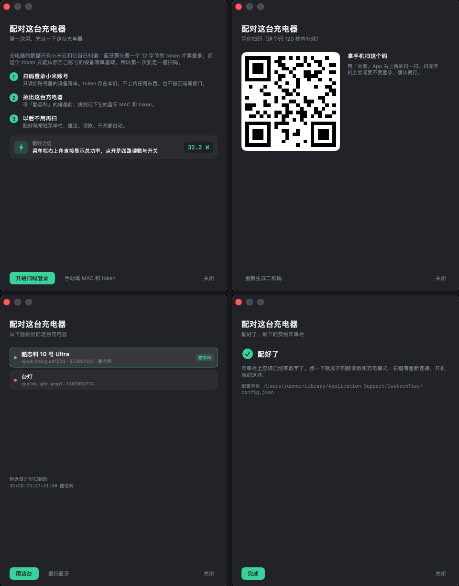
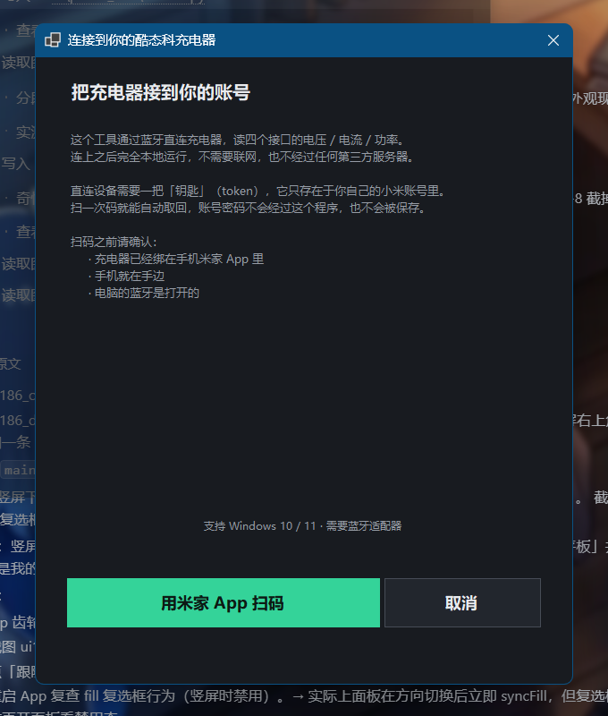
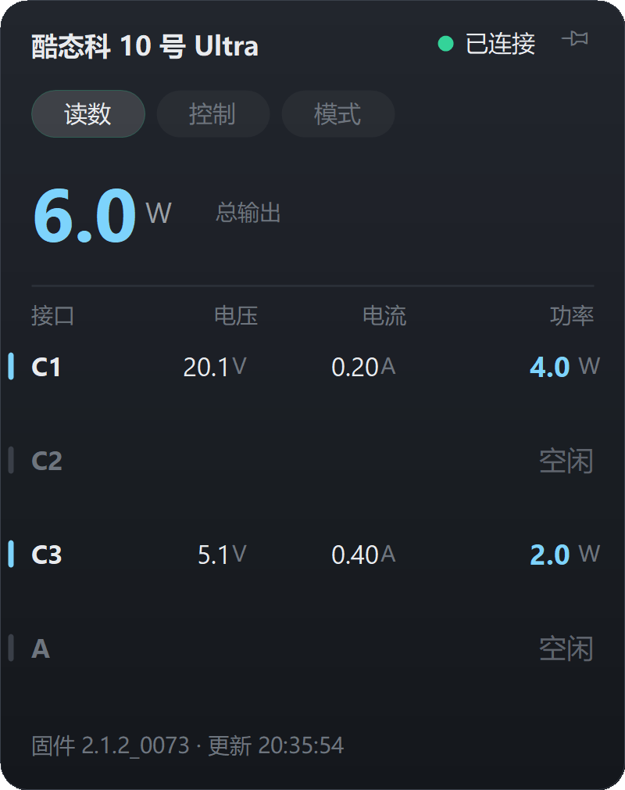
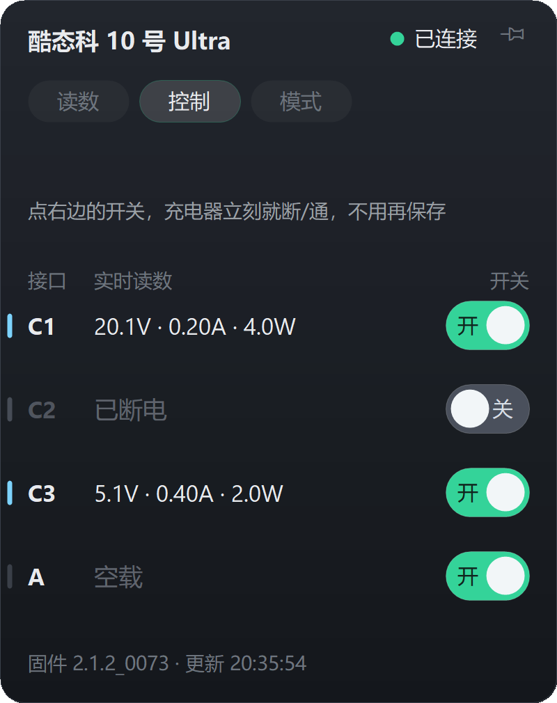
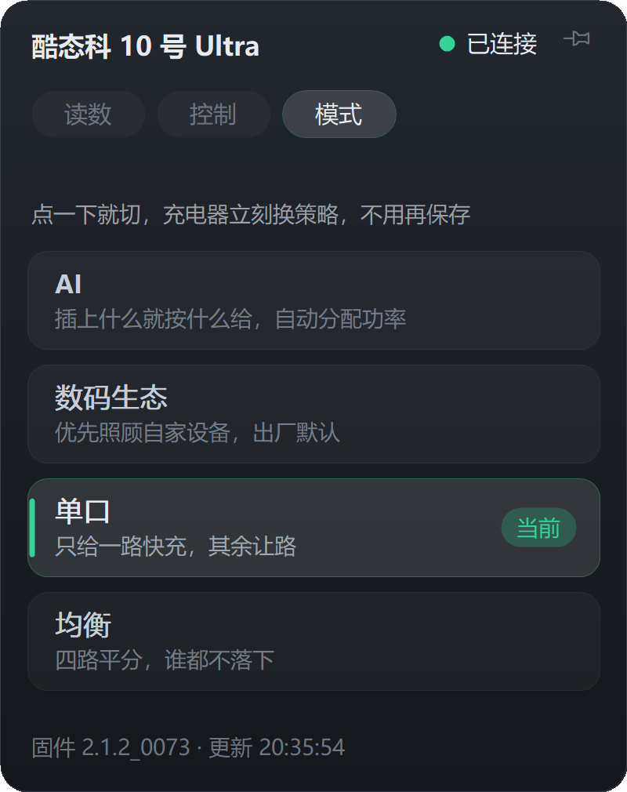
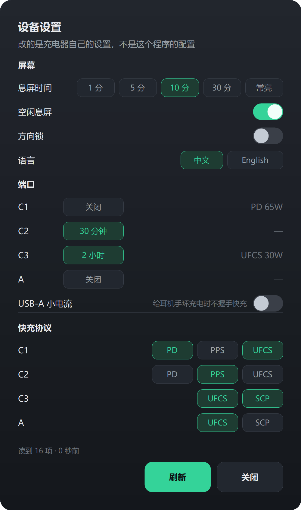
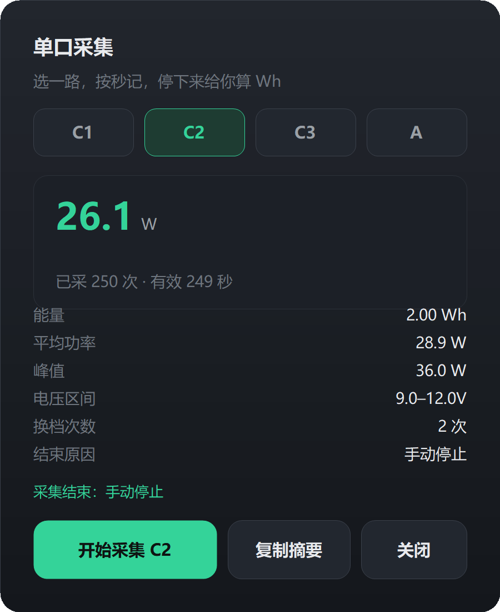
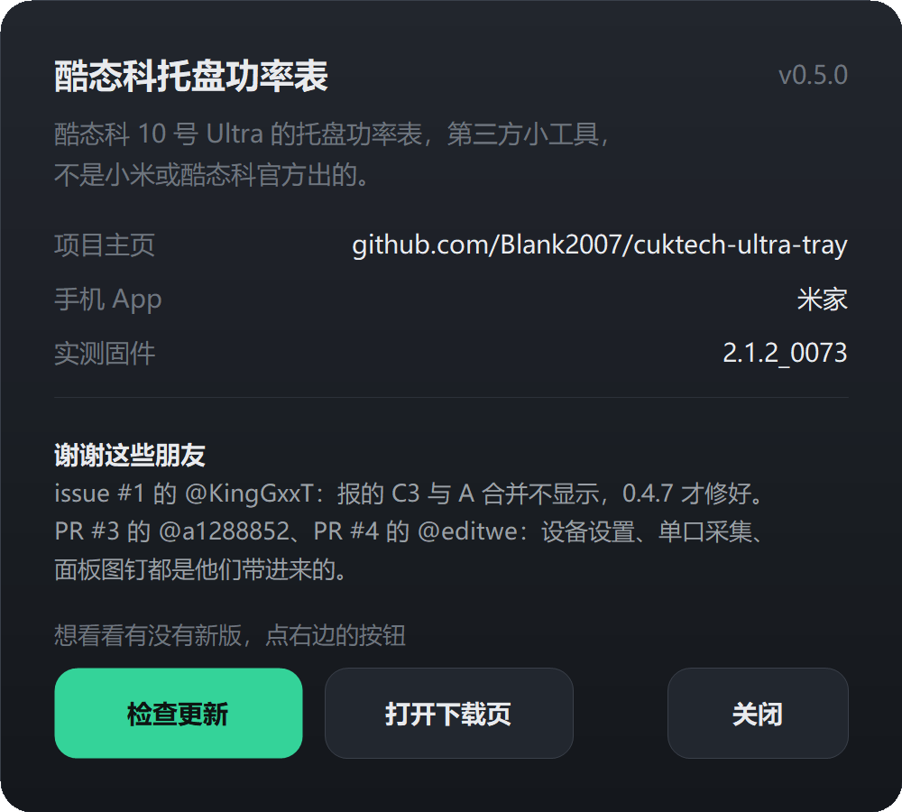
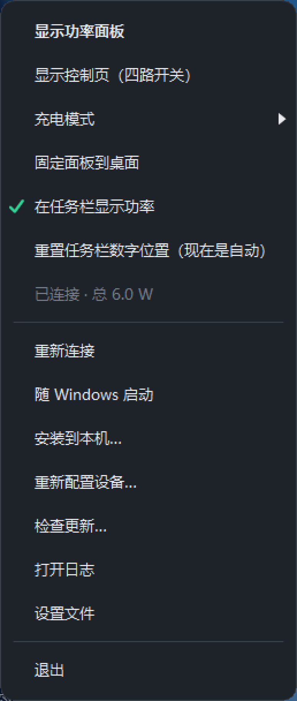
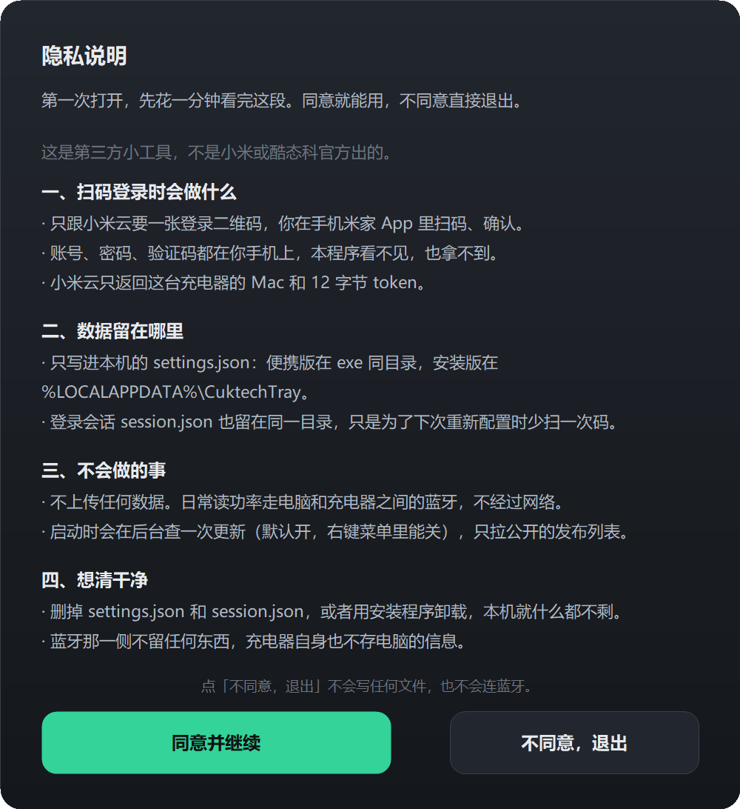

<p align="center">
  <a href="assets/intro-en.png"></a>
</p>

<p align="center">
  <a href="README.md">简体中文</a> · <b>English</b>
</p>

<p align="center">
  <a href="LICENSE"></a>
  
  
  <a href="https://github.com/Blank2007/cuktech-ultra-tray/releases/latest"></a>
</p>

# CUKTECH 10 Ultra Tray Power Gauge — Total Power, Right on the Taskbar

A tiny app with no main window: **total power sits in digits on the taskbar**, next to the Start button, updated once per second.
Click the tray icon (or the digits) and the panel opens with voltage / current / power for all four ports, plus a direct way to cut the power.

* Talks to the charger over **direct Bluetooth BLE** (our own implementation of Xiaomi MIoT encrypted authentication) — no gateway, no Mi Home app running in the background, and no network traffic once connected
* The whole program is **one exe, 10.4 MB**, and the target machine needs no .NET — that same file is the portable build, the installer and the updater
* Updating does not mean downloading another installer: one click on "Check for updates" and it replaces itself
* Tens of MB resident, sits quietly in the tray — no popups, no desktop clutter

> 🍎 **The macOS build lives in [`mac/`](mac/README.md)**: same protocol, same colour rules, except the number goes into the
> menu bar (a system `NSStatusItem`, not a hand-drawn overlay), in pure Swift — the .app is about 1 MB. Feature parity:
> menu-bar total power, the four-port panel with per-port switches, the QR pairing wizard, C3+A shown as one merged port,
> and the **privacy notice you must accept on first launch** (same as Windows).
> The Bluetooth code is fully independent of the UI and its tests run on Linux. macOS has its own version line starting at
> **0.1.0** instead of following Windows 0.4.x — it is **0.1.2** right now.



---

> ### 🤖 The code in this repository was written by AI
>
> **Every line of source code was written by an AI coding agent** — inside **DeepSeek Harness**, using the **deepseek-v4.1-flash** model,
> from scratch across a few sessions on 2026-11-17 (protocol research → authentication working → tray app → panel → taskbar widget → control page → installer).
> The human ([@Blank2007](https://github.com/Blank2007)) filed the requirements, plugged in the charger, scanned the QR code with the Mi Home app, and did the acceptance testing.
>
> Every dead end along the way is recorded in **[开发日志.md](开发日志.md)**, and a few of them are worth a read:
> a z-order bug where the panel came back from the lock screen sitting on top of every other window, a ghosting mess where the taskbar digits stacked themselves into two layers,
> and a fake bug that fooled us for half a day — **the screenshot tool's DPI virtualization made the window look like a corner had been clipped, while the program had been right all along**.

**What makes it different**

| | |
|---|---|
| ⚡ **Total power at a glance** | A small digit strip at the far left of the taskbar shows the total output of all four ports, refreshed every second. The tray icon itself is just an on / off badge (green when connected, grey when not) |
| 🖥️ **Four ports on one screen** | The panel opens straight onto C1 / C2 / C3 / A with voltage, current, power and total output, refreshed every second |
| 🔵 **Bluetooth direct** | Full Xiaomi MIoT BLE authentication implemented from scratch (HKDF + HMAC + AES-CCM), measured at 3.7–4.6 s to authenticate; no Mi Home app in the loop, no gateway |
| 📊 **Taskbar too** | A small strip at the far left of the taskbar, right next to the Start button, shows total power live — digits only, no icon and no background plate, and you can drag it somewhere else |
| 🎛️ **It can control** | One switch per port on the panel's Control tab to cut or restore power directly; every write is read back and verified, and failures explain themselves at the bottom |
| ⚡ **Charge mode** | Third panel tab, four profiles: AI / Digital ecosystem / Single port / Balanced. One click applies it and reads the device back; also in the tray right-click menu |
| 🎚️ **Device settings** | Tray menu -> "Device settings": screen timeout, idle screen-off, orientation lock, screen language, per-port countdown shutoff, USB-A low-current mode and per-port fast-charge protocols. Anything that cannot be read is dimmed and unclickable - "not read" is never shown as "off" |
| ⏱️ **Per-port capture** | Tray menu -> "Per-port capture": sample one port every second and get Wh, average, peak and voltage changes for that session when you stop |
| 💬 **About** | Tray menu -> "About": version, project page and who helped with this release. Opening it sends no request at all; only "Check for updates" touches the network |
| 🔌 **Self-healing** | Unplug it, walk out of Bluetooth range, switch system Bluetooth off — it reconnects on its own |
| 📦 **Just one file** | A 10.4 MB self-contained exe: copy it to any writable folder and double-click. The same exe can also install itself — Start menu shortcut, uninstall entry, optional start with Windows — without a UAC prompt |
| 🔄 **Updates itself** | One click on "Check for updates" downloads the new version, verifies its SHA256 against the release metadata and swaps the exe in place after a restart. Only that click touches the network; nothing else does |
| 🪟 **Win11-style menu** | The context menu is a rounded, semi-transparent dark panel (acrylic) with Win11's item spacing; toggle items such as "Pin panel to desktop", "Show power on taskbar" and "Start with Windows" get a green check on the left while they are on |
| 🧹 **Clean** | No drivers, no runtime to install, no background service; the config is a single JSON file and logs rotate themselves |

> **Want one ready-made?**
> * Windows: `CuktechTray-<version>-win.exe` from the **[latest release](https://github.com/Blank2007/cuktech-ultra-tray/releases/latest)** — 10.4 MB, that single file is all you need
> * macOS: `CuktechTray-<mac version>-mac.zip` from the same release — about 0.9 MB, unpack to a .app (universal, runs on Intel and Apple Silicon). macOS has its own version line, starting at `0.1.0`
>
> This repo holds source only; the exe is not checked in, so please download it from the [Releases](https://github.com/Blank2007/cuktech-ultra-tray/releases) page.
> It is **not code-signed**, so the first run may show the blue "Windows protected your PC" box — click **More info → Run anyway**.

## What changed in each version

Each release gets its own section in **[开发日志.md](开发日志.md)**, along with the measurements and the dead ends of the time (English version: [CHANGELOG.en.md](CHANGELOG.en.md)).
This document only covers how to use it.

---

## 0. Installation

There is no separate installer file any more. `CuktechTray.exe` is one 10.4 MB file that plays both roles: portable build and installer.

**Just run it**: copy it to any writable folder and double-click. `settings.json` and `logs/` are created next to it; the tray icon appears and the taskbar digits start flowing.

**Or let it install itself**: tray menu → **Install on this PC…** (command line: `CuktechTray.exe --install [--dir=<path>] [--autostart] [--desktop] [--silent]`). It

* copies the running exe into `%LOCALAPPDATA%\Programs\CuktechTray` (or the folder you pick)
* creates a Start menu shortcut ("CUKTECH Tray Power Gauge" under the CuktechTray group) and, with `--desktop`, a desktop shortcut
* writes the per-user uninstall entry (Settings → Apps → Installed apps) and, with `--autostart`, the start-with-Windows entry
* takes `settings.json` along if it sits next to the exe, so the device credentials you already set up keep working

**No UAC prompt at any point**: everything is written under the current user (HKCU, `%LOCALAPPDATA%`).

Uninstall: Settings → Apps → "CUKTECH Tray Power Gauge" → Uninstall, or tray menu → **Uninstall from this PC…** (shortcuts, registry keys and the install folder all go away).
`CuktechTray.exe --uninstall` does the same from the command line.

Upgrade: tray menu → **Check for updates**. The menu entry reads "Install on this PC…" or "Uninstall from this PC…" depending on whether the running exe is the installed copy.

---

## 1. Quick start

**Prerequisites**: the charger is already bound in the Mi Home app on your phone; the PC has a working Bluetooth adapter and Bluetooth is switched on (on Win11: Settings → Bluetooth & devices).

**The first run pops up the QR-code wizard by itself** (since 0.4.1 the wizard lives in the native shell too, so the old build is no longer needed).
Click "Scan the QR code with the Mi Home app" → **+** in the top right of the Mi Home app → Scan → pick your charger → "Use this one",
and the credentials land in `settings.json`. Later runs need no scanning; to pair again, tray menu → "Reconfigure device…", or just `CuktechTray.exe --setup`.



If you would rather not: run `tools/token-fetch` (the original Python QR login), then hand-edit `settings.json` as shown in section 8.

That's it — later runs need no scanning, and authentication takes about 4 seconds before numbers start appearing.

> Scanning only pulls the device token of a device **in your own account** down to this machine. Your account password never passes through this program, and the token is written only to the local
> `settings.json`; once the charger is connected everything runs over local Bluetooth and no internet access is needed.

---

## 2. The interface

### Power panel



A 320×404 borderless dark window with two tabs: **Read** (the default) and **Control**. Drag it by any blank area, close it with `Esc`, and it tucks itself away when it loses focus.

* The top row holds the device name, a status dot plus its label (green = connected, amber = connecting, red = offline, no fill) and the pin
* **Read tab**: the large total output plus four rows of voltage, current and power for C1 / C2 / C3 / A, refreshed every second; ports with nothing plugged in read "Idle"
* **When C3 and A are merged, they count once**: the two ports share one power meter, and the firmware reports state `0x11` on it when it merges them.
  The row that carries the numbers is then labelled **C3+A**, the other one no longer pretends to be "Idle" but says "merged into C3+A" in grey, and the total is not double counted
* **It is just an ordinary window**: click the pin in the top right (or right-click the panel → Pin to desktop) and it stays on the desktop and remembers its position; click again to unpin.
  It is **not always-on-top and does not steal focus** — other windows cover it normally, it comes forward when clicked, and after a lock screen or user switch it never inexplicably ends up on top of everything

### Power on the taskbar


The small strip at the far left of the taskbar, right next to the Start button, shows total power live — **digits only, no icon and no background block**
(the whole window is drawn per-pixel alpha: only the glyphs are solid, everything else is fully transparent), and one click opens the panel.

The colour follows the wattage, so you can tell the charger's gear without opening anything:

| Digit colour | Total power | Meaning |
| --- | --- | --- |
| grey | ≈0 W | all four ports idle |
| light blue | 0–20 W | trickle charging |
| green | 20–60 W | normal fast charge |
| amber | 60–100 W | high, nearly full |
| red | above 100 W | at the ceiling |

The `6.0W` in the picture above is light blue (a phone charging at idle): the digits are rendered by the program
with the same font and colour rules it uses at runtime, over this machine's real Windows taskbar — that is exactly where it sits, left of the Start button.

* It hangs off the taskbar window, so it takes no desktop space, stays out of Alt+Tab, and does not interfere with the taskbar's centering or auto-hide
* **Position is up to you**: hold and drag the digits left or right, and the position is remembered across reboots
* Toggle it from the tray context menu → "Show power on taskbar"; → "Reset taskbar digits position" puts it back to the left of the Start button

### Control page



The panel's second tab (right-click the tray icon → "Show control page", or add `--control` at launch to flip straight to it).

* One switch per port, so you can cut or restore power directly (C1 / C2 / C3 / A are controlled independently, and every write is read back and verified; failures explain themselves at the bottom)
* When the charger is not connected the switches are **dimmed into gray sliders** — they don't respond, and they shouldn't: if we can't read the device state we don't write anything into the device

### Charge mode



The panel's third tab, the same thing as "charge mode" in the Mi Home app (scene mode in the protocol, SIID 2 / PIID 5). Four profiles:

| Profile | Value | Meaning |
|---|---|---|
| AI | 1 | gives whatever the device asks for, allocates power automatically |
| Digital ecosystem | 2 | favours Mi devices, factory default |
| Single port | 3 | one port fast-charges, the others give way |
| Balanced | 4 | splits evenly, nobody left out |

* Click a card to apply it, there is no save button; afterwards it reads the device back once to confirm it really changed, and the footer says "switched to X (device reads N)"
* The card for the current profile gets a green border, a green bar on its left and a small "current" tag; when the charger is not connected the whole page dims
* The tab reads the real value from the device every time you open it — no cached value pretending
* The tray right-click menu has a matching "Charge mode" submenu, with the check mark following the current profile

### Device settings



Tray menu -> "Device settings". This page changes **the charger's own settings**, not the config file this program keeps (that is still `settings.json`).

| Group | What you can change | Protocol |
|---|---|---|
| Screen | Screen timeout (1 / 5 / 10 / 30 min or always on), idle screen-off, orientation lock, screen language (Chinese / English) | SIID 2, PIID 6 / 19 / 20 / 13 |
| Ports | Countdown shutoff per port (off / 15 min / 30 min / 1 h / 2 h / 4 h, click to cycle) and USB-A low-current mode | PIID 9-12 / 15 |
| Fast charge | Which handshakes each port may use: PD / PPS / UFCS on C1 and C2, UFCS / SCP on C3 and A | PIID 21 bitmask |

* Every write is read back; a mismatch says "the device only accepted 0x..." instead of pretending it worked
* Two bits of the protocol mask are reserved and hard-wired by firmware, so the value is read first and only the target bits change. If that baseline cannot be read the write is refused
* When the settings cannot be read (unsupported firmware, just disconnected) every control is dimmed and the status line says the charger is not connected
* The port rows also show what that port is negotiating right now (`PD 65W`), because that belongs on the same screen as its countdown

### Per-port capture



Tray menu -> "Per-port capture". Pick C1 / C2 / C3 / A, press "Start capture", it samples that port once a second, and "Stop" gives you the result:

* **Wh**, **average power** (divided by the seconds that actually delivered power, not by total time), **peak**, **voltage range** and **voltage changes**
* The integration is conservative: trapezoidal inside one voltage tier; on a tier change (5 V -> 20 V) that second uses the pre-jump power, because averaging would invent a 12.5 V state that never existed and roughly double the energy
* Gaps longer than 4 s are skipped rather than filled in, so the total cannot grow out of nowhere
* 30 s with no output, or 30 s without readings, ends the capture on its own and tells you which one it was
* "Copy summary" puts the whole result on the clipboard, ready to paste into a chat window

### About



Tray menu -> "About". It shows the version, the project page, the tested firmware and who helped with this release.

* Opening this window sends **no network request**; only "Check for updates" asks GitHub
* "Open download page" just opens the Releases page in your browser - for people who would rather not let the exe replace itself

### Tray menu

Right-clicking the tray icon gets you this menu; a left-click just shows or hides the panel.



> 0.4.0 removed the "Icon style" entry (the icon only has one look now, see "Tray icon" below); every other entry is unchanged.
> The menu is drawn by the program itself (the 0.4.x self-drawn menu, captured on a real desktop), not the system menu; the three panel screenshots above are also drawn by the program (`--render --render-demo`), not old screen captures.

* **It looks like Win11**: rounded corners, a rounded border, a semi-transparent background (acrylic blur), and the side padding and item spacing are matched to Win11's menu proportions
* **On or off, visible at a glance**: whenever an item is an on / off toggle, an item that is on gets a green check on the left and an item that is off stays blank
  — the old "Start with Windows" tick used to take a click to find out; now you just look
* The "Connected · 36.8 W total" line is live numbers, and it reads "Not connected" when the charger is not attached
* Theme changes don't matter: the background follows the system's light / dark setting, and the menu itself is drawn by the program

### Tray icon


The icon is a status badge, not a gauge: a rounded square with a white lightning bolt, green while connected and grey while disconnected.
0.4.0 dropped the icon styles and the power digits (five styles became one) — the wattage lives on the taskbar digit strip, and hovering the tray icon shows the total plus the four-port breakdown in the tooltip.

### Day-to-day use

* The program has no main window; it just lives in the tray. On startup it pops the panel once in the bottom right corner (numbers start flowing after about 4 s of authentication) and tucks it away if nobody touches it for 12 s
* **Left-click** the tray icon: show / hide the panel; **right-click** it: the menu
* Double-clicking the exe while the program is already running does not start a second process — it brings up the panel instead
* The full context menu: Show power panel / Show control page / Device settings / Per-port capture / Charge mode / Pin panel to desktop /
  Show power on taskbar / Reset taskbar digits position / Reconnect / Check for updates / About / Install on this PC (Uninstall from this PC) /
  Start with Windows / Open log / Settings file / Exit
* In that menu, "Pin panel to desktop", "Show power on taskbar" and "Start with Windows" each show **a green check on the left while they are on** — no clicking in to guess

> On Win11, newly appeared tray icons are tucked into the "hidden icons" overflow area by default. If you can't see it, click the `^` on the taskbar and drag it onto the taskbar,
> or turn it on in Settings → Personalization → Taskbar → Other system tray icons.

---

## 3. Command-line arguments

| Argument | Effect |
| --- | --- |
| (none) | Normal start: tray resident + the panel popped once in the bottom right corner |
| `--tray-only` | Tray only, no panel (this is what start-with-Windows uses) |
| `--pin` | Pin the panel to the desktop at startup |
| `--panel` | Show the panel centered on screen without auto-hiding (for checking layout in screenshots) |
| `--control` | Flip the panel straight to the control page as it appears (with `--tray-only --control` only the control page opens) |
| `--setup` | Force the QR-code wizard open (`--wizard-demo` is the same thing, used for self-checks) |
| `--selftest` | Run the "connect → authenticate → read four ports" regression once, write the result to the log, exit code 0/1 |
| `--check-update` | Ask GitHub once for the latest release; when a newer one is on offer the normal tray flow downloads it, verifies the SHA256 and restarts into it |
| `--install [--dir=<path>] [--autostart] [--desktop] [--silent]` | Copy the running exe into `%LOCALAPPDATA%\Programs\CuktechTray`, create shortcuts, write the HKCU uninstall entry (same as the tray menu item) |
| `--uninstall [--silent]` | Remove the shortcuts, the registry keys and the install folder |
| `--render [--render-demo]` | Draw the three panel pages into 400x450 PNGs under `docs/` without a visible screen; `--render-demo` fills in a fake connected snapshot and **must be given together with `--render`** |
| `--shortcut-test <lnk path>` | Only check that a `.lnk` gets created and read back correctly |
| `--update-selftest` | Exercise the updater's file replacement on temp files only; never touches the running exe |
| `--update-download-test --url= --sha= --size=` | Download one asset for real and verify size + SHA256 |

---

## 4. Repository layout

| Path | Description |
| --- | --- |
| `src/CuktechMible/` | Protocol core library: authentication, encrypted frames, MiOT TLV codec (UI-free, reusable on its own) |
| `src/CuktechLogin/` | Xiaomi cloud QR-code login library: QR code → serviceToken → device list → 12-byte BLE token |
| `src/CuktechTrayAot/` | The 0.4.0 NativeAOT build: Win32 + GDI+ self-drawn panel / taskbar strip / menu / tray icon, plus the installer and the updater |
| `src/CuktechTray/` | The 0.3.3 WinForms shell, kept as an archive (first-run wizard, panel, taskbar widget); the AOT build shares its protocol, data, settings and self-test sources |
| `setup/` | The old installer source (a WinForms wizard wrapping the main program) — history since 0.4.0 |
| `src/probe-cs/` | Command-line probe: `scan` / `diag` / `info` / `probe`, for protocol debugging |
| `src/probe-rs/` | Rust feasibility check (btleplug scan + tray spike) |
| `src/aot-*-probe/` | Throwaway probes from the AOT migration (raw BLE link, pure Win32 drawing, WinRT toasts), kept as evidence |
| `tools/token-fetch/` | The earliest Python QR-code login (kept for reference; the C# version is built in) |
| `tools/` | A pile of PowerShell forensics scripts: screenshots, window lookup, z-order checks, taskbar prototypes, banner generation |
| `assets/` | The README banner (generated by `tools/make-banner.py`) |
| `docs/` | Design notes, protocol research, the Rust validation report, z-order fix records, UI screenshots |
| `dist/` | Local build output (published exe and installer, **not checked in**) |

---

## 5. How it works

1. **Authentication**: Xiaomi MIoT Bluetooth devices require a "MIoT BLE authentication" handshake first — each side contributes a nonce, HKDF derives the keys,
   HMAC verifies and AES-CCM encrypts. The implementation and the pitfalls are in [docs/protocol-research.md](docs/protocol-research.md)
2. **Polling**: after authentication, one MiOT TLV read request is sent per second (SIID=2), returning voltage, current and power for C1 / C2 / C3 / A,
   summed for display. The full PIID table and the power byte layout are in that same document
3. **Control**: the port switch is a bit mask, and the value is read back and verified after every write ([docs/control-protocol.md](docs/control-protocol.md))
4. **Login**: scanning follows the Mi Home app's QR-code login flow; once a serviceToken is obtained, the device-list API is called to fetch the token
5. **Windows**: since 0.4.0 the panel (both tabs included) is plain Win32 + GDI+, drawn by hand with no UI framework at all; the taskbar strip is a window `SetParent`-ed under the taskbar's child window
   (the same trick as AF-Media-Bar), with details and the risk list in [docs/taskbar-component.md](docs/taskbar-component.md)

---

## 6. FAQ

**Can't find the icon in the tray?** Win11 puts new icons in the overflow area by default; click `^` and drag it out, or enable it in Settings → Personalization → Taskbar → Other system tray icons.

**Blue "Windows protected your PC" box on first run?** It isn't signed; click "More info → Run anyway".

**The digits on the taskbar don't appear?** A normal double-click start shows them. If the process was started from a lower-integrity context (some sandboxes, services, scheduled tasks),
Windows refuses to parent the window to the taskbar — in that case the program writes the reason to the log, so just start it by double-clicking normally.
After an Explorer restart it re-attaches itself within a second.

**Can't connect / authentication fails?** First check that the charger has power, is close to the PC and that Bluetooth is on. Restarting the program too quickly leaves the Bluetooth connection no time to be released;
if the log shows `AccessDenied` or `未收到 RCV_RDY` ("RCV_RDY not received"), close the program, wait 20 seconds and start it again.

**New PC / new charger?** Context menu → "Reconfigure device" and scan again; the config lives in `settings.json`, and deleting it gives you a fresh state.

---

## 7. Building it yourself

You need the .NET 8 SDK. Double-click **build.cmd** to build, **run.cmd** to launch.

If your execution policy blocks the `.ps1` scripts, start them with `powershell -ExecutionPolicy Bypass -File build.ps1`.

```powershell
.\build.ps1 -Aot             # NativeAOT build (0.4.0) -> src\CuktechTrayAot\out\CuktechTray.exe (about 10.4 MB)
.\build.ps1 -Aot -Publish    # also copy it over dist\CuktechTray.exe
.\run.ps1 -Aot -Panel        # launch the AOT build and pop the panel
.\run.ps1                    # launch whatever was built last
.\build.ps1                  # the old WinForms build (0.3.3) - archive only
```

---

## 8. Config and logs

`<exe folder>\settings.json` (context menu → Settings file opens it directly). If the exe sits in a non-writable location such as Program Files,
the config automatically falls back to `%LOCALAPPDATA%\CuktechTray\settings.json`. Example:

```json
{
  "Mac": "AA:BB:CC:DD:EE:FF",
  "TokenHex": "00112233445566778899aabb",
  "PollMs": 1000,
  "AutoStart": false,
  "PanelPinned": false,
  "TaskbarWidget": true,
  "ConfigVersion": 2
}
```

The `Mac` / `TokenHex` values above are placeholders; the real ones are written by the wizard (the archived WinForms build) or by `tools/token-fetch`, and normally need no hand-editing.
They are device credentials, so delete them before pasting this anywhere (`.gitignore` already excludes `settings.json`).

Logs: `<exe folder>\logs\app.log` (rotated to `app.old.log` above 512 KB); check it first when troubleshooting.

---

## 9. Privacy

This program touches exactly two things: **the credentials of this one charger inside your own account**, and **its four-port readings**. Details:

| When | What the program does | Where the data goes |
| --- | --- | --- |
| First QR pairing | Asks Xiaomi Cloud for a login QR code; you scan it and confirm in the Mi Home app | Account, password and verification code stay on the phone — the program never sees them |
| The moment pairing finishes | Xiaomi Cloud returns this charger's MAC and a 12-byte token | Written only to the local `settings.json` (installed builds: `%LOCALAPPDATA%\CuktechTray\settings.json`) |
| Everyday use | Connects to the charger over Bluetooth and reads voltage / current / power for four ports once per second; the port switches ride the same link | Shown in memory only — nothing written, no network |
| When you click "Check for updates" | One request to GitHub for the latest version number and download URL | No local information is sent |

- `session.json` keeps a login session (serviceToken) only so "reconfigure device" does not need another scan; it stays local, and deleting it breaks nothing
- **What it never does**: upload readings, collect statistics, install a background service, or touch any other device in your account
- **To wipe it clean**: delete `settings.json` and `session.json` (or uninstall from the tray menu); nothing is left behind
- The Bluetooth side leaves no trace either — the charger does not record which computer connected to it

**On first launch you read this screen and agree before anything else happens**:



- The four sections are exactly the text above: what the QR login does / where the data lives / what this program never does / how to clean up
- "Agree and continue" writes `PrivacyAccepted: true` into `settings.json` so it never asks again
- "Disagree, quit", `Esc`, or just closing the window exits the process — **nothing is written and Bluetooth is not touched**
- Installations from before 0.4.7 will see it once on upgrade (the field did not exist yet); macOS behaves the same from 0.1.2 on

---
## 10. Credits, contact and license

### Third-party components

| Component | Purpose | License |
| --- | --- | --- |
| .NET 8 / NativeAOT (ILCompiler) | Ahead-of-time compilation, and the tiny footprint | MIT |
| System.Drawing.Common | GDI+ drawing of the self-drawn UI | MIT |
| System.Text.Json (BCL) | Config file and API parsing | MIT |
| .NET 8 / Windows Forms | The archived 0.3.3 build only | MIT |
| Apart from that: none — no third-party installer framework any more | — | — |

See [第三方组件许可.txt](第三方组件许可.txt) and [NOTICE](NOTICE) for details.

### Implementations we referenced

* [kairui1108/cuktech-ble-ha](https://github.com/kairui1108/cuktech-ble-ha) — Python BLE server + Home Assistant integration (MIT)
* [kairui1108/cuktech-ble-esp32](https://github.com/kairui1108/cuktech-ble-esp32) — standalone ESP32 firmware

This project is an **independent** C# implementation of the protocol spec reverse-engineered from them, with no code reused directly;
should any be used later, the MIT license and copyright notice will be preserved.

### Known limitations

* Limited controls: only on / off for the four ports so far. Scene modes, screen-off time and language are PIIDs that have also been tested as writable, they simply have no UI yet
* Power accuracy is capped by the device: only 0.1 V / 0.1 A resolution
* One-click updating only works from 0.4.0 onwards: anything older has to be replaced by hand once
* The Rust version is still just a spike, with no complete protocol implementation

### Contact me

Open an [issue](https://github.com/Blank2007/cuktech-ultra-tray/issues) if anything is wrong.

### One last thing

This project has no affiliation with Xiaomi or CUKTECH; it is a small third-party tool written from public information and hands-on protocol experimentation.
The protocol may change after a firmware update, and there is no warranty if something breaks.

Licensed under [MIT](LICENSE).