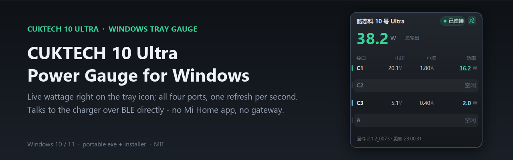
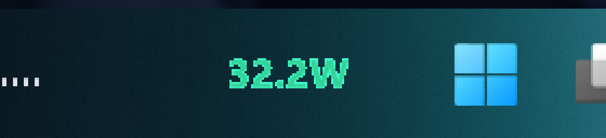
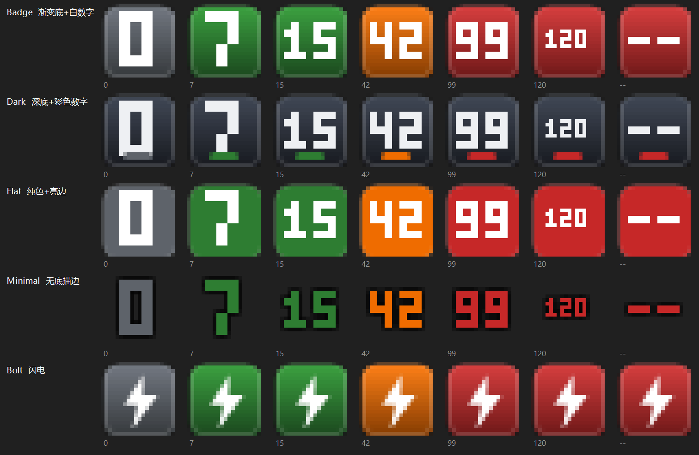

<p align="center">
  <a href="assets/intro-en.png"></a>
</p>

<p align="center">
  <a href="README.md">简体中文</a> · <b>English</b>
</p>

<p align="center">
  <a href="LICENSE"></a>
  
  
  <a href="https://github.com/Blank2007/cuktech-ultra-tray/releases/latest"></a>
</p>

# CUKTECH 10 Ultra Tray Power Gauge — Read Total Power Right in the Tray

A tiny app that is nothing but a tray icon: **the tray icon itself is the power gauge**. The number is the total output power across all four ports, and its color tracks the wattage;
click it and you get voltage / current / power for all four ports on one screen, plus a direct way to cut the power.

* Talks to the charger over **direct Bluetooth BLE** (our own implementation of Xiaomi MIoT encrypted authentication) — no gateway, no Mi Home app running in the background, and no network traffic once connected
* The portable version is a **single-file exe** (69 MB, the target machine needs no .NET); there is also an installer (127 MB, with a wizard, shortcuts and an uninstaller)
* Around 60 MB resident, sits quietly in the tray — no popups, no desktop clutter

---

> ### 🤖 The code in this repository was written by AI
>
> **Every line of source code was written by an AI coding agent** — inside **DeepSeek Harness**, using the **deepseek-v4.1-flash** model,
> from scratch across a few sessions on 2026-11-17 (protocol research → authentication working → tray app → panel → taskbar widget → control page → installer).
> The human ([@Blank2007](https://github.com/Blank2007)) filed the requirements, plugged in the charger, scanned the QR code with the Mi Home app, and did the acceptance testing.
>
> Every dead end along the way is recorded in **[开发日志.md](开发日志.md)**, and a few of them are worth a read:
> a z-order bug where the panel came back from the lock screen sitting on top of every other window, a ghosting mess where the taskbar digits stacked themselves into two layers,
> and a fake bug that fooled us for half a day — **the screenshot tool's DPI virtualization made the window look like a corner had been clipped, while the program had been right all along**.

**What makes it different**

| | |
|---|---|
| ⚡ **Read it right in the tray** | The tray icon is a power gauge: the number is the total power of all four ports, and the color follows the wattage (grey when disconnected / pale blue below 20 W / green 20–60 W / yellow 60–100 W / red at ≥100 W). No clicking, no hovering |
| 🖥️ **Four ports on one screen** | The panel opens straight onto C1 / C2 / C3 / A with voltage, current, power and total output, refreshed every second |
| 🔵 **Bluetooth direct** | Full Xiaomi MIoT BLE authentication implemented from scratch (HKDF + HMAC + AES-CCM), measured at 3.7–4.6 s to authenticate; no Mi Home app in the loop, no gateway |
| 📊 **Taskbar too** | A small strip at the far left of the taskbar, right next to the Start button, shows total power live — digits only, no icon and no background plate, and you can drag it somewhere else |
| 🎛️ **It can control** | One switch per port on the control page to cut or restore power directly; every write is read back and verified, and failures explain themselves at the bottom |
| 🔌 **Self-healing** | Unplug it, walk out of Bluetooth range, switch system Bluetooth off — it reconnects on its own |
| 📦 **Single file** | The portable version is a 69 MB self-contained exe: copy it to any writable folder and double-click. The installer adds a wizard, shortcuts and a clean uninstaller |
| 🧹 **Clean** | No drivers, no runtime to install, no background service; the config is a single JSON file and logs rotate themselves |

> **Want one ready-made?**
> * Installer ⬇️ **[latest release](https://github.com/Blank2007/cuktech-ultra-tray/releases/latest)** (file name looks like `CuktechTray-Setup-0.2.3.exe`, 127 MB)
> * Portable ⬇️ **[CuktechTray.exe](https://github.com/Blank2007/cuktech-ultra-tray/releases/latest/download/CuktechTray.exe)** (69 MB, no installation)
>
> This repo holds source only; neither exe is checked in (together they are nearly 200 MB), so please download them from the [Releases](https://github.com/Blank2007/cuktech-ultra-tray/releases) page.
> Neither exe is **code-signed**, so the first run may show the blue "Windows protected your PC" box — click **More info → Run anyway**.

## What changed in each version

Each release gets its own section in **[开发日志.md](开发日志.md)**, along with the measurements and the dead ends of the time (English version: [CHANGELOG.en.md](CHANGELOG.en.md)).
This document only covers how to use it.

---

## 0. Installation

**Installing with the installer is recommended**: double-click `CuktechTray-Setup.exe` (about 127 MB; the main program is bundled inside, so the target machine needs no .NET).

The wizard has four steps: Welcome → choose install location → installing → done. The default location is `%LOCALAPPDATA%\Programs\CuktechTray`,
**it writes to the current user only (HKCU) and never triggers UAC**; you only need to run as administrator if you point it at a system folder such as `Program Files`.

The second page has four checkboxes, all on by default:

* Create a desktop shortcut
* Create a Start menu shortcut (listed as "CUKTECH Tray Power Gauge", under the CuktechTray group)
* Start with Windows (writes only to the current user's startup entry; it then just sits in the tray without showing the panel)
* Launch immediately after installation

If an older version is already installed, double-clicking the new installer performs an **in-place upgrade**: it installs back into the same folder, config and logs are left alone,
shortcuts and start-with-Windows stay as they are, and the version number in the uninstall entry is updated.

Uninstall: Settings → Apps → Installed apps → "CUKTECH Tray Power Gauge", or just run `CuktechTray-Setup.exe --uninstall`.
Uninstall clears the start-with-Windows entry, both shortcuts, the uninstall registry key and the install folder, then asks whether to delete the config as well.

**Don't want to install?** `CuktechTray.exe` is a single-file portable build (about 69 MB); copy it to any writable folder and double-click.
Config and logs are written next to the exe.

---

## 1. Quick start (three steps)

**Prerequisites**: the charger is already bound in the Mi Home app on your phone; the PC has a working Bluetooth adapter and Bluetooth is switched on (on Win11: Settings → Bluetooth & devices).

On the first run the program finds no configured device and shows the wizard:


1. Click "Scan the QR code with the Mi Home app" and a QR code appears on screen;
2. Scan it with the Mi Home app on your phone (**+** in the top right → Scan), then tap "Confirm login" on the phone;
3. The program lists the Bluetooth devices under your account; pick your charger → "Use this one".

That's it — later runs need no scanning, and authentication takes about 4 seconds before numbers start appearing.

> Scanning only pulls the device token of a device **in your own account** down to this machine. Your account password never passes through this program, and the token is written only to the local
> `settings.json`; once the charger is connected everything runs over local Bluetooth and no internet access is needed.

---

## 2. The interface

### Power panel


A borderless dark window: drag it by any blank area, close it with `Esc`, and it tucks itself away when it loses focus.

* The top row is total output and connection state; below it, four rows show voltage, current and power for C1 / C2 / C3 / A, with idle ports reading "Idle"
* **It is just an ordinary window**: click the pin in the top right (or right-click the panel → Pin to desktop) and it stays on the desktop and remembers its position; click again to unpin.
  It is **not always-on-top and does not steal focus** — other windows cover it normally, it comes forward when clicked, and after a lock screen or user switch it never inexplicably ends up on top of everything

### Power on the taskbar



The small strip at the far left of the taskbar, right next to the Start button, shows total power live — **digits only, no icon and no background block**
(the whole window is drawn per-pixel alpha: only the glyphs are solid, everything else is fully transparent), the color follows the wattage, and one click opens the panel.

* It hangs off the taskbar window, so it takes no desktop space, stays out of Alt+Tab, and does not interfere with the taskbar's centering or auto-hide
* **Position is up to you**: hold and drag the digits left or right, and the position is remembered across reboots
* Toggle it from the tray context menu → "Show power on taskbar"; → "Reset taskbar digits position" puts it back to the left of the Start button

### Control page


One switch per port, so you can cut or restore power directly (C1 / C2 / C3 / A are controlled independently, and every write is read back and verified).
There is also a refresh-now button and an auto-refresh toggle.

### Tray icon

Five looks are available (context menu → Icon style); the default is "dark square with a colored bar at the bottom", and there are also large color block / solid color / bare digits with no background / lightning bolt:



### Day-to-day use

* The program has no main window; it just lives in the tray. On startup it pops the panel once in the bottom right corner (numbers start flowing after about 4 s of authentication) and tucks it away if nobody touches it for 12 s
* **Left-click** the tray icon: show / hide the panel; **right-click** it: the menu
* Double-clicking the exe while the program is already running does not start a second process — it brings up the panel instead
* The full context menu: Show power panel / Control page / Pin panel to desktop / Show power on taskbar / Reset taskbar digits position /
  Icon style / Reconnect / Reconfigure device / Start with Windows / Open log / Settings file / Exit

> On Win11, newly appeared tray icons are tucked into the "hidden icons" overflow area by default. If you can't see it, click the `^` on the taskbar and drag it onto the taskbar,
> or turn it on in Settings → Personalization → Taskbar → Other system tray icons.

---

## 3. Command-line arguments

| Argument | Effect |
| --- | --- |
| (none) | Normal start: tray resident + the panel popped once in the bottom right corner |
| `--tray-only` | Tray only, no panel (this is what start-with-Windows uses) |
| `--pin` | Pin the panel to the desktop at startup |
| `--panel` | Show the panel centered on screen without auto-hiding (for checking layout in screenshots) |
| `--control` | Open the control page directly (with `--tray-only --control` only the control page opens) |
| `--setup` | Force the first-run wizard open (for switching accounts or devices) |
| `--selftest` | Run the "connect → authenticate → read four ports" regression once, write the result to the log, exit code 0/1 |
| `--dump-icons` | Export a sample sheet of the five icon styles as `icons.png` |

---

## 4. Repository layout

| Path | Description |
| --- | --- |
| `src/CuktechMible/` | Protocol core library: authentication, encrypted frames, MiOT TLV codec (UI-free, reusable on its own) |
| `src/CuktechLogin/` | Xiaomi cloud QR-code login library: QR code → serviceToken → device list → 12-byte BLE token |
| `src/CuktechTray/` | The tray app itself (first-run wizard, power panel, control page, taskbar widget, icon drawing) |
| `setup/` | Installer source (WinForms wizard, embeds the main program, ships its own uninstaller) |
| `src/probe-cs/` | Command-line probe: `scan` / `diag` / `info` / `probe`, for protocol debugging |
| `src/probe-rs/` | Rust feasibility check (btleplug scan + tray spike) |
| `tools/token-fetch/` | The earliest Python QR-code login (kept for reference; the C# version is built in) |
| `tools/` | A pile of PowerShell forensics scripts: screenshots, window lookup, z-order checks, taskbar prototypes, banner generation |
| `assets/` | The README banner (generated by `tools/make-banner.py`) |
| `docs/` | Design notes, protocol research, the Rust validation report, z-order fix records, UI screenshots |
| `dist/` | Local build output (published exe and installer, **not checked in**) |

---

## 5. How it works

1. **Authentication**: Xiaomi MIoT Bluetooth devices require a "MIoT BLE authentication" handshake first — each side contributes a nonce, HKDF derives the keys,
   HMAC verifies and AES-CCM encrypts. The implementation and the pitfalls are in [docs/protocol-research.md](docs/protocol-research.md)
2. **Polling**: after authentication, one MiOT TLV read request is sent per second (SIID=2), returning voltage, current and power for C1 / C2 / C3 / A,
   summed for display. The full PIID table and the power byte layout are in that same document
3. **Control**: the port switch is a bit mask, and the value is read back and verified after every write ([docs/control-protocol.md](docs/control-protocol.md))
4. **Login**: scanning follows the Mi Home app's QR-code login flow; once a serviceToken is obtained, the device-list API is called to fetch the token
5. **Windows**: the panel and the control page are custom-drawn WinForms; the taskbar strip is a window `SetParent`-ed under the taskbar's child window
   (the same trick as AF-Media-Bar), with details and the risk list in [docs/taskbar-component.md](docs/taskbar-component.md)

---

## 6. FAQ

**Can't find the icon in the tray?** Win11 puts new icons in the overflow area by default; click `^` and drag it out, or enable it in Settings → Personalization → Taskbar → Other system tray icons.

**Blue "Windows protected your PC" box on first run?** It isn't signed; click "More info → Run anyway".

**The digits on the taskbar don't appear?** A normal double-click start shows them. If the process was started from a lower-integrity context (some sandboxes, services, scheduled tasks),
Windows refuses to parent the window to the taskbar — in that case the program writes the reason to the log, so just start it by double-clicking normally.
After an Explorer restart it re-attaches itself within a second.

**Can't connect / authentication fails?** First check that the charger has power, is close to the PC and that Bluetooth is on. Restarting the program too quickly leaves the Bluetooth connection no time to be released;
if the log shows `AccessDenied` or `未收到 RCV_RDY` ("RCV_RDY not received"), close the program, wait 20 seconds and start it again.

**New PC / new charger?** Context menu → "Reconfigure device" and scan again; the config lives in `settings.json`, and deleting it gives you a fresh state.

---

## 7. Building it yourself

You need the .NET 8 SDK. Double-click **build.cmd** to build, **run.cmd** to launch.

If your execution policy blocks the `.ps1` scripts, start them with `powershell -ExecutionPolicy Bypass -File build.ps1`.

```powershell
.\build.ps1            # build (Release)
.\build.ps1 -Publish   # publish a single-file self-contained exe to dist\ (about 72 MB, no .NET needed on the target machine)
.\run.ps1              # launch the tray app
.\run.ps1 -Panel       # launch and pop the panel immediately
.\build-setup.ps1      # pack the exe in dist\ into the installer dist\CuktechTray-Setup.exe
```

---

## 8. Config and logs

`<exe folder>\settings.json` (context menu → Settings file opens it directly). If the exe sits in a non-writable location such as Program Files,
the config automatically falls back to `%LOCALAPPDATA%\CuktechTray\settings.json`. Example:

```json
{
  "Mac": "AA:BB:CC:DD:EE:FF",
  "TokenHex": "00112233445566778899aabb",
  "PollMs": 1000,
  "AutoStart": false,
  "IconStyle": "Dark",
  "PanelPinned": false,
  "TaskbarWidget": true,
  "ConfigVersion": 2
}
```

The `Mac` / `TokenHex` values above are placeholders; the real ones are written by the wizard and normally need no hand-editing.
They are device credentials, so delete them before pasting this anywhere (`.gitignore` already excludes `settings.json`).

Logs: `<exe folder>\logs\app.log` (rotated to `app.old.log` above 512 KB); check it first when troubleshooting.

---

## 9. Credits, contact and license

### Third-party components

| Component | Purpose | License |
| --- | --- | --- |
| .NET 8 / Windows Forms | Runtime, tray, window drawing | MIT |
| System.Text.Json (BCL) | Config file and API parsing | MIT |
| Apart from WiX: none — the installer is handwritten WinForms | — | — |

See [第三方组件许可.txt](第三方组件许可.txt) and [NOTICE](NOTICE) for details.

### Implementations we referenced

* [kairui1108/cuktech-ble-ha](https://github.com/kairui1108/cuktech-ble-ha) — Python BLE server + Home Assistant integration (MIT)
* [kairui1108/cuktech-ble-esp32](https://github.com/kairui1108/cuktech-ble-esp32) — standalone ESP32 firmware

This project is an **independent** C# implementation of the protocol spec reverse-engineered from them, with no code reused directly;
should any be used later, the MIT license and copyright notice will be preserved.

### Known limitations

* Limited controls: only on / off for the four ports so far. Scene modes, screen-off time and language are PIIDs that have also been tested as writable, they simply have no UI yet
* Power accuracy is capped by the device: only 0.1 V / 0.1 A resolution
* The portable version has no uninstaller of its own: before deleting the folder by hand, turn off "Start with Windows" in the tray menu, otherwise a dead link is left behind in the registry
* The Rust version is still just a spike, with no complete protocol implementation

### Contact me

Open an [issue](https://github.com/Blank2007/cuktech-ultra-tray/issues) if anything is wrong.

### One last thing

This project has no affiliation with Xiaomi or CUKTECH; it is a small third-party tool written from public information and hands-on protocol experimentation.
The protocol may change after a firmware update, and there is no warranty if something breaks.

Licensed under [MIT](LICENSE).