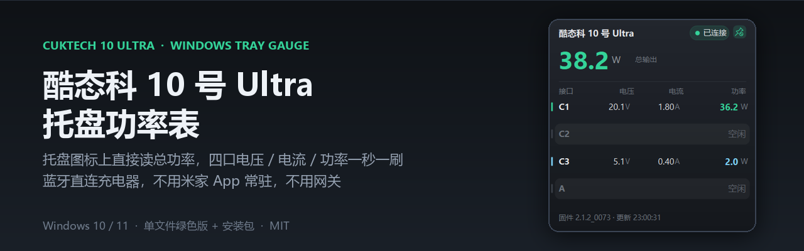
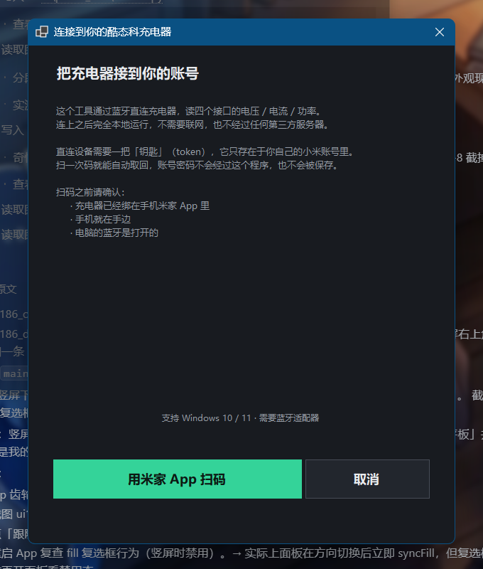
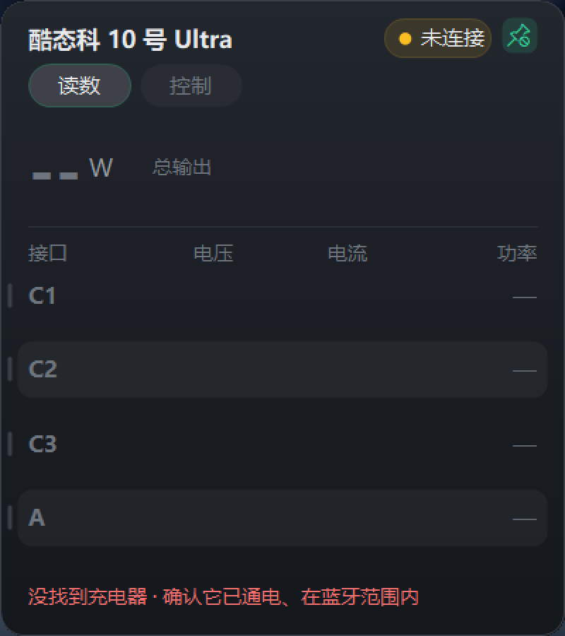
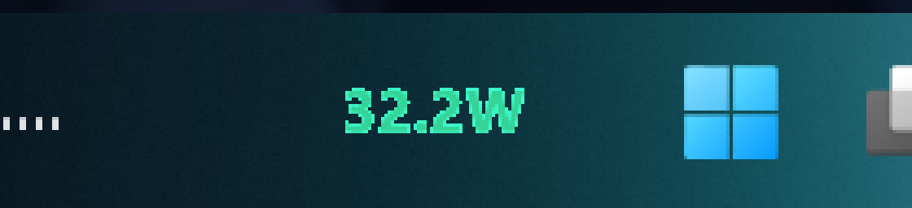
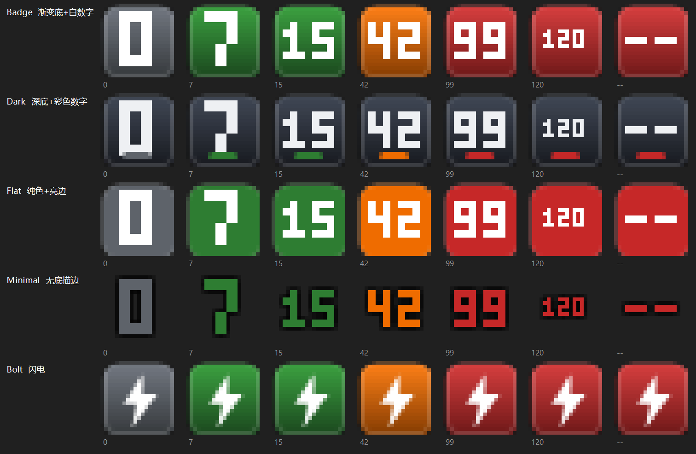

<p align="center">
  <a href="assets/intro-zh.png"></a>
</p>

<p align="center">
  <b>简体中文</b> · <a href="README.en.md">English</a>
</p>

<p align="center">
  <a href="LICENSE"></a>
  
  
  <a href="https://github.com/Blank2007/cuktech-ultra-tray/releases/latest"></a>
</p>

# 酷态科 10 号 Ultra 托盘功率表 —— 托盘图标上直接读总功率

一个只有托盘图标的小程序：**托盘图标本身就是功率表**，数字是四口总输出功率，颜色随功率变；
点开是一屏四口的电压 / 电流 / 功率，想断电还能直接断电。

* 通过**蓝牙 BLE 直连充电器**（自己实现小米 MIoT 加密认证），不需要网关、不需要米家 App 常驻、连上之后不联网
* 绿色版是**单文件 exe**（69 MB，目标机不用装 .NET），另有安装包（127 MB，带向导、快捷方式和卸载）
* 常驻内存约 60 MB，托盘待着不弹窗、不占桌面

---

> ### 🤖 这个仓库的代码是 AI 写的
>
> **全部源代码由 AI 编码代理编写**——在 **DeepSeek Harness** 里、用 **deepseek-v4.1-flash** 模型，
> 于 2026-11-17 的几次会话里从零写完（协议调研 → 认证打通 → 托盘程序 → 面板 → 任务栏组件 → 控制页 → 安装程序）。
> 人类（[@Blank2007](https://github.com/Blank2007)）负责提需求、把充电器插上电、用米家 App 扫码、以及验收。
>
> 中间踩过的坑都记在 **[开发日志.md](开发日志.md)** 里，其中几个我觉得挺值得一读：
> 一个「面板锁屏回来后压在所有窗口最上面」的层级 bug、一团「任务栏数字自己叠成两层」的重影，
> 以及一个把人骗了半天的假 bug——**截图工具的 DPI 虚拟化让窗口看起来被裁掉了一角，程序其实一直是对的**。

**它有什么特别的**

| | |
|---|---|
| ⚡ **托盘上直接读** | 托盘图标就是一个功率表：数字 = 四口总功率，颜色随功率走（未连接灰 / <20W 淡蓝 / 20~60W 绿 / 60~100W 黄 / ≥100W 红）。不用点开、不用悬停 |
| 🖥️ **一屏四口** | 点开面板就是 C1 / C2 / C3 / A 四路的电压、电流、功率和总输出，每秒刷新 |
| 🔵 **蓝牙直连** | 自己完成小米 MIoT BLE 认证（HKDF + HMAC + AES-CCM），实测认证 3.7 ~ 4.6 秒；不经过米家 App，不用网关 |
| 📊 **任务栏也能看** | 任务栏最左边、紧挨开始按钮的一小块实时显示总功率——只有数字，没有图标也没有底板，可以拖着换位置 |
| 🎛️ **能控制** | 控制页四路各一个开关，能直接断电 / 恢复；写入后自动回读校验，失败会在底部说原因 |
| 🔌 **掉线自愈** | 拔电、走出蓝牙范围、系统蓝牙关掉，都能自己重连回来 |
| 📦 **单文件** | 绿色版是 69 MB 的自包含 exe，拷到任何可写目录双击就能用；安装包带向导、快捷方式和完整卸载 |
| 🧹 **干净** | 不装驱动、不装运行库、不开后台服务；配置就是一个 JSON，日志会自己轮转 |

> **想直接拿现成的？**
> * 安装程序 ⬇️ **[最新版本](https://github.com/Blank2007/cuktech-ultra-tray/releases/latest)**（文件名形如 `CuktechTray-Setup-0.2.3.exe`，127 MB）
> * 绿色版 ⬇️ **[最新版本](https://github.com/Blank2007/cuktech-ultra-tray/releases/latest)**（文件名形如 `CuktechTray-0.2.3.exe`，69 MB，免安装）
>
> 本仓库只放源码，两个 exe 都不进仓库（加起来近 200 MB），请到 [Releases](https://github.com/Blank2007/cuktech-ultra-tray/releases) 页面下载。
> 两个 exe 都**没有代码签名**，第一次运行时 Windows 可能弹「已保护你的电脑」蓝框，点 **更多信息 → 仍要运行** 即可。

## 各版本改了什么

放在 **[开发日志.md](开发日志.md)** 里，一版一节，附带当时的实测数据和踩过的坑（英文版：[CHANGELOG.en.md](CHANGELOG.en.md)）。
这里只讲怎么用。

---

## 〇、安装

**推荐装安装包**：双击 `CuktechTray-Setup.exe`（约 127 MB，里面已经打包好主程序，目标机不需要装 .NET）。

向导四步：欢迎 → 选择安装位置 → 正在安装 → 完成。默认装到 `%LOCALAPPDATA%\Programs\CuktechTray`，
**只写当前用户（HKCU），全程不弹 UAC**；只有你把它改到 `Program Files` 这类系统目录时才需要以管理员身份运行。

第二页有四个勾选，默认全开：

* 创建桌面快捷方式
* 创建开始菜单快捷方式（列表里叫「酷态科托盘功率表」，归在 CuktechTray 组下）
* 开机时自动启动（只写当前用户的启动项，启动后只蹲托盘、不弹面板）
* 安装完成后立即启动

已经装过旧版本的话，直接双击新安装包就是**原地升级**：装回原目录、配置和日志不动、
快捷方式和开机自启按现状保留、卸载项里的版本号更新。

卸载：设置 → 应用 → 已安装的应用里找「酷态科托盘功率表」，或直接跑 `CuktechTray-Setup.exe --uninstall`。
卸载会清掉开机自启项、两个快捷方式、卸载注册表项和安装目录，最后问你配置要不要一起删。

**不想装也行**：`CuktechTray.exe` 是单文件绿色版（约 69 MB），拷到任意可写目录双击就能用，
配置和日志写在 exe 旁边。

---

## 一、快速开始（三步）

**前提**：充电器已经绑在手机米家 App 里；电脑有可用蓝牙适配器并且蓝牙是打开的（Win11 在「设置 → 蓝牙和设备」）。

第一次双击运行，程序发现还没配置过设备，会弹出向导：



1. 点「用米家 App 扫码」，屏幕上出现二维码；
2. 用手机米家 App（右上角 **+** → 扫一扫）扫它，手机上点「确认登录」；
3. 程序自动列出你账号下的蓝牙设备，选中你的充电器 → 「就用这台」。

搞定，之后每次运行都不用再扫码，约 4 秒完成认证开始出数。

> 扫码只是把**你自己账号里**的设备 token 取回本地。账号密码不经过这个程序，token 只写在本机的
> `settings.json` 里；连上充电器之后完全走蓝牙本地通信，不需要联网。

---

## 二、界面说明

### 功率面板



无边框深色窗口，空白处可以拖动，`Esc` 关闭，失焦自动收起。

* 顶部是总输出 + 连接状态；下面四行是 C1 / C2 / C3 / A 的电压、电流、功率，空闲的口显示「空闲」
* **它就是个普通窗口**：点右上角的图钉（或右键面板 → 固定到桌面）它会待在桌面上、位置也记住，再点一次解除。
  它**不置顶、不抢焦点**——会被别的窗口正常盖住，点它才浮上来，锁屏 / 切换用户之后再回来也不会莫名其妙压在最上面

### 任务栏上的功率



任务栏最左边、紧挨开始按钮的那一小块实时显示总功率——**只有数字，没有图标、没有底色方块**
（整个窗口逐像素 alpha 绘制，只有字是实心的，其余完全透明），颜色跟着功率走，点一下打开面板。

* 挂在任务栏窗口下面，不占桌面空间、不进 Alt+Tab、不影响任务栏的居中 / 自动隐藏
* **位置随你**：按住那串数字左右拖，松手就记住，下次开机还在那
* 右键托盘菜单 →「在任务栏显示功率」开关它，→「重置任务栏数字位置」回到开始按钮左边

### 控制页


四路各一个开关，能直接开 / 断电（C1 / C2 / C3 / A 独立控制，写入后自动回读校验）。
另有立即刷新与自动刷新开关。

### 托盘图标

五种观感可选（右键菜单 → 图标风格），默认「深色方块 + 底部彩条」，另有大色块 / 纯色 / 无底色纯数字 / 闪电：



### 日常使用

* 程序没有主窗口，只在托盘待着。启动时会先在右下角弹一次面板（约 4 秒认证完开始出数），12 秒没人理就自动收起
* **左键**点托盘图标：弹出 / 收起面板；**右键**点它：菜单
* 程序已经在跑的时候再双击一次 exe，不会开第二个进程，而是把面板叫出来
* 右键菜单全貌：显示功率面板 / 控制页 / 固定面板到桌面 / 在任务栏显示功率 / 重置任务栏数字位置 /
  图标风格 / 重新连接 / 重新配置设备 / 随 Windows 启动 / 打开日志 / 设置文件 / 退出

> Win11 上新出现的托盘图标默认会被收进「隐藏的图标」溢出区。看不到的话点任务栏的 `^` 把它拖到任务栏上，
> 或在「设置 → 个性化 → 任务栏 → 其他系统托盘图标」里打开。

---

## 三、命令行参数

| 参数 | 作用 |
| --- | --- |
| （无） | 正常启动：托盘常驻 + 右下角弹一次面板 |
| `--tray-only` | 只蹲托盘，不弹面板（开机自启用这个） |
| `--pin` | 启动即把面板固定在桌面上 |
| `--panel` | 面板显示在屏幕中央且不自动收起（截图核对排版用） |
| `--control` | 直接打开控制页（配 `--tray-only --control` 就只开控制页） |
| `--setup` | 强制打开首次使用向导（换账号 / 换设备时用） |
| `--selftest` | 跑一遍「连接 → 认证 → 读四口」回归，结果写日志，退出码 0/1 |
| `--dump-icons` | 导出五种图标风格的样例图 `icons.png` |

---

## 四、目录结构

| 路径 | 说明 |
| --- | --- |
| `src/CuktechMible/` | 协议核心库：认证、加密帧、MiOT TLV 编解码（不依赖 UI，可单独复用） |
| `src/CuktechLogin/` | 小米云扫码登录库：二维码 → serviceToken → 设备列表 → 12 字节 BLE token |
| `src/CuktechTray/` | 托盘程序本体（首次使用向导、功率面板、控制页、任务栏组件、图标绘制） |
| `setup/` | 安装程序源码（WinForms 向导，内嵌主程序，自带卸载） |
| `src/probe-cs/` | 命令行探针：`scan` / `diag` / `info` / `probe`，协议调试用 |
| `src/probe-rs/` | Rust 可行性验证（btleplug 扫描 + 托盘 spike） |
| `tools/token-fetch/` | 最早的 Python 版扫码登录（保留作参考，C# 版已内置） |
| `tools/` | 一堆 PowerShell 取证脚本：截屏、找窗口、验证 z 序、任务栏原型、生成 banner |
| `assets/` | README 顶部横幅（`tools/make-banner.py` 生成） |
| `docs/` | 方案、协议调研、Rust 验证报告、层级修复记录、界面截图 |
| `dist/` | 本地构建输出（发布好的 exe 与安装包，**不进仓库**） |

---

## 五、它是怎么工作的

1. **认证**：小米 MIoT 蓝牙设备要求先做一次「MIoT BLE 认证」——双方各出一个随机数，经 HKDF 派生密钥，
   用 HMAC 校验、AES-CCM 加密。这部分的实现和踩坑过程在 [docs/protocol-research.md](docs/protocol-research.md)
2. **轮询**：认证后每秒发一次 MiOT TLV 读请求（SIID=2），拿回 C1 / C2 / C3 / A 四路电压、电流、功率，
   加总显示。PIID 全表和功率字节布局也在上面那份文档里
3. **控制**：端口开关是一个位掩码，写入后回读校验（[docs/control-protocol.md](docs/control-protocol.md)）
4. **登录**：扫码走的是米家 App 的扫码登录流程，拿到 serviceToken 后调用设备列表接口取回 token
5. **窗口**：面板 / 控制页都是 WinForms 自绘；任务栏那一小块是把窗口 `SetParent` 挂到任务栏子窗口下
   （和 AF-Media-Bar 一样的办法），细节和风险清单在 [docs/taskbar-component.md](docs/taskbar-component.md)

---

## 六、常见问题

**托盘里找不到图标？** Win11 默认把新图标塞进溢出区，点 `^` 拖出来，或在「设置 → 个性化 → 任务栏 → 其他系统托盘图标」里打开。

**第一次运行弹蓝色「已保护你的电脑」？** 没签名，点「更多信息 → 仍要运行」。

**任务栏上那块数字没出现？** 正常双击启动就会出现；如果是从权限被降级的进程（某些沙箱、服务、任务计划）
里启动的，Windows 会拒绝把窗口挂到任务栏上——这时程序会在日志里写明原因，换正常双击就好。
Explorer 重启后它会在 1 秒内自动重新挂上。

**连不上 / 认证失败？** 先确认充电器通电、离电脑近、蓝牙开着。快速重启程序会让蓝牙连接来不及释放，
日志里出现 `AccessDenied` 或 `未收到 RCV_RDY` 时，关掉程序等 20 秒再开。

**换电脑 / 换充电器？** 右键菜单 →「重新配置设备」重新扫码即可；配置存在 `settings.json` 里，删掉它就等于全新状态。

---

## 七、自己编译

需要 .NET 8 SDK。双击 **build.cmd** 构建，**run.cmd** 启动。

`.ps1` 脚本如果被执行策略拦住，用 `powershell -ExecutionPolicy Bypass -File build.ps1` 启动。

```powershell
.\build.ps1            # 构建（Release）
.\build.ps1 -Publish   # 发布单文件自包含 exe 到 dist\（约 72 MB，目标机免装 .NET）
.\run.ps1              # 启动托盘
.\run.ps1 -Panel       # 启动并直接弹面板
.\build-setup.ps1      # 把 dist\ 里的 exe 打进安装包 dist\CuktechTray-Setup.exe
```

---

## 八、配置与日志

`<exe 所在目录>\settings.json`（右键菜单 → 设置文件 可直接打开）。如果 exe 放在 Program Files 这类不可写的位置，
配置会自动落到 `%LOCALAPPDATA%\CuktechTray\settings.json`。示例：

```json
{
  "Mac": "AA:BB:CC:DD:EE:FF",
  "TokenHex": "00112233445566778899aabb",
  "PollMs": 1000,
  "AutoStart": false,
  "IconStyle": "Dark",
  "PanelPinned": false,
  "TaskbarWidget": true,
  "ConfigVersion": 2
}
```

上面 `Mac` / `TokenHex` 是占位值，真实的这两个由向导自动写入，一般不用手改；
它们等于设备凭据，贴给别人前记得删掉（`.gitignore` 已经把 `settings.json` 排除了）。

日志：`<exe 目录>\logs\app.log`（超 512 KB 自动轮转为 `app.old.log`），排障先看它。

---

## 九、致谢、联系与许可

### 用到的第三方组件

| 组件 | 用途 | 许可 |
| --- | --- | --- |
| .NET 8 / Windows Forms | 运行时、托盘、窗口绘制 | MIT |
| System.Text.Json（BCL） | 配置文件与接口解析 | MIT |
| WiX 之外：无 —— 安装包是手写 WinForms | —— | —— |

详见 [第三方组件许可.txt](第三方组件许可.txt) 与 [NOTICE](NOTICE)。

### 参考过的实现

* [kairui1108/cuktech-ble-ha](https://github.com/kairui1108/cuktech-ble-ha) —— Python BLE Server + Home Assistant 集成（MIT）
* [kairui1108/cuktech-ble-esp32](https://github.com/kairui1108/cuktech-ble-esp32) —— ESP32 独立固件

本项目是照它们反推出的协议规格**独立实现**的 C# 版本，没有直接复用其代码；
若日后引用，会保留 MIT 许可证与版权声明。

### 已知限制

* 控制项有限：目前只做了四路端口的开 / 关。场景模式、息屏时间、语言这些 PIID 也已实测可写，只是还没做成界面
* 功率精度受设备限制，只有 0.1 V / 0.1 A 分辨率
* 绿色版没有自带卸载：手动删目录前，先在托盘菜单里关掉「随 Windows 启动」，否则注册表里会留一个死链
* Rust 版还只是 spike，没有完整协议实现

### 联系我

有问题就开 [Issue](https://github.com/Blank2007/cuktech-ultra-tray/issues)。或发送邮件至1553008865@qq.com

### 最后说一句

本项目与小米、酷态科官方没有任何关系，是照公开资料和协议实测自己写的第三方小工具；
固件升级后协议可能变化，用坏了不负责。

许可是 [MIT](LICENSE)。
