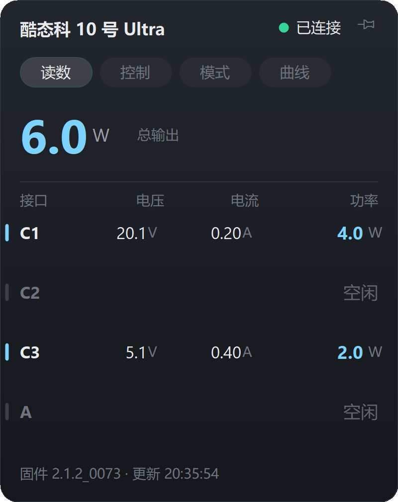
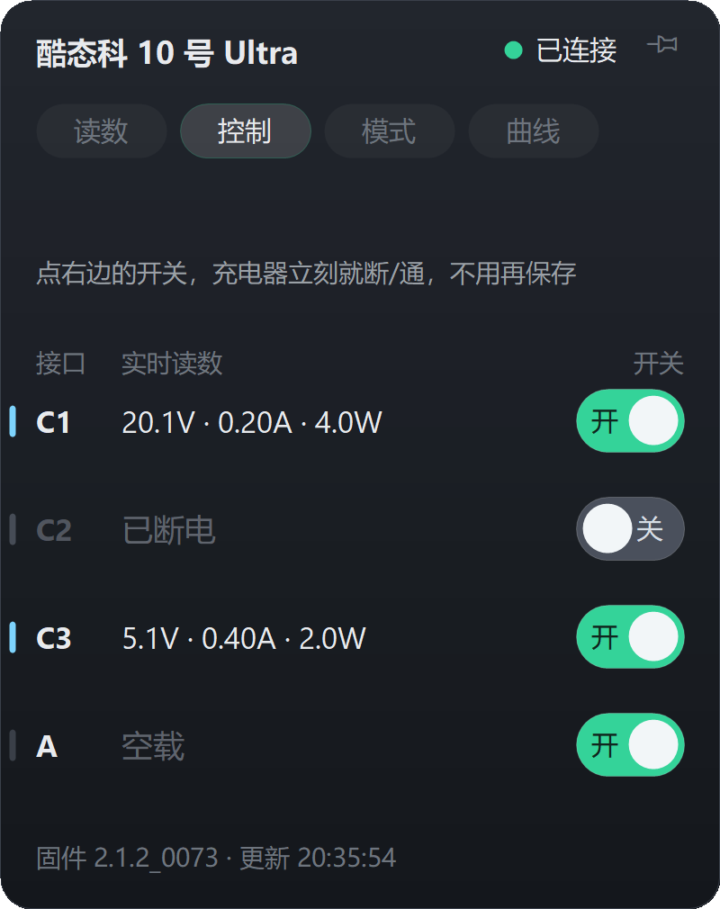
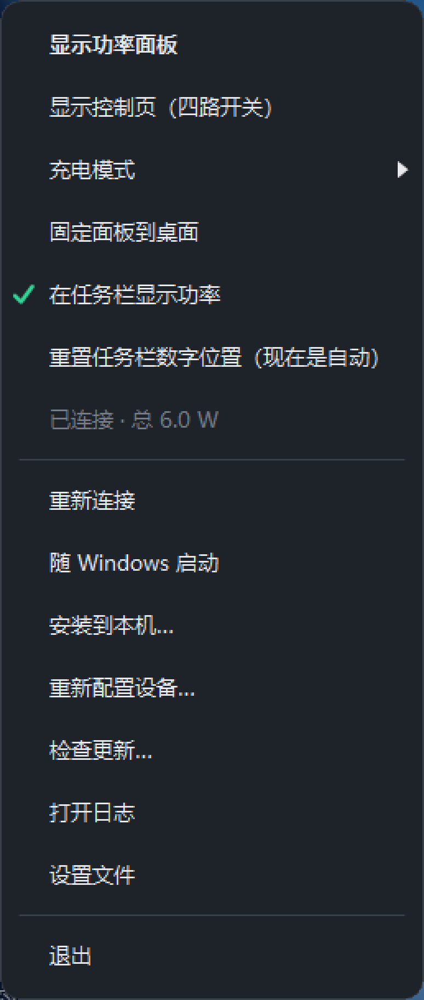

<p align="center">
  <a href="assets/intro-zh.png"></a>
</p>

<p align="center">
  <b>简体中文</b> · <a href="README.en.md">English</a>
</p>

<p align="center">
  <a href="LICENSE"></a>
  
  
  
  <a href="https://github.com/Blank2007/cuktech-ultra-tray/releases/latest"></a>
</p>

# 酷态科 10 号 Ultra 托盘功率表 —— 任务栏上直接读总功率

一个只有托盘图标的小程序：**任务栏上那一小块数字就是功率表**，实时显示四口总输出；
点开托盘面板是一屏四口的电压 / 电流 / 功率，想断电还能直接断电。

* 通过**蓝牙 BLE 直连充电器**（自己实现小米 MIoT 加密认证），不需要网关、不需要米家 App 常驻、连上之后不联网
* **只有一个 exe**（10.4 MB，目标机不用装 .NET）：拷走双击就是绿色版，点一下「安装到本机」它自己装自己
* 装好之后**升级也不用再下安装包**：右键「检查更新」自己下载、校验 SHA256、替换正在运行的自己，几秒后自动回来
* 常驻内存几十 MB，托盘待着不弹窗、不占桌面

> 🍎 **macOS 版在 [`mac/`](mac/README.md)**：同一套协议、同一套取色规则，位置换成菜单栏文字（`NSStatusItem`，
> 系统级、不是自绘浮层），纯 Swift 写的 .app 约 1 MB。功能对齐：菜单栏总功率、点开四路读数与开关、
> 扫码配对向导、C3 与 A 合并成一路显示，以及**第一次打开必须点同意**的隐私说明（和 Windows 一样）。
> 与自己这台充电器通信的部分完全独立于界面，协议层在 Linux 上都能跑单测。
> macOS 版的版本号从 **0.1.0** 起自己算，不再跟 Windows 的 0.4.x 绑在一起，当前是 **0.1.2**。


---

> ### 🤖 这个仓库的代码是 AI 写的
>
> **全部源代码由 AI 编码代理编写**——在 **DeepSeek Harness** 里、用 **deepseek-v4.1-flash** 模型，
> 于 2026-11-17 的几次会话里从零写完（协议调研 → 认证打通 → 托盘程序 → 面板 → 任务栏组件 → 控制页 → 安装程序）。
> 人类（[@Blank2007](https://github.com/Blank2007)）负责提需求、把充电器插上电、用米家 App 扫码、以及验收。
>
> 中间踩过的坑都记在 **[开发日志.md](开发日志.md)** 里，其中几个我觉得挺值得一读：
> 一个「面板锁屏回来后压在所有窗口最上面」的层级 bug、一团「任务栏数字自己叠成两层」的重影，
> 以及一个把人骗了半天的假 bug——**截图工具的 DPI 虚拟化让窗口看起来被裁掉了一角，程序其实一直是对的**。

**它有什么特别的**

| | |
|---|---|
| ⚡ **任务栏上直接读** | 任务栏最左边一小块实时显示四口总功率，只有数字、没有底板，颜色随功率走（未连接灰 / <20W 淡蓝 / 20~60W 绿 / 60~100W 黄 / ≥100W 红）。不用点开、不用悬停 |
| 🖥️ **一屏四口** | 点开面板就是 C1 / C2 / C3 / A 四路的电压、电流、功率和总输出，每秒刷新 |
| 🔵 **蓝牙直连** | 自己完成小米 MIoT BLE 认证（HKDF + HMAC + AES-CCM），实测认证 3.7 ~ 4.6 秒；不经过米家 App，不用网关 |
| 📊 **任务栏也能看** | 任务栏最左边、紧挨开始按钮的一小块实时显示总功率——只有数字，没有图标也没有底板，可以拖着换位置 |
| 🎛️ **能控制** | 面板控制页签里四路各一个开关，能直接断电 / 恢复；写入后自动回读校验，失败会在底部说原因 |
| ⚡ **充电模式** | 面板第三个页签「模式」：AI / 数码生态 / 单口 / 均衡四档，点一下就切，写入后自动回读校验；托盘右键菜单里也有一份 |
| 🔌 **掉线自愈** | 拔电、走出蓝牙范围、系统蓝牙关掉，都能自己重连回来 |
| 📦 **就一个文件** | 10.4 MB 的原生 exe，拷到任何可写目录双击就能用；想要装进开始菜单也不用另找安装包——菜单里点「安装到本机」，它把自己复制过去、建快捷方式、写卸载项 |
| 🔄 **能自己升级** | 右键「检查更新」：查到新版就下载，边下边算 SHA256，和 GitHub 给的 digest 对上才替换——替换的正是正在运行的那份 exe，然后自己重启回来。只有点它才联网，平时一律不碰网络 |
| 🪟 **Win11 风格菜单** | 右键菜单是圆角 + 半透明的深色面板（亚克力），条目间距按 Win11 来；「固定面板」「在任务栏显示功率」「随 Windows 启动」这类开关项，开着的时候左边会打一个绿勾 |
| 🧹 **干净** | 不装驱动、不装运行库、不开后台服务；配置就是一个 JSON，日志会自己轮转 |

> **想直接拿现成的？**
> * Windows：**[最新版本](https://github.com/Blank2007/cuktech-ultra-tray/releases/latest)** 里的 `CuktechTray-<版本>-win.exe`，10.4 MB
> * macOS：同一个 Release 里的 `CuktechTray-<mac 版本>-mac.zip`（macOS 版自己编号，第一版是 `0.1.0`），约 0.9 MB（解压出 .app，universal，Intel 和 Apple Silicon 都能跑）
>
> Windows 就这一个文件，没有第二个安装包——它既是绿色版也是安装包。本仓库只放源码，产物不进仓库，请到
> [Releases](https://github.com/Blank2007/cuktech-ultra-tray/releases) 页面下载。
> 它**没有代码签名**，第一次运行时 Windows 可能弹「已保护你的电脑」蓝框，点 **更多信息 → 仍要运行** 即可。

## 各版本改了什么

放在 **[开发日志.md](开发日志.md)** 里，一版一节，附带当时的实测数据和踩过的坑（英文版：[CHANGELOG.en.md](CHANGELOG.en.md)）。
这里只讲怎么用。

---

## 〇、安装

下载只有一个文件：`CuktechTray-<版本>-win.exe`（10.4 MB，目标机不用装 .NET）。没有第二个安装包——
**这一个 exe 既是绿色版，也是安装程序，还能自己给自己升级**。

**想免安装**：拷到任意可写目录，双击就用；配置和日志写在 exe 旁边。

**想装进系统**：托盘右键 →「安装到本机…」→ 点「是」。它把正在运行的这份复制到
`%LOCALAPPDATA%\Programs\CuktechTray`，建开始菜单快捷方式（「酷态科托盘功率表」，归在 CuktechTray 组下），
在「设置 → 应用」里留下卸载入口，开机自启按你当前的设置一起带过去。
**只写当前用户（HKCU + 用户目录），全程不弹 UAC**，不需要管理员身份。

装完从开始菜单打开装好的那一份，绿色版那份可以直接退出——两份不会打架：后启动的那个发现已经有一个在跑，
只会把面板叫出来然后自己退掉。

卸载：设置 → 应用 → 已安装的应用里找「酷态科托盘功率表」，或者托盘右键「从这台电脑卸载…」。
卸载会清掉开机自启项、快捷方式、卸载注册表项和整个安装目录（配置和日志就在目录里，想留就先拷出来）。

**升级**：不用再下任何安装包。托盘右键 →「检查更新」，有新版本它会自己下载、校验 SHA256、
替换正在运行的这份 exe，然后自动重启回来，充电器重连约 4 秒。
（前提是手上这份已经是 0.4.0 或更新的版本——老版本里的「检查更新」只会告诉你有个新版。）

命令行也行：`CuktechTray.exe --install --silent`、`CuktechTray.exe --uninstall --silent`，
`--install --dir=<路径>` 可以换安装位置。

---

## 一、快速开始

**前提**：充电器已经绑在手机米家 App 里；电脑有可用蓝牙适配器并且蓝牙是打开的（Win11 在「设置 → 蓝牙和设备」）。

**第一次运行会自己弹出扫码向导**（0.4.1 起向导也搬进了原生外壳，不用再借老版本）。点「用米家 App 扫码」→
手机米家 App 右上角 **+** → 扫一扫 → 选中你的充电器 →「就用这台」，凭据就写进 `settings.json` 了。
以后不用再扫；想重扫，托盘菜单 →「重新配置设备…」，或者直接 `CuktechTray.exe --setup`。


真不想走这条路也行：跑 `tools\token-fetch`（Python 版扫码登录，最早就是这么干出来的），拿到 MAC 与 token 后，
照「八、配置与日志」里的样子手填 `settings.json`。

搞定之后每次运行都不用再扫码，约 4 秒完成认证开始出数。

> 扫码只是把**你自己账号里**的设备 token 取回本地。账号密码不经过这个程序，token 只写在本机的
> `settings.json` 里；连上充电器之后完全走蓝牙本地通信，不需要联网。完整说明见 [九、隐私](#九隐私)。

---

## 二、界面说明

### 功率面板



一块 320×404 的无边框深色小窗，两个页签：**读数**（默认）/ **控制**。空白处可以拖动，`Esc` 关闭，失焦自动收起。

* 顶上一行：设备名、状态点 + 文字（绿=已连接，黄=连接中，红=没连上，没有底色）、固定图钉
* **读数页**：大号总输出 + 四行 C1 / C2 / C3 / A 的电压、电流、功率，每秒刷新；没插东西的口显示「—」
* **C3 和 A 合并时只算一路**：这两个口共用一路功率计，固件把它们合并输出时会在这路上报 state `0x11`。
  这时有数的那行名字变成 **C3+A**，另一行不再装作「空闲」，而是灰字写「并入 C3+A」，总输出也不会重复累加
* **它就是个普通窗口**：点右上角的图钉（或右键面板 → 固定到桌面）它会待在桌面上、位置也记住，再点一次解除。
  它**不置顶、不抢焦点**——会被别的窗口正常盖住，点它才浮上来，锁屏 / 切换用户之后再回来也不会莫名其妙压在最上面

### 任务栏上的功率


任务栏最左边、紧挨开始按钮的那一小块实时显示总功率——**只有数字，没有图标、没有底色方块**
（整个窗口逐像素 alpha 绘制，只有字是实心的，其余完全透明），点一下打开面板。

颜色跟着功率走，不用点开就知道充电器在什么档位：

| 数字颜色 | 总功率 | 意思 |
| --- | --- | --- |
| 灰 | ≈0 W | 四个口都空着 |
| 淡蓝 | 0–20 W | 手机在慢慢充 |
| 绿 | 20–60 W | 正常快充 |
| 黄 | 60–100 W | 偏高，快满了 |
| 红 | 100 W 以上 | 顶到上限了 |

上面那张图里的 `6.0W` 是淡蓝色（手机在待机充电）：数字由程序按真机同一套字体和取色规则渲染，
背景是这台机器真实的 Windows 任务栏——它就是挂在开始按钮左边那个样子。

* 挂在任务栏窗口下面，不占桌面空间、不进 Alt+Tab、不影响任务栏的居中 / 自动隐藏
* **位置随你**：按住那串数字左右拖，松手就记住，下次开机还在那
* 右键托盘菜单 →「在任务栏显示功率」开关它，→「重置任务栏数字位置」回到开始按钮左边

### 控制页



面板的第二个页签（右键托盘菜单 →「显示控制页」，或启动时加 `--control` 直接翻到这页）。

* 四路各一个开关，点一下立刻断电 / 通电（C1 / C2 / C3 / A 独立控制，写入后自动回读校验，失败会在底部说原因）
* 没连上充电器时开关会**压暗成灰滑块**——点不动，也不该点动：读不到设备状态就不往设备里乱写

### 充电模式


面板的第三个页签，等于米家 App 里的「充电模式」（协议里叫场景模式，SIID 2 / PIID 5）。四档：

| 档位 | 值 | 意思 |
|---|---|---|
| AI | 1 | 插上什么就按什么给，自动分配功率 |
| 数码生态 | 2 | 优先照顾自家设备，出厂默认 |
| 单口 | 3 | 只给一路快充，其余让路 |
| 均衡 | 4 | 四路平分，谁都不落下 |

* 点卡片就切，不用保存；切完读一次设备确认真的变了，底部会写「已切到「X」（设备回读 N）」
* 当前档那张卡片有绿边、左侧绿条和「当前」小标签；连不上充电器时整页压暗
* 切到这一页时会从设备读一次真实档位，不会拿缓存糊弄你
* 托盘右键菜单里也有一个「充电模式」子菜单，勾选同步

### 托盘菜单

右键点托盘图标出来的就是这张菜单，左键是直接开关面板。



> 0.4.0 把「托盘图标风格」那一项去掉了（图标只剩一种样子，见下「托盘图标」），其余项不变。
> 这张菜单是程序自己画的（0.4.x 自绘菜单，真机抓屏），不是系统菜单；上面三张面板截图也是程序自己画的（`--render --render-demo` 生成），不是旧版截屏。

* **看着像 Win11**：圆角、圆角描边、半透明底（亚克力模糊），条目左右留白和间距都是按 Win11 菜单的比例调的
* **开着没开着一眼看得见**：只要那一项是「有 / 没有」这种开关，开着的时候左边就是一个绿色对勾，关着就空着
  ——以前「随 Windows 启动」勾没勾得自己点一次才知道，现在直接看
* 「已连接 · 总 36.8 W」那一行是实时数字，没连上时写「未连接」
* 换了主题也不怕：底色跟着系统深浅色走，菜单本身是程序自己画的

### 托盘图标

0.4.0 起托盘图标只负责「状态」，不再往那点像素里塞功率数字：


* **已连接**：绿色渐变方块 + 白色闪电
* **未连接**：灰色渐变方块 + 白色闪电

功率交给任务栏那一小块和面板——图标里的小字在 125% 缩放下本来就数不清。
鼠标悬停在图标上，提示里是「总 X W」加四口明细。

### 日常使用

* 程序没有主窗口，只在托盘待着。启动时会先在右下角弹一次面板（约 4 秒认证完开始出数），12 秒没人理就自动收起
* **左键**点托盘图标：弹出 / 收起面板；**右键**点它：菜单
* 程序已经在跑的时候再双击一次 exe，不会开第二个进程，而是把面板叫出来
* 右键菜单全貌：显示功率面板 / 显示控制页 / 充电模式 / 固定面板到桌面 / 在任务栏显示功率 / 重置任务栏数字位置 /
  重新连接 / 重新配置设备 / 检查更新 / 随 Windows 启动 / 打开日志 / 设置文件 / 安装到本机（或从这台电脑卸载）/ 退出
* 菜单里「固定面板到桌面」「在任务栏显示功率」「随 Windows 启动」这三项，**开着的时候左边有绿勾**，不用点进去猜

> Win11 上新出现的托盘图标默认会被收进「隐藏的图标」溢出区。看不到的话点任务栏的 `^` 把它拖到任务栏上，
> 或在「设置 → 个性化 → 任务栏 → 其他系统托盘图标」里打开。

---

## 三、命令行参数

| 参数 | 作用 |
| --- | --- |
| （无） | 正常启动：托盘常驻 + 右下角弹一次面板 |
| `--tray-only` | 只蹲托盘，不弹面板（开机自启用这个） |
| `--pin` | 启动即把面板固定在桌面上 |
| `--panel` | 面板显示在屏幕中央且不自动收起（截图核对排版用） |
| `--control` | 面板一出来就翻到控制页（配 `--tray-only --control` 就只开控制页） |
| `--setup` | 强制打开扫码向导（自查用的 `--wizard-demo` 同义） |
| `--selftest` | 跑一遍「连接 → 认证 → 读四口」回归，结果写日志，退出码 0/1 |
| `--check-update` | 只查一次 GitHub 有没有新版，把当前版本 / 最新版本 / 走代理还是直连写进日志，不弹窗 |
| `--install [--dir=<路径>] [--autostart] [--desktop] [--silent]` | 把自己装进这台电脑（等价的托盘菜单动作） |
| `--uninstall [--silent]` | 卸载（删快捷方式、注册表项和安装目录） |
| `--render` / `--render --render-demo` | 把读数 / 控制 / 模式三页各画一张 400x450 的 PNG 到 `docs\`（排版回归用，锁屏也能出图） |
| `--shortcut-test <lnk 路径>` | 只验一下快捷方式能不能建成并读回，不碰系统目录 |
| `--update-selftest <目录>` / `--update-download-test <目录> --url= --sha= --size=` | 开发自测：前者验替换与回滚，后者真下载一次验 SHA256 |

---

## 四、目录结构

| 路径 | 说明 |
| --- | --- |
| `src/CuktechMible/` | 协议核心库：认证、加密帧、MiOT TLV 编解码（不依赖 UI，可单独复用） |
| `src/CuktechLogin/` | 小米云扫码登录库：二维码 → serviceToken → 设备列表 → 12 字节 BLE token |
| `src/CuktechTray/` | 托盘程序本体（WinForms 版，0.3.3 的归档；协议层、设置、自测这些共用源码） |
| `src/CuktechTrayAot/` | **0.4.0 起的正式版本**：NativeAOT + 纯 Win32/GDI+ 自绘外壳，含安装（`Installer.cs`）与自动更新（`Updater.cs`） |
| `setup/` | 老安装程序源码（WinForms 向导，内嵌 72 MB 主程序）——0.4.0 起不再使用，留作历史 |
| `src/probe-cs/` | 命令行探针：`scan` / `diag` / `info` / `probe`，协议调试用 |
| `src/probe-rs/` | Rust 可行性验证（btleplug 扫描 + 托盘 spike） |
| `src/aot-*-probe/` | AOT 迁移期的一次性探针（BLE 直连、纯 Win32 自绘、WinRT 通知），验完留着当证据 |
| `tools/token-fetch/` | 最早的 Python 版扫码登录（保留作参考，C# 版已内置） |
| `tools/` | 一堆 PowerShell 取证脚本：截屏、找窗口、验证 z 序、任务栏原型、生成 banner |
| `assets/` | README 顶部横幅（`tools/make-banner.py` 生成） |
| `docs/` | 方案、协议调研、Rust 验证报告、层级修复记录、界面截图 |
| `dist/` | 本地构建输出（发布好的 exe 与安装包，**不进仓库**） |

---

## 五、它是怎么工作的

1. **认证**：小米 MIoT 蓝牙设备要求先做一次「MIoT BLE 认证」——双方各出一个随机数，经 HKDF 派生密钥，
   用 HMAC 校验、AES-CCM 加密。这部分的实现和踩坑过程在 [docs/protocol-research.md](docs/protocol-research.md)
2. **轮询**：认证后每秒发一次 MiOT TLV 读请求（SIID=2），拿回 C1 / C2 / C3 / A 四路电压、电流、功率，
   加总显示。PIID 全表和功率字节布局也在上面那份文档里
3. **控制**：端口开关是一个位掩码，写入后回读校验（[docs/control-protocol.md](docs/control-protocol.md)）
4. **登录**：扫码走的是米家 App 的扫码登录流程，拿到 serviceToken 后调用设备列表接口取回 token
5. **窗口**：面板（三个页签）和菜单都是纯 Win32 + GDI+ 自绘，没有 WinForms / WPF——0.4.0 换成 NativeAOT 后
   外壳只能自己画（见 [开发日志.md](开发日志.md) 第十四章）。任务栏那一小块是把窗口 `SetParent` 挂到
   任务栏子窗口下（和 AF-Media-Bar 一样的办法），细节和风险清单在 [docs/taskbar-component.md](docs/taskbar-component.md)

---

## 六、常见问题

**托盘里找不到图标？** Win11 默认把新图标塞进溢出区，点 `^` 拖出来，或在「设置 → 个性化 → 任务栏 → 其他系统托盘图标」里打开。

**第一次运行弹蓝色「已保护你的电脑」？** 没签名，点「更多信息 → 仍要运行」。

**任务栏上那块数字没出现？** 正常双击启动就会出现；如果是从权限被降级的进程（某些沙箱、服务、任务计划）
里启动的，Windows 会拒绝把窗口挂到任务栏上——这时程序会在日志里写明原因，换正常双击就好。
Explorer 重启后它会在 1 秒内自动重新挂上。

**连不上 / 认证失败？** 先确认充电器通电、离电脑近、蓝牙开着。快速重启程序会让蓝牙连接来不及释放，
日志里出现 `AccessDenied` 或 `未收到 RCV_RDY` 时，关掉程序等 20 秒再开。

**换电脑 / 换充电器？** 右键菜单 →「重新配置设备」重新扫码即可；配置存在 `settings.json` 里，删掉它就等于全新状态。

---

## 七、自己编译

需要 .NET 8 SDK。双击 **build.cmd** 构建，**run.cmd** 启动。

`.ps1` 脚本如果被执行策略拦住，用 `powershell -ExecutionPolicy Bypass -File build.ps1` 启动。

```powershell
.\build.ps1              # AOT 版：NativeAOT 发布到 src\CuktechTrayAot\out\（约 10.4 MB，目标机免装 .NET）
.\build.ps1 -Aot -Publish # 再拷成 dist\CuktechTray.exe
.\run.ps1 -Aot -Panel    # 启动 AOT 版并直接弹面板
```

**0.4.0 起只有 AOT 版在维护**。老的那套（`src\CuktechTray\` 的 WinForms 外壳）保留在仓库里当 0.3.3 的归档，
`build.ps1` 不带 `-Aot` 时构建的就是它（单文件自包含约 72 MB），`build-setup.ps1` 打的老安装包也还在，但都不再跟进。
AOT 需要 C 链接器：脚本会自己用 `.tools\lld\lld-link.exe` 加 `.tools\xwin` 里的 CRT 库，别绕开脚本手敲 `dotnet publish`。

---

## 八、配置与日志

`<exe 所在目录>\settings.json`（右键菜单 → 设置文件 可直接打开）。如果 exe 放在 Program Files 这类不可写的位置，
配置会自动落到 `%LOCALAPPDATA%\CuktechTray\settings.json`。示例：

```json
{
  "Mac": "AA:BB:CC:DD:EE:FF",
  "TokenHex": "00112233445566778899aabb",
  "PollMs": 1000,
  "AutoStart": false,
  "PanelPinned": false,
  "TaskbarWidget": true,
  "ConfigVersion": 2
}
```

上面 `Mac` / `TokenHex` 是占位值，真实的这两个由向导（老版本）或 `tools\token-fetch` 写入，一般不用手改；
它们等于设备凭据，贴给别人前记得删掉（`.gitignore` 已经把 `settings.json` 排除了）。

日志：`<exe 目录>\logs\app.log`（超 512 KB 自动轮转为 `app.old.log`），排障先看它。

---

## 九、隐私

这程序只碰两样东西：**你自己账号里这台充电器的凭据**，和**它自己的四路读数**。明细如下。

| 什么时候 | 程序做了什么 | 数据去了哪 |
| --- | --- | --- |
| 第一次扫码配对 | 向小米云要一个登录二维码，你用手机米家 App 扫、并在手机上确认 | 账号、密码、验证码全程在手机端，程序看不见也拿不到 |
| 配对完成那一刻 | 小米云返回这台充电器的 MAC 和 12 字节 token | 只写进本机 `settings.json`（安装版在 `%LOCALAPPDATA%\CuktechTray\settings.json`） |
| 日常使用 | 跟充电器蓝牙直连，每秒读一次四路电压 / 电流 / 功率，四路开关也走这条链路 | 只在内存里显示，不落盘、不联网 |
| 你主动点「检查更新」 | 访问 GitHub 一次，取最新版本号与下载地址 | 不发送任何本机信息 |

- `session.json` 里会留一份登录会话（serviceToken），只是为了「重新配置设备」时少扫一次码；同样只在本机，删掉不影响日常使用
- **不会做的事**：不上传读数、不做统计、不装后台服务、不碰你账号里的其它设备
- **想清干净**：删掉 `settings.json` 与 `session.json`（或托盘菜单里卸载）；卸载之后本机不留任何东西
- 蓝牙那一侧也不留痕——充电器本身不记录是哪台电脑连过它

**第一次打开会先让你看完这一屏，点同意才往下走**：


- 四段正文就是上面这些内容：扫码时会做什么 / 数据留在哪里 / 不会做的事 / 想清干净
- 点「同意并继续」→ 往 `settings.json` 里记一个 `PrivacyAccepted: true`，以后不再打扰
- 点「不同意，退出」、按 `Esc`、或直接关窗口 → 进程直接退出，**不写任何文件、也不连蓝牙**
- 0.4.7 之前装的版本升级上来会再看一次（那时还没有这个字段）；macOS 版从 0.1.2 起行为一致

---
## 十、致谢、联系与许可

### 用到的第三方组件

| 组件 | 用途 | 许可 |
| --- | --- | --- |
| .NET 8 / NativeAOT | 运行时与提前编译（0.4.0 起目标机连 .NET 都不用装） | MIT |
| System.Drawing.Common | 0.4.0 的 GDI+ 自绘（面板、菜单、任务栏、图标） | MIT |
| System.Text.Json（BCL） | 配置文件与接口解析 | MIT |
| Windows Forms | 只在 0.3.3 及更早的归档版本里 | MIT |
| WiX 之外：无 —— 安装能力是程序自己手写的 | —— | —— |

详见 [第三方组件许可.txt](第三方组件许可.txt) 与 [NOTICE](NOTICE)。

### 参考过的实现

* [kairui1108/cuktech-ble-ha](https://github.com/kairui1108/cuktech-ble-ha) —— Python BLE Server + Home Assistant 集成（MIT）
* [kairui1108/cuktech-ble-esp32](https://github.com/kairui1108/cuktech-ble-esp32) —— ESP32 独立固件

本项目是照它们反推出的协议规格**独立实现**的 C# 版本，没有直接复用其代码；
若日后引用，会保留 MIT 许可证与版权声明。

### 已知限制

* 控制项有限：目前只做了四路端口的开 / 关，外加充电模式四档。息屏时间、语言这些 PIID 也已实测可写，只是还没做成界面
* 功率精度受设备限制，只有 0.1 V / 0.1 A 分辨率
* **自动更新只对 0.4.0 及更新的版本有效**：老版本里的「检查更新」只会告诉你有个新版，仍要手动下载
* Rust 版还只是 spike，没有完整协议实现

### 联系我

有问题就开 [Issue](https://github.com/Blank2007/cuktech-ultra-tray/issues)。

### 最后说一句

本项目与小米、酷态科官方没有任何关系，是照公开资料和协议实测自己写的第三方小工具；
固件升级后协议可能变化，用坏了不负责。

许可是 [MIT](LICENSE)。