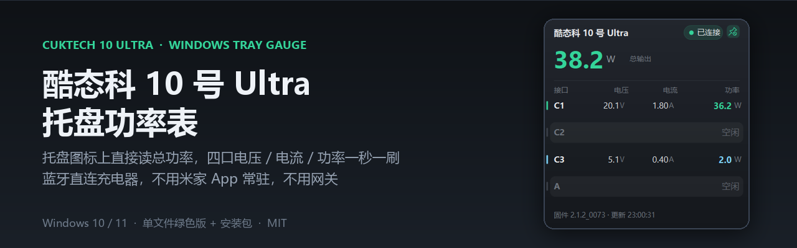
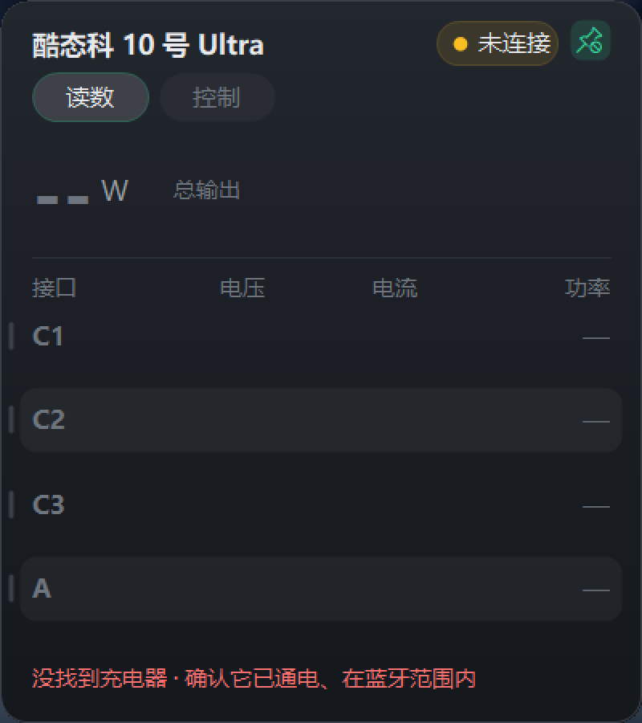
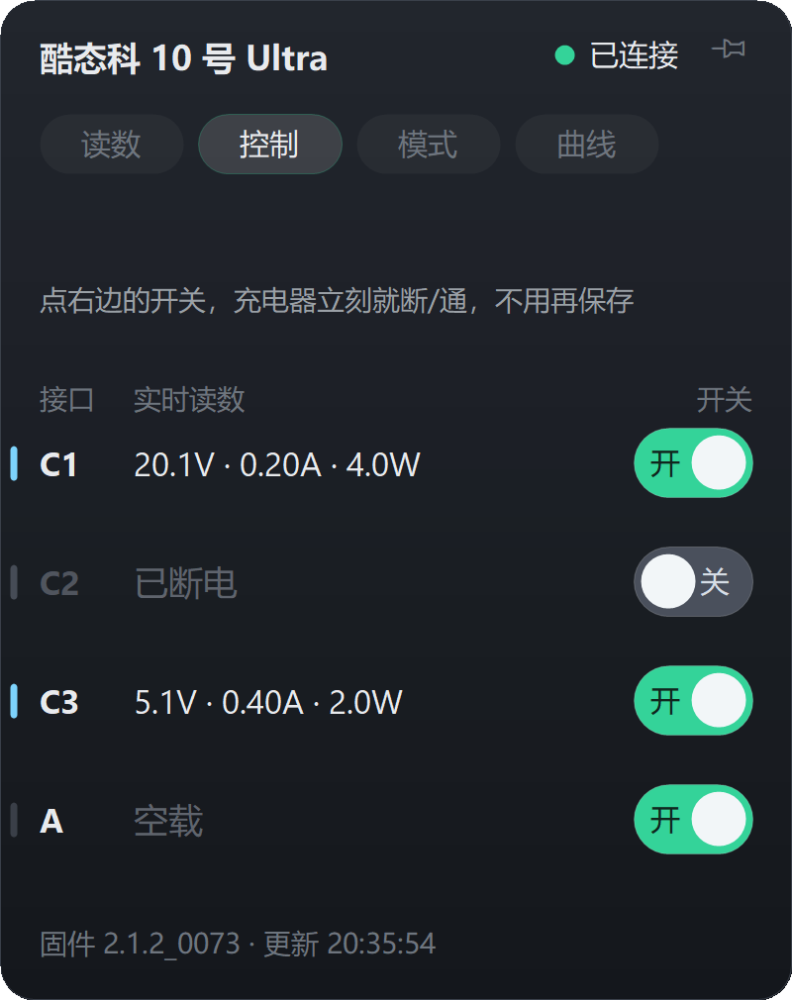
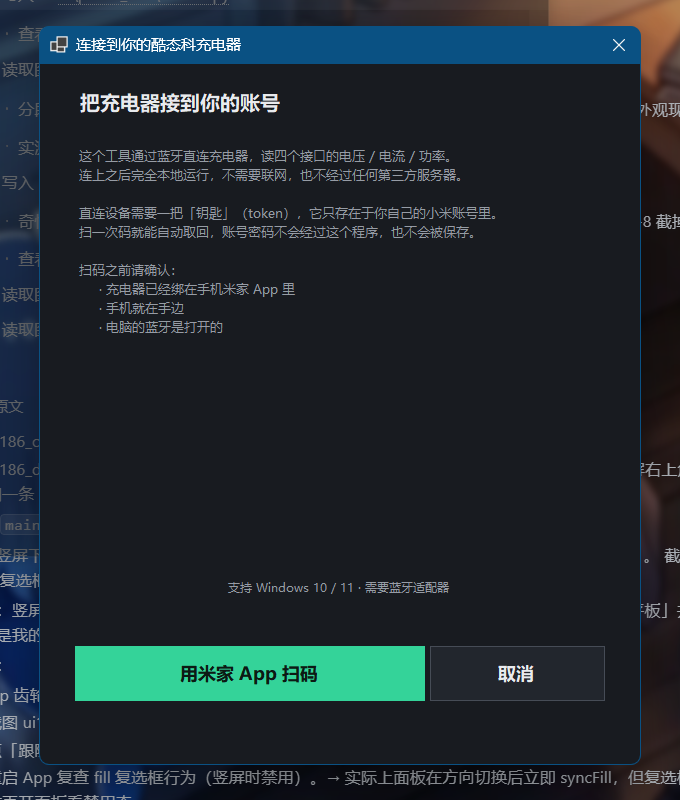

# 酷态科 10 号 Ultra 桌面功率表

> Windows 托盘小工具 · 蓝牙直连 · 开源免费

## 先说我为什么做这个

酷态科 10 号 Ultra 本身带屏，能看到实时功率。但屏太小，要凑近看，手机支架一挡就看不见了；米家 App 虽然能看，可每次都得开 App、等蓝牙连上，看完就关。

我想要的是一个一直在那儿、看一眼就有的数字。于是有了这个小工具：Windows 托盘图标本身就是功率表，图标上的数字就是四个口加起来的总输出，颜色跟着功率走——低功率绿、中功率黄、高功率红。

## 它长什么样

左键点托盘图标，弹出功率面板：C1 / C2 / C3 / A 四个口，每行显示电压、电流、功率，底部一行是总输出、固件版本和最后更新时间。

*功率面板（四路实时读数）*

任务栏上也能放一串数字。透明底、只有文字，不挡图标，位置按住就能左右拖，松手记住。

*任务栏左端的总功率数字*

右键菜单里还有打开控制页：四张端口卡片，每个口一个开关，能直接把某一路的输出断掉再打开。

*控制页（每路都能单独开关）*

## 能干什么

- 托盘图标直接显示总功率，不用点开
- 面板里四路电压、电流、功率一目了然
- 可以单独关掉某个口，比如只给手机充电时把笔记本那一路断掉
- 任务栏数字想放哪拖哪，右键有「重置任务栏数字位置」
- 开机自启，托盘常驻，常驻内存大约 60 MB
- 全程蓝牙直连，不经过米家云，连上之后不产生任何网络流量

## 怎么用（三步）

1. 下载安装包双击安装；不想装就用绿色版，拷到任意文件夹双击即可（两个都不用装 .NET）
2. 第一次运行会弹二维码：用米家 App 扫码登录一次，工具自己把你账号下这台充电器的密钥取出来，存在本地
3. 之后每次开机它自己连，托盘上就有数字了

*第一次运行：手机米家 App 扫码授权一次*

## 几个说明

- 系统要求：Windows 10 / 11 64 位，电脑有蓝牙适配器
- 只在我自己这台 10 号 Ultra 上验证过（固件 2.1.2_0073）；其它支持米家的酷态科型号理论上同一套协议，但我没设备测
- 程序没有代码签名，第一次运行时 Windows 可能弹「已保护你的电脑」，点「更多信息 → 仍要运行」就好
- 首次扫码会登录一次小米账号，拿到的只是设备密钥，存在本地 settings.json，不会上传到任何地方
- 想卸载：设置 → 应用 → 找到「酷态科托盘功率表」卸载；绿色版直接删文件夹（删之前先进托盘菜单关掉开机自启）

## 下载

开源仓库（源码、更新日志、踩坑记录都在里面）：  
https://github.com/Blank2007/cuktech-ultra-tray

安装包（127 MB）/ 绿色版（69 MB）：  
https://github.com/Blank2007/cuktech-ultra-tray/releases/latest

链接不能直接点的话，复制到浏览器打开。

## 关于这个工具

源码全部开源，MIT 协议，随便改随便发。说句实话：代码是我用 AI（DeepSeek Harness）写出来的，我负责提需求、插充电器、验收；过程中踩的坑（任务栏数字重影、低权限进程挂不进任务栏、还有一个把我骗了半天的「截图工具 DPI 假 bug」）都写在仓库的「开发日志」里了。

有问题在酷安评论里说，或者去 GitHub 提 Issue，都行。
