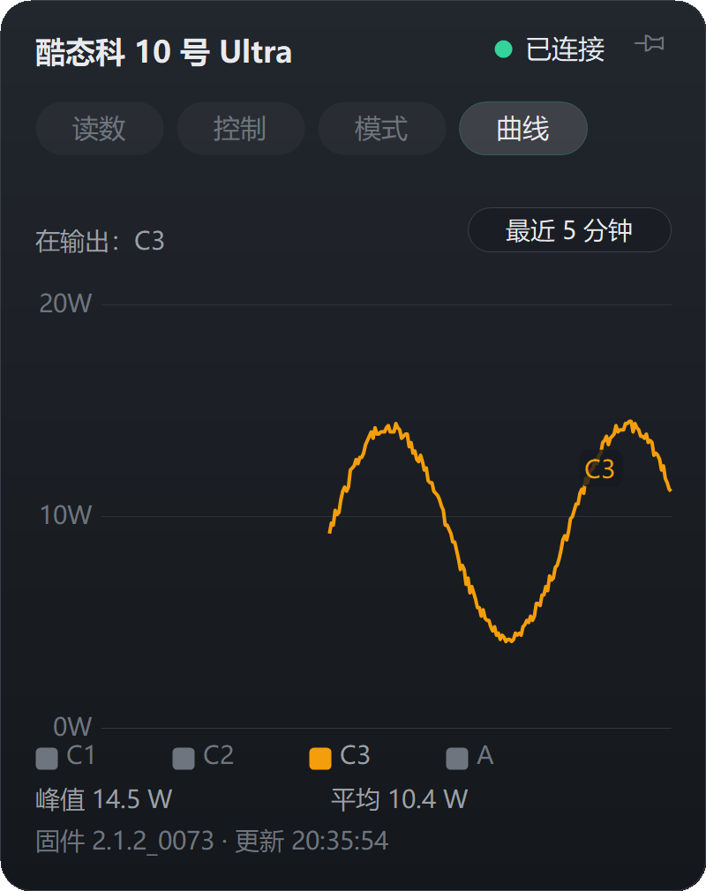

# 0.5.7 — you can see a single port on the chart at a glance

> Draft of the GitHub Release body (English). 中文见 [release-0.5.7.md](release-0.5.7.md).

In one line: **the chart tab no longer makes you match a line colour back to the legend** — the subtitle names the
ports that are delivering, and every line carries its port name at its end. macOS is unchanged, still 0.1.8.

## What changed

### Windows: telling lines apart on the chart

The old chart was "four lines plus a legend row"; which line is which was encoded only in colour
(C1 blue / C2 green / C3+A amber / A violet). With a single port delivering you see one amber line, and the third
legend entry was hard-coded to **C3+A** — so "is this C3, or C3 and A merged?" had no answer on screen; you had to
switch back to the Control tab and look at the switches. The three dimmed legend swatches carried no information.

Three changes together:

* **The subtitle names the ports**: "delivering: C3", or "delivering: C1, C3" for several; only when nothing is
  delivering does the old "one line per port, tap the pill to change the span" come back
* **Each line is labelled at its end**: C1 / C2 / C3 / A in the line colour, stacked at least 13 dip apart, moved
  to the left of the point near the right edge, on a translucent rounded backing so a line crossing underneath does
  not swallow the text
* **The third name follows the merge state**: **C3+A** when C3 and A are folded together, plain **C3** otherwise



### macOS: unchanged

* Still **0.1.8**; CI re-packs `CuktechTray-0.1.8-mac.zip` on this tag, same content as last time

## How to update

* **Windows, portable**: overwrite the old `CuktechTray.exe`, keep your `settings.json`
* **Windows, installed**: tray → "Check for updates"; it downloads, verifies the SHA256 and replaces itself
* **macOS**: nothing to do, still 0.1.8

## Files

| File | Size | Notes |
| --- | --- | --- |
| `CuktechTray-0.5.7-win.exe` | **11,151,360 bytes (10.63 MiB)** | Windows: portable + installer in one |
| `CuktechTray-0.1.8-mac.zip` | **1,623,257 bytes (1.55 MiB)** | macOS: still 0.1.8 (unchanged) |

## Checksums

```
file   CuktechTray-0.5.7-win.exe   (built locally as CuktechTray.exe, same file)
size   11,151,360
ver    0.5.7.0
sha256 55768A358130A68B8EA59AD5D15B815AD7E3B9234653CD5AFBE790DD1611A40C

file   CuktechTray-0.1.8-mac.zip    (packed by CI, unpacks to CuktechTray.app)
size   1,623,257
sha256 25E4258DB233E74D227CBC472774133850B447DD234E6FB7B0330727F943C215
```

## Requirements

* Windows 10 2004 (build 19041) or newer, x64; no runtime needed (NativeAOT single file)
* macOS 13 or newer, Apple Silicon and Intel (universal)
* Hardware is still a CUKTECH 10 GaN Charger Ultra + Bluetooth LE

## Known

* The Windows exe is **not code signed**; the first run shows the blue SmartScreen prompt, click "More info → Run anyway"
* The macOS .app is ad-hoc signed (no Apple developer account); first launch needs "Open Anyway" in Privacy & Security

## Thanks

* [@kairui1108](https://github.com/kairui1108) for the two projects that first documented the CUKTECH 10 Ultra BLE protocol
* And everyone who filed an issue or a PR
