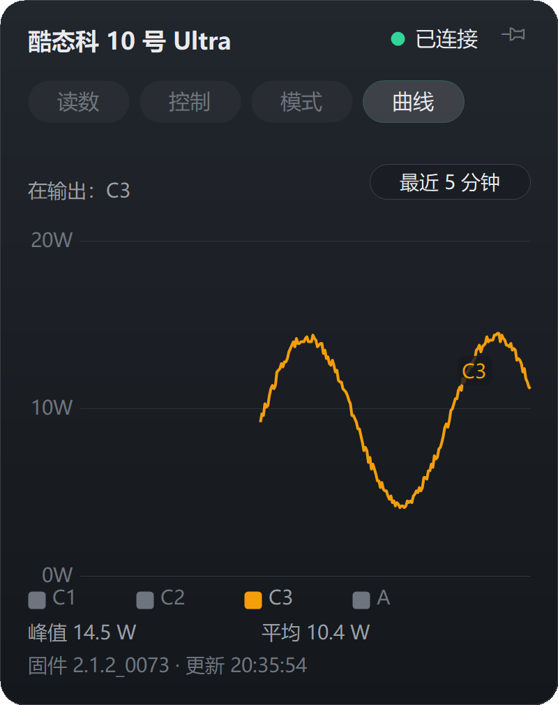

# 0.5.7 —— 单口在输出，曲线上一眼看得出来

> 这份是发 GitHub Release 用的正文草稿（中文），复制粘贴即可。英文见 [release-0.5.7.en.md](release-0.5.7.en.md)。

一句话：**曲线页不再要求你拿线的颜色回头对图例**——副标题直接点名哪几路在输出，每条线的末端也写着自己的口名。
macOS 这次没改动，仍是 0.1.8。

## 这次改了什么

### Windows：曲线页的辨认方式

问题是这么来的：原来的曲线页是「四条线 + 一行图例」，认哪条线靠颜色对图例（C1 蓝 / C2 绿 / C3+A 橙 / A 紫）。
单口输出时画面上只有一条橙线，而第三路图例固定写死成「C3+A」——于是「这条橙线是 C3，还是 C3 和 A 合并后的那一路」
在画面里没有答案，得翻回控制页看开关状态。压暗的另外三个图例色块也没有信息量。

这次三处一起改：

* **副标题点名**：有输出时写「在输出：C3」，多口写「在输出：C1、C3」；一路都没有时才回到原来那句
  「每路一条线，点右边换时长」
* **线末端直接写口名**：每条线最后一个有效点旁边用同色字标出 C1 / C2 / C3 / A，标签按 y 排序至少错开 13 dip、
  靠右时改写在点的左侧，底下垫一层半透明圆角块，线从字下面穿过也读得清
* **第三路的名字跟着合并状态走**：C3 与 A 合并成一路时写 **C3+A**，单口时就是个 **C3**，不再一律写 C3+A



### macOS：这次没改动

* 版本仍是 **0.1.8**；这个 tag 上 CI 会照例重新打一份 `CuktechTray-0.1.8-mac.zip` 传上来，内容与上次一致

## 怎么升级

* **Windows 绿色版**：把新的 `CuktechTray.exe` 覆盖旧的，`settings.json` 原样接着用
* **Windows 装过本机的**：托盘右键 →「检查更新」，它自己下载、校验 SHA256、重启换掉自己
* **macOS**：不用动，仍是 0.1.8

## 文件

| 文件 | 大小 | 说明 |
| --- | --- | --- |
| `CuktechTray-0.5.7-win.exe` | **11,151,360 字节（10.63 MiB）** | Windows：绿色版 + 安装器二合一 |
| `CuktechTray-0.1.8-mac.zip` | **PENDING** | macOS：仍是 0.1.8（这次没改动） |

## 校验

```
文件   CuktechTray-0.5.7-win.exe   （本地 build 出来叫 CuktechTray.exe，同一个文件）
大小   11,151,360 字节
版本   0.5.7.0
SHA256 55768A358130A68B8EA59AD5D15B815AD7E3B9234653CD5AFBE790DD1611A40C

文件   CuktechTray-0.1.8-mac.zip     （由 CI 打包，解出来是 CuktechTray.app）
大小   PENDING
SHA256 PENDING
```

## 系统要求

* Windows 10 2004（内部版本 19041）及以上，x64；不需要装运行时（NativeAOT 单文件）
* macOS 13 或更新，Apple Silicon 与 Intel 都行（universal）
* 硬件还是「酷态科 10 号 Ultra」充电器 + 蓝牙（BLE）

## 已知

* Windows 的 exe **没有代码签名**，首次运行会弹蓝色的「Windows 已保护你的电脑」，点「更多信息 → 仍要运行」即可
* macOS 的 .app 是 ad-hoc 签名（没有 Apple 开发者账号），第一次打开要在「隐私与安全性」里点「仍要打开」

## 致谢

* [@kairui1108](https://github.com/kairui1108)：最早把酷态科 10 号 Ultra 的 BLE 协议写下来的两个项目
* 还有本项目所有提 issue、提 PR 的人
