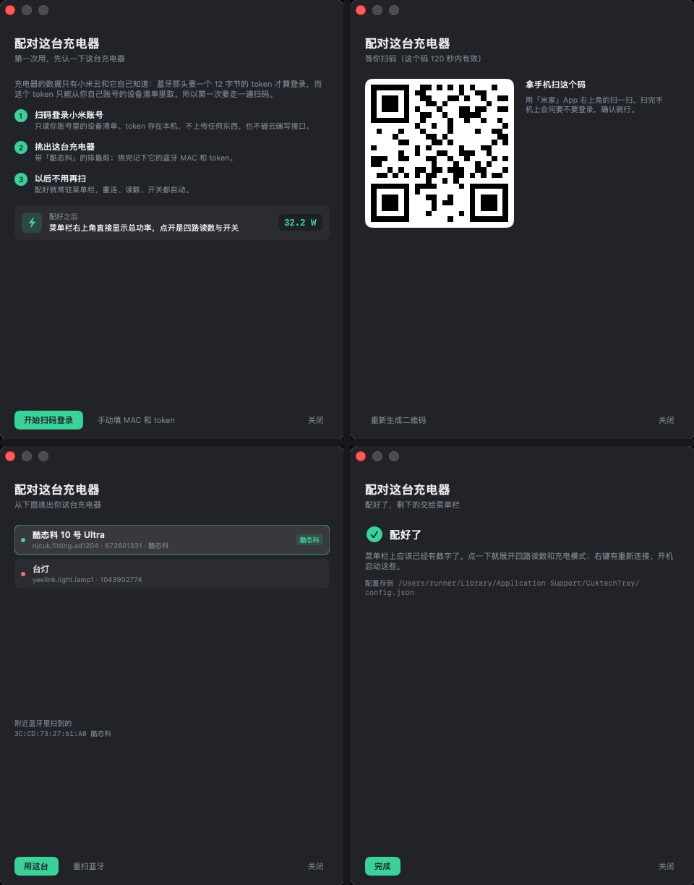

# CUKTECH 10 Ultra · macOS 菜单栏功率表

macOS 版的「酷态科 10 号 Ultra」功率表：一个菜单栏小工具，蓝牙直连充电器，
状态栏上直接显示四口总功率，点开看四路电压/电流/功率和充电模式，还能直接断电。

除了读数，它还能做三件事：**单口采集**（每秒记一次，算出这一口到底充进去多少 Wh，结果能**导出 CSV**）、
**设备设置**（息屏时间、快充协议开关、定时断电、屏幕语言，不用再开米家 App）、
**更新检查**（启动 8 秒后自己在后台查一次，查到新版就在菜单栏点个红点；也能在菜单里手动点）。

纯 Swift 写的（AppKit + SwiftUI + CoreBluetooth），不需要 Electron、不需要装运行时。
目标系统 macOS 13 或更新（Apple Silicon 与 Intel 都行）。

---

## 和 Windows 版的关系

同一套协议、同一套取色规则、同样的数字格式，两边都是从一个充电器上读出来的：

| | Windows 版 | macOS 版 |
|---|---|---|
| 语言 / 技术 | C# + NativeAOT，自绘 Win32 界面 | Swift + AppKit/SwiftUI |
| 常驻位置 | 托盘图标 + 任务栏数字 | 状态栏（menu bar）文字 |
| 找设备 | 按 MAC 直连（Windows 缓存里有） | 扫 FE95 广播反解 MAC 再连 |
| 配置 | settings.json | ~/Library/Application Support/CuktechTray/config.json |
| 配对 | 扫码登录小米云 → 取 token | 一样（向导四屏） |
| 体积 | 约 10.4 MB 单文件 exe | 约 1 MB 的 .app |

两者的配置可以互相抄：Windows 版 settings.json 里的 `Mac` 与 `TokenHex` 就是 macOS 版 config.json 里的 `mac` 与 `tokenHex`。

---

## 安装

下载 `CuktechTray-<版本>-mac.zip`，解压出 `CuktechTray.app`，拖进「应用程序」。

> macOS 版的版本号**自己算**，从 `0.1.0` 起（当前 `0.1.8`），不跟 Windows 版的 0.5.x 绑在一起——两个平台改动节奏不一样，
> 绑同一个号只会让更新日志里一半条目跟对方无关。当前版本见 `--version`。

这个 .app 是 **ad-hoc 签名**（本仓库没有 Apple 开发者账号，没做公证），第一次打开时
macOS 会拦一下：

1. 右键点 `CuktechTray.app` → 打开，或者双击后在弹窗里点「取消」；
2. 进 **系统设置 → 隐私与安全性**，往下滚到「安全性」，点「仍要打开」；
3. 再双击一次就开了。

如果是从命令行解压的，也可以直接去掉隔离属性：

```bash
xattr -dr com.apple.quarantine /Applications/CuktechTray.app
```

第一次启动会问蓝牙权限，必须给，否则状态栏只会显示 `—`。点掉那个弹窗之前程序会一直等
（最多 30 秒，之后再进入重试退避），所以「先看到 `—`、允许之后才出数字」是正常的。

> 每次重新构建、重新签名（ad-hoc 签名每次都会变）之后，系统会再问一次蓝牙权限，
> 因为 macOS 把 App 当成新的二进制看待。用官方 zip 的用户只会在第一次见到这个弹窗。

---

## 第一次用：扫一次码

菜单栏出现 `未配对` 时会自动弹向导，四屏长这样（这是 CI 在真 macOS 上截的）：




1. **认路** —— 说明为什么要扫码：充电器的 token 只在你自己小米账号的设备清单里；这一屏底部还有一段隐私说明（点「看完整的隐私说明」看全文）；
2. **扫码** —— 用「米家」App 扫码登录（只读设备清单，token 存在本机）；
3. **挑设备** —— 列表里带「酷态科」的排最前，选这台 10 号 Ultra；
4. **完成** —— 状态栏立刻开始显示功率。

如果云端没给蓝牙地址（有些账号的 `mac` 字段是空的），向导会顺手扫一遍附近的
FE95 广播，用广播里反解出来的地址补上。实在不行还有「手动填 MAC 和 token」的兜底，
从 Windows 版的 settings.json 抄两个值就行。

---

## 日常

- 菜单栏上那串数字就是四口总功率，颜色按档走：灰 ≈0W、淡蓝 0–20W、绿 20–60W、黄 60–100W、红 100W 以上；
- **左键点一下**数字：弹出面板。面板跟 Windows 版同构，四个页签：
  **读数**（四路各多少伏多少安多少瓦，右边是单口采集按钮）/ **控制**（每路的开关）/
  **模式**（AI、数码生态、单口、均衡四种充电模式）/ **曲线**（四路功率走势）；
  面板已经开着时，**再点一下数字就收起**（不会闪一下又弹回来）；
- **曲线页**：四路各一条线（C1 蓝 / C2 绿 / C3 橙 / A 紫，C3 与 A 合并时那一路写 C3+A），
  副标题直接点名「在输出：C3」，每条线的末端还写着口名 —— 单口输出时不用拿颜色回头对图例；
  点右上角胶囊在 **1 / 5 / 15 / 30 分钟**之间切档（写进 `config.json` 的 `chartSeconds`）。
  历史只活在内存里（1 Hz × 30 分钟），程序退出就没了，不写盘；
- 面板页脚「重新连接」右边是**读数间隔**（`读数 1/2/3/5/10 秒`）：改完立刻生效，同时写回 `config.json`
  的 `pollInterval`，不用再去手改文件；它只管 **App 多久读一次蓝牙**，跟充电器无关，
  所以放在页脚、不放在「充电模式」那一行（挤在一起会读成「充电模式每 1 秒自动切一档」）；
  页脚右半边是「设置 / 关于 / 退出」，跟右键菜单里的入口是一回事；
- 面板默认**点外面就收起**（点到别的 App、桌面、Dock 都算，⌘-Tab 切走也算）；想让它常驻就点右上角的**图钉**，
  钉住之后切 App 也不收，再点一次取消；
- **右键**：弹菜单 —— 显示功率面板 / 设备设置… / 重新连接 / 重新配对… / 菜单栏显示功率数字 / 打开日志 / 显示配置文件 / 关于 / 退出；
- 关掉「菜单栏显示功率数字」后，菜单栏换成一个闪电图标（跟 App 图标上的那个对应），
  悬停能看到实时读数；不占地方，也不会有个「瓦」字在那儿晃；
- **更新检查分两条路**：一条是启动后 **8 秒自动查一次**（先让蓝牙连上，不跟握手抢网络），
  查到新版就在菜单栏功率数字后面点一个小红点、右键菜单那行变成「检查更新…（有 X）」并带行首红点，
  **不弹框**；另一条是右键菜单里手动点「检查更新…」，这时候才会弹「有新版本 / 去下载 / 以后再说」
  或者「已经是最新的」。不想每次启动都查，菜单里「启动时自动检查更新」取消勾选即可（`checkUpdatesOnStart`）。
  比的是 release 里 `CuktechTray-<版本>-mac.zip` 这个资产名，不看 tag —— mac 版自己编号，跟 Windows 版的号不是一回事；
- 「关于」窗口只放版本号、GitHub 仓库入口和两个按钮，打开窗口**本身不发任何请求**（请求只由上面那两条路发出）；
- 面板底部「**设置**」（右键菜单里是「设备设置…」）打开一个小窗，把协议里能改的东西都放进来，
  改完直接写进充电器，米家 App 那边也会同步：
  - 屏幕：**息屏时间**（1/5/10/30 分钟、常亮）、**空闲息屏**、**屏幕方向锁**；
  - 供电：**USB-A 小电流**；每口的**快充协议开关**（C1/C2 有 PD/PPS/UFCS，C3/A 有 UFCS/SCP），
    关掉就是让充电器别再跟设备谈这个协议；每口右边还会显示**现在实际谈成的协议和功率**
    （PIID 17/18，例如「PD 70W」），用来对照左边那排开关；
  - 定时断电：四口各设 15/30 分钟、1/2/4 小时，到点自动断这一口（「关闭」= 0）；
  - 这些项是**一条一条 GET 读回来的**，读不到就显示「设备没答这一项」并把控件禁掉——
    不会把「没读到」当成「关着」，免得一点就写进未知的值；
- 每个端口行里、功率和开关之间有个**波形按钮**：点一下开始**采集这一口**。每秒读一次，
  顶上一行会实时变成「采集中 · C1 / 12s · 0.04Wh · 平均 12.1W」，按钮变红，再点就是停止；
  采集会在**连续 30 秒这一口没有输出**、连续 30 秒读不到数据、或者蓝牙断开时自己结束，
  然后弹一个小窗给出充入 Wh、平均/峰值功率、有效时长、电压区间与换档次数、采样次数
  （严格 1 Hz：30 秒就是 30 次，采集开始那一秒也算一次）。
  这些数字**不自动写盘**：关掉窗口就没了；要留档点窗口里的「导出 CSV」，
  每行一秒（时间 / 电压 / 电流 / 功率 / 是否带载），自己挑存哪儿，默认文件名
  `cuktech-capture-<口名>-<yyyyMMdd-HHmmss>.csv`，UTF-8 带 BOM（Excel 打开中文表头不乱码）；
- 电量是按**分段积分**算的：电压没变时取梯形，遇到跳档（5V→9V→20V 这种）的那一秒只用跳变**前**
  的功率走完，不跨档平均 —— 否则 5V→20V 会被算成 12.5V，那一秒的能量凭空翻倍。代价是跨档那一秒
  略少算一点，但不会虚报。采集期间常规轮询会自动让路，避免两路命令挤一个通道被设备吞掉；
- 面板里的开关是「读 → 改 → 写 → 回读确认」，写失败会回退，不会把别的口一起关掉；
  开关是自己画的：系统那个在窗口不是 key window 时会渲染成灰绿，点一下面板内部才变蓝，看着像坏了，
  现在颜色固定，跟窗口激活状态无关；
- 断开或者走远了会自动重连，重连不上就先显示 `—`。

---

## C3 与 A 合并成一路功率（0.1.2）

充电器在 **C3 与 A 同时通电**时，把这两个口的功率合并到同一路功率计上上报：C3 那一路的原始帧里
state 变成 `0x11`（`0x01` 是单口工作、`0x00` 是空闲），另一路回的是「有电但空载」。米家 App 也只显示一个合并值。

0.1.2 起跟着合并，规则与 Windows 版完全一致（同一份判据、同一套措辞）：

- **判据**：`merged = (C3.hasData && C3.state == 0x11) || (A.hasData && A.state == 0x11)`；
- **主人（owner）**：C3 在工作就让 C3 当 owner，否则 A 在工作就让 A 当 owner，两个都不在工作就用 C3；
- **名字**：owner 那一行显示 `C3+A`，另一行仍是 `A`；
- **另一行**：不再写「空载」，改成暗色的 `并入 C3+A`；右侧功率位显示暗色 `—`，不显示数字
  （macOS 版只有一页，读数与开关在同一条行上，所以规格里「读数页」和「控制页实时读数列」这两条在这里是同一行里的两段）；
- **总功率**：这一对只算一次（只累加 owner 的 watts，另一路跳过），状态栏那个总数不会翻倍；
- **没合并时**：一切照旧——还是 `C3` / `A` 两行各自读数，空闲仍显示「空载」。

实测样例（`port_switch=0x0F`）：C3 原始帧 `11 30 04 33` → 5.1V / 0.4A = 2.04W，A 原始帧 `00 30 00 00`
（state=0x00、code=0x30 = 通电但空载）。0.1.2 之前 A 那行会显示「空载 0.0W」，看着像 A 没在充电。

这个问题的报告人是 issue #1 的 [@KingGxxT](https://github.com/KingGxxT)。

---

## 隐私

和 Windows 版完全一致：只碰**你自己账号里这台充电器的凭据**和**它自己的读数**。

- **扫码时**：向小米云要一个登录二维码，账号、密码、验证码全程在你手机上，本程序看不见也拿不到；
  配对完成时小米云只返回这台充电器的 `mac` 与 12 字节 `tokenHex`
- **凭据在哪**：只写本机的 `~/Library/Application Support/CuktechTray/config.json`（登录会话另存 `session.json`，
  只为「重新配对」时少扫一次码；删掉不影响日常使用）
- **日常**：跟充电器蓝牙直连读功率、写四路开关，全程不联网；**启动 8 秒后会在后台查一次更新**
  （菜单里能关，见上面「更新检查分两条路」），访问的是 GitHub 公开的发布列表，不带任何账号信息
- **不做的事**：不上传读数、不做统计、不装后台服务、不碰账号里的其它设备；卸载后本机不留东西

向导欢迎页那段小字点开就是上面这些。

### 首次启动必须先同意（0.1.2）

0.1.2 起，**第一次打开**（配置里没有 `privacyAccepted` 或者它是 `false`）会先弹一个模态窗口，
把下面「隐私说明全文」摆出来，底部两个按钮：

- **同意并继续**（绿色主按钮）→ 把 `privacyAccepted = true` 写进 `config.json`，然后照常启动
  （还没配对就照旧弹配对向导）；
- **不同意，退出**（暗色次要按钮）→ 本程序直接退出，**不写任何文件**（下次打开还会再问一遍）。

窗口跟向导同一套样子：深色底、绿色主按钮、暗色次要按钮，Esc 和点红叉都关不掉——
只能选这两个按钮之一。实现是 `Sources/CuktechTray/PrivacyWindow.swift` 里的 `PrivacyView` / `PrivacyGate`
（`NSApp.runModal(for:)`），入口在 `Sources/CuktechTray/main.swift` 的 `applicationDidFinishLaunching` 最前面。

**演示 / 自检路径不弹这道门**：`--version`、`--selftest`、`--wizard-demo=<屏>` 这类非交互参数一律不问，
CI 里那四屏截图和自检照旧能跑。想重置成「第一次打开」的样子，把 `config.json` 里的
`privacyAccepted` 删掉（或改成 `false`）即可。

### 隐私说明全文

> 这是第三方小工具，不是小米或酷态科官方出的。

**一、扫码时会做什么**

- 只向小米云要一张登录二维码，你在手机米家 App 里扫码、确认。
- 账号、密码、验证码都在你手机上，本程序看不见，也拿不到。
- 小米云只返回这台充电器的 Mac 和 12 字节 token。

**二、数据留在哪里**

- 只写进本机的 config.json（`~/Library/Application Support/CuktechTray/`）。
- 登录会话 session.json 也留在同一目录，只是为了下次重新配置少扫一次码。

**三、不会做的事**

- 不上传任何数据；日常读功率走电脑和充电器之间的蓝牙，不经过网络。
- 启动时会在后台查一次更新（默认开，右键菜单里能关），只拉公开的发布列表。

**四、想清干净**

- 删掉 CuktechTray 这个配置目录，本机就什么都不剩；蓝牙那头不留任何东西。

（这段文字和程序里弹窗显示的、以及 Windows 版向导里的是同一份，只有路径写法按平台不同。）

---
## 命令行参数

```bash
/Applications/CuktechTray.app/Contents/MacOS/CuktechTray --version     # 打印版本号
/Applications/CuktechTray.app/Contents/MacOS/CuktechTray --selftest    # 自检：配置路径、是否已配对
/Applications/CuktechTray.app/Contents/MacOS/CuktechTray --wizard-demo=<屏>  # 只摆出向导某一屏（welcome|login|pick|done），截图用
```

---

## 自己编译

需要 Xcode 命令行工具（或者完整 Xcode）：

```bash
# 在 Intel 或 Apple Silicon 的任意一台 Mac 上都能出 universal（arm64 + x86_64）：
bash mac/scripts/build-universal.sh mac            # 编出 mac/.build/release/CuktechTray（fat）
bash mac/scripts/make-app.sh mac/.build/release/CuktechTray dist   # 组装 .app + ad-hoc 签名
bash mac/scripts/package.sh dist                   # 打成 dist/CuktechTray-<版本>-mac.zip
dist/CuktechTray.app/Contents/MacOS/CuktechTray --selftest
open dist/CuktechTray.app
```

只想编本机架构的话直接 `swift build -c release --package-path mac` 也行。

`make-app.sh` 会顺手跑 `scripts/make-icon.swift` 现画一套 `AppIcon.iconset`，再用 `iconutil`
打成 `AppIcon.icns` 塞进 `Contents/Resources`。图标是**构建时生成**的，仓库里不放 `.icns`：
二进制进 git 没法 review，改配色就得重新导出一堆 PNG。想换图标只改那个脚本里的两个颜色常量。
（`build-universal.sh` 存在的理由：GitHub 的 arm64 runner 排队经常被取消，所以 CI 固定用
Intel runner 编两个架构——SwiftPM 多 `--arch` 的产物落在 `.build/apple/Products/Release/`，
脚本负责把它挪回 `.build/release/`。）

跑测试：

```bash
swift test --package-path mac
```

协议那部分（AES-CCM、HKDF、MiOT 编解码、小米云客户端）跟界面完全解耦，
在 Linux 上也能跑，所以 CI 里有一条 ubuntu job 专门跑单元测试。

---

## 目录

```
mac/
  Package.swift                SwiftPM 清单（CuktechCore / CuktechBle / CuktechTray）
  Sources/CuktechCore/         协议核心：AES-CCM、HKDF、MiOT 编解码、小米云客户端
  Sources/CuktechBle/          CoreBluetooth：连接、认证、扫描
  Sources/CuktechTray/         菜单栏 App：状态栏、面板（含固定、采集按钮）、向导、首次启动隐私同意（PrivacyWindow.swift）、设备设置（SettingsWindow.swift）、关于 / 更新检查（AboutWindow.swift）
  Tests/CuktechCoreTests/      单元测试（黄金向量、协议、云端解析）
  Tests/CuktechBleTests/       广播解析回归测试（只在 macOS 上编译）
  scripts/build-universal.sh   在单台机器上编 universal（arm64 + x86_64）
  scripts/make-app.sh          组装 .app、生成图标并签名
  scripts/make-icon.swift      画 AppIcon.iconset（构建时调用）
  scripts/package.sh           打成 CuktechTray-<版本>-mac.zip
  Resources/Info.plist         包信息（LSUIElement、蓝牙权限说明）
```

---

## 出问题了看这里

日志在 `~/Library/Application Support/CuktechTray/tray.log`（右键菜单「打开日志」），
认证每一步、每次重连、每次写入口都记在里面。

| 现象 | 原因 / 处理 |
|---|---|
| 状态栏一直是 `—`，日志里反复出现 `扫不到 MAC 为 … 的广播` | **0.1.0 有、0.1.1 起修好**：MiBeacon 广播解析把 `95 FE` 服务 UUID 头当成必需的，但 macOS 通过 `CBAdvertisementDataServiceDataKey` 给的是**裸 payload**（`10 59 0E 66 00 30 8B 31 73 CD 3C`），于是永远解析失败。更新到修复后的版本即可；自己编译的话 `swift test` 里有一条用真机字节写的回归测试 |
| 日志 `蓝牙 30 秒内没就绪` | 授权弹窗没点，或「系统设置 → 隐私与安全性 → 蓝牙」里没勾上本程序 |
| `central state=4` / 一直重启扫描 | 蓝牙关着（state 4 是 poweredOff），打开蓝牙 |
| 连上但读数是 0，日志 `四个端口都没有应答` | 手机上的米家正连着这台充电器。BLE 同时只允许一个中心，把米家退到后台或关掉手机蓝牙 |
| `认证结果` 不是 0x21，或 HMAC 校验失败 | token 不对/已过期：设备被解绑或换绑过。右键「重新配对…」重扫一次 |
| 面板开关点了弹回原状 | 写入口失败（设备忙或有负载）。读-改-写带回读校验，失败会回退并写日志 |
| 重新编译后菜单栏不见了 | ad-hoc 签名每次构建都会变，系统重新要一次蓝牙权限；允许后即可 |

## 已知限制

- **没做公证**：只有 ad-hoc 签名，第一次打开要走「隐私与安全性 → 仍要打开」。想彻底顺畅得买 Apple 开发者账号（99 美元/年）做 Developer ID 签名 + 公证。
- **蓝牙这块没有真机回归**：GitHub 的 macOS runner 是没有蓝牙硬件的虚拟机，CI 只能验证「编译过、单测全绿、界面能起来」，连充电器那一步必须自己机器上跑。
- **只在自己机器上验过**：开发过程中没有第二台 Mac，Intel 与 Apple Silicon 都是 CI 编出来的，实际连设备以你手上的为准。
- 菜单栏那一格现在是**固定宽度 58pt**（托盘菜单「菜单栏固定宽度」，默认开）：读数在 `9.9W` ↔ `10.0W` 之间跳时整格不再伸缩，右边图标也不会跟着挪。关掉就回到系统的 `NSStatusItem.variableLength`，位数一变整条菜单栏都会重排。

---

## 0.1.7 里的变化（修玻璃面板）

[issue #6](https://github.com/Blank2007/cuktech-ultra-tray/issues/6)（[@editwe](https://github.com/editwe) 报）：
0.1.6 在 macOS 26/27 上开玻璃面板，整个面板被冲成中灰、副标题和「空载 / 0.0W」这类次要文字几乎看不清；
另外按窗口截图框不住面板。

- **原因**：0.1.6 在 `#available(macOS 26.0, *)` 上换成 `NSGlassEffectView`，这个视图塞进 `NSPopover` 的普通容器里
  **拿不到窗口背景采样**，只剩一层中性半透明玻璃；同时把 SwiftUI 的实色底压到了 **0.55**，背后只要有一扇浅色窗口，
  深色底就被冲成中灰
- **现在的做法**：玻璃底统一用 `NSVisualEffectView`（`.popover` + `.behindWindow`），不再按系统版本分叉；
  底色固定 **0.9**，次要文字留得住对比度（改的是 `Sources/CuktechTray/GlassSupport.swift`，整文件重写）
- **默认关**：`config.json` 里没有 `glassPanel` 这个键时按 `false` 处理，要玻璃就去托盘菜单勾「面板玻璃质感」。
  以前勾过的配置里写着 `true`，继续生效
- 面板尺寸、层级、圆角都没动（还是 340×424 的 popover）

## 0.1.6 里的变化（社区 PR #5 的后半 + 自己补的）

[@editwe](https://github.com/editwe) 的 [PR #5](https://github.com/Blank2007/cuktech-ultra-tray/pull/5)
按 0.1.5 / 0.1.6 两版提交，这里合成 macOS 的 **0.1.6**（0.1.4 的内容上一版 0.1.3 已经并过）。
分支是从 0.1.1 时期拉的，直接 merge 会把 0.1.2 / 0.1.3 / 0.1.4 冲回去，所以按语义手工搬了一遍。

- **连接更稳**：只用一个 central，连接前先清掉陈旧连接；扫描阶段会用 `retrieveConnectedPeripherals` **接管**
  系统里已经连上的那台（以前这种情况只能干等超时），扫描超时之后再试一次接管
- **睡醒自动重连**：`NSWorkspace.didWakeNotification` 之后主动重连一次，不用手动点「重新连接」
- **记住 `peripheralId`**：同一台充电器下次按标识找，不用再靠 RSSI 猜。这个字段是**可选**的——
  老 `config.json` 里没有它，若当成必填，解码失败会把已经配好的 MAC 和 token 一起冲掉
- **采集补上平均 / 最大**：电压、电流、功率各一行两列，口径跟 Windows 0.5.1 一致（峰值电流只认带载样本、
  拔线不算换档、跨档按跳变前积分、空口待机不进电压区间）；新增 `testVoltageStepIsNotAveraged`（11.75 V）
  与 `testUnplugIsNotARailChange` 两条测试；`--capture-demo` 可以直接看样例结果
- **面板「始终在最前」**：托盘菜单里勾上就 `NSWindow.level = .floating`，跟「固定面板」互相独立
- **菜单栏不再抖**：那一格固定 58 pt，并且只有读数 / 颜色真的变了才重绘（内容指纹去抖）；托盘菜单可以关掉
- **面板玻璃质感**：面板背景垫一层 `NSVisualEffectView`（`.popover` 材质 + `behindWindow` 采样，13 以上都这一条路）；
  只动面板背景，其它窗口不变，托盘菜单可开（**默认关** —— 0.1.7 改的，见下面那一节）
- **参考了衍生项目的思路**：固定宽度菜单栏、睡醒重连、玻璃质感这三处来自
  [@a1287448852](https://github.com/a1287448852) 的 [CuktechMac10Ultra](https://github.com/a1287448852/CuktechMac10Ultra)
  （它本身是本项目 macOS 协议实现的衍生版，MIT）。**实现是自己重写的，没有复制源码**，引用写在 [NOTICE](../NOTICE) 与根 README 里

## 0.1.3 里的变化（社区 PR #4）

[@editwe](https://github.com/editwe) 的 [PR #4](https://github.com/Blank2007/cuktech-ultra-tray/pull/4)
把 0.1.2 ~ 0.1.4 三版做的东西一次交了过来，这里合成 macOS 的 **0.1.3** 一版：

- **设备设置**（面板底部「设置」/ 右键「设备设置…」）：息屏时间、空闲息屏、方向锁、USB-A 小电流、
  每口快充协议开关（PIID 21 位掩码，读-改-写）、四口定时断电、屏幕语言，外加每口实际谈成的协议与功率（PIID 17/18）
- **单口采集**：每行一个波形按钮，每秒读一次，分段积分算 Wh；结束条件与结果窗见上面「日常」一节
- **面板与菜单栏**：面板可钉住、再点状态栏图标收起、读数间隔挪到页脚、菜单栏可换成闪电图标
- **关于 / 更新检查**：版本号、仓库入口，只有点「检查更新」才联网一次
- **命令通道只留一套锁**：PR #4 自带的那套 `channelBusy` 20 ms 自旋锁已删除，
  全部走 0.1.2 的 `DeviceSession.withTransactionLock(urgent:)` —— UI 写操作走高优先级（
  `urgentControlCount`，轮询每读一条前先让路），轮询与采集每拍走低优先级排队；
  持锁体里只发一条命令，没有嵌套取锁
- **端口序号统一成 0..3**：PR #4 的 `TrayController.setPort` 按 1..4 收再减 1，而 0.1.2 的面板已经传
  `PortSlot.zeroBasedIndex`（0..3），叠加起来会「点 C1 关 C2 / 点 A 报序号错」；现在开关这条路一律 0..3 透传，
  采集那条路仍是 1..4（`PortSlot.index`）
- 新增文件：`Sources/CuktechCore/Capture.swift`、`DeviceSettings.swift`、`Sources/CuktechTray/SettingsWindow.swift`、
  `AboutWindow.swift`、`CaptureResultWindow.swift`，以及 `Tests/CuktechCoreTests/CaptureTests.swift`、
  `DeviceSettingsTests.swift`

## 0.1.2 里的其它修正

除了合入 PR #3，0.1.2 还动了三处：

- **等应答的判据收紧**（`Sources/CuktechCore/MibleSession.swift` 的 `receiveResponse`）：改之前 GET 与 SET
  共用一个「op 是 GET_RESULT 或者 SET ACK 就算回来了」，于是同一个 siid/piid 上先到的 SET ACK（里面没有新值）
  会把后面真正的 GET 结果顶掉，回读校验就被跳过。现在 GET 只认 `op=0x03` 的 GET_RESULT，
  SET 只认 `op=0x01` 的 ACK；新值一律由调用方显式 GET 回读。
- **合并功率显示**：见上面「C3 与 A 合并成一路功率」。
- **首次启动隐私同意**：见上面「隐私」一节。

---

## 致谢

- [@editwe](https://github.com/editwe)：[PR #2](https://github.com/Blank2007/cuktech-ultra-tray/pull/2) —— macOS「配对成功但连不上」的根因（广播解析把 `95 FE` 服务 UUID 头当成必需的）是他定位并修好的，还补了用真机广播字节写的回归测试与构建时生成图标的脚本，0.1.1 的改动基本都是他的。
- [@editwe](https://github.com/editwe)：[PR #4](https://github.com/Blank2007/cuktech-ultra-tray/pull/4) —— 设备设置面板（息屏 / 供电 / 定时 / 快充协议位掩码，PIID 17/18 协商读数）、单口电量采集（分段积分，跨档只取跳变前功率）、面板可固定、关于窗口与更新检查、读数间隔挪到页脚。0.1.3 的改动基本都是他的，合并时我把他的命令排队并进了 0.1.2 的 `withTransactionLock`、并收掉了他与 0.1.2 冲突的端口序号换算。
- [@a1287448852](https://github.com/a1287448852)：[PR #3](https://github.com/Blank2007/cuktech-ultra-tray/pull/3) —— 一口气修了四个真问题：端口开关索引错位一位（`PortSlot.index` 是 1…4，写入口却按 0…3 校验，导致开关错位、USB-A 报「端口序号只能是 0~3」）、Swift actor 在 `await` 处可重入导致并发命令把加密帧计数器写乱（新增 `AsyncCommandMutex` / `withTransactionLock(urgent:)` 与 `teardownLink()`）、SET ACK 之后那 1 秒空等、浅色系统 + 深色壁纸下状态栏破折号几乎看不见。合并时我额外收紧了 GET/SET 的等待判据（见上一节），0.1.2 的这四个修复以他的版本为基础。
- [@KingGxxT](https://github.com/KingGxxT)：[issue #1](https://github.com/Blank2007/cuktech-ultra-tray/issues/1) —— 报出「C3 与 A 同时充电时，没数的那一路显示成空载」这个显示 bug，并给了复现条件（两个口一起开、米家 App 只显示一个合并值）。0.1.2 的合并功率显示是因为他才有的。

## 许可证

[MIT](../LICENSE)。与小米、酷态科官方没有任何关系，是照公开资料和协议实测自己写的第三方小工具。
