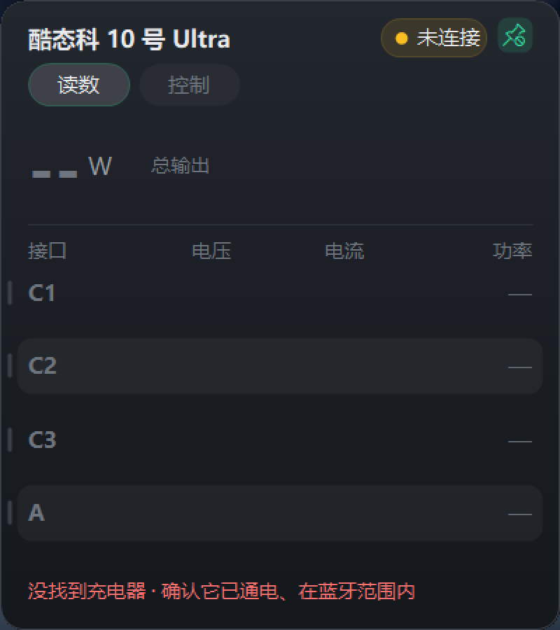
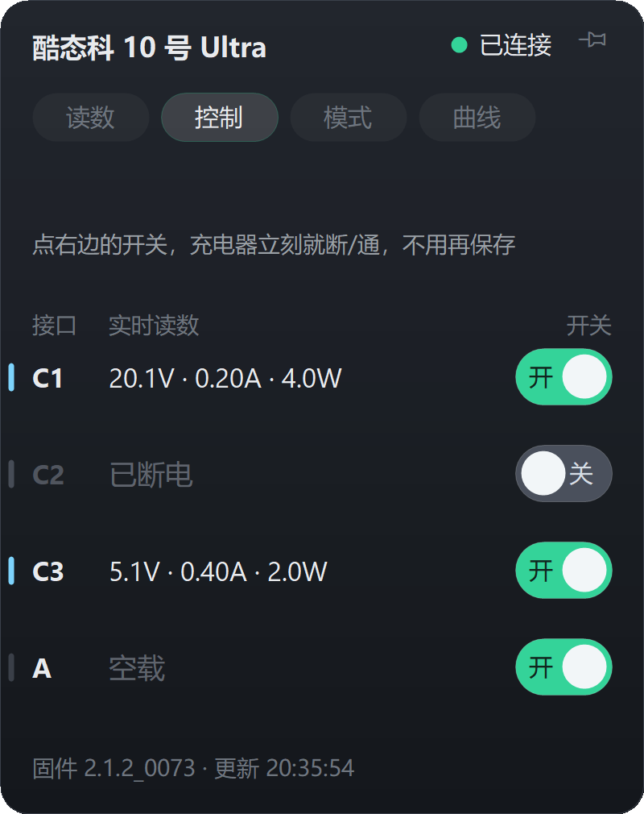
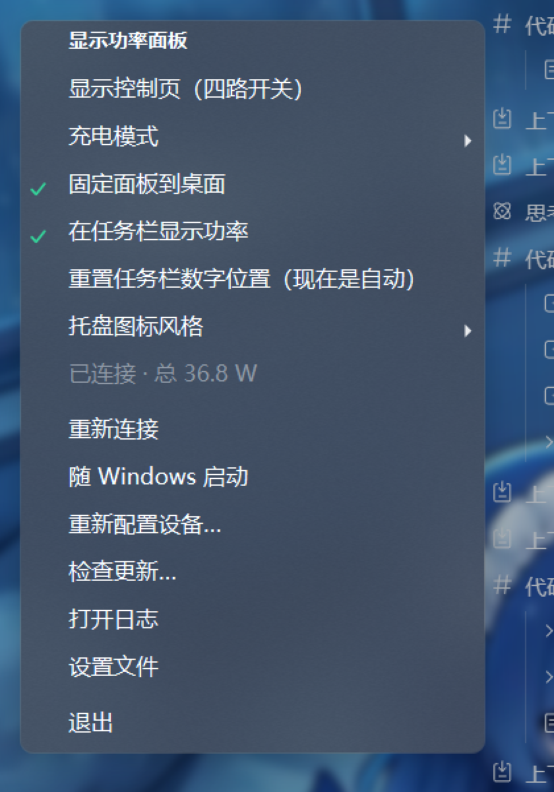
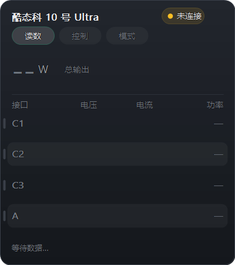

# 开发日志

> 这份日志按时间顺序记：一天里怎么从「手上有个带蓝牙的充电器」做到「托盘上有个能看的功率表」，中间卡在哪、错在哪、怎么绕出来的。
> 代码全部由 AI 编写（DeepSeek Harness + deepseek-v4.1-flash），人负责提需求、插充电器、手机扫码、验收。所以这里也记了 AI 自己踩的坑——包括两个「其实不是 bug，是我们测量工具错了」的乌龙。

---

## 一、起点

需求只有一句话：**桌面上放个小东西，点一下就能看这个充电器现在输出多少瓦。**

手上的设备是酷态科 10 号 Ultra（CUKTECH 10 GaN Charger Ultra），120W，四个口（C1 / C2 / C3 / A），正面一块小屏自己会显示功率，能连米家 App。也就是说：**官方能看到的数，我们得自己想办法拿到。**

一开始定的三条硬要求，后来一直没变：

1. **常驻托盘，点开就有**——不能是那种要开个窗口、扫一遍设备、等十秒的程序；
2. **占用要小**——挂在后台一整天，不能吃掉几百兆内存；
3. **不依赖米家 App 和云端**——App 关掉、断网也得能读。

第三条决定了整个技术路线：不去碰米家的云接口，直接走**蓝牙 BLE**，自己实现小米那套加密认证，跟 App 用一样的路径读设备属性。

---

## 二、先看别人怎么做的

动手前先翻了一遍公开资料，这一步省了很多时间：

* **小米 MIoT 的 BLE 协议**是公开可查的：设备广播里带 product id，连上以后按 UUID 找服务与特征值，认证走一套 `token + 随机数 + HMAC` 的握手（App 里叫 `RCV_RDY` / `SEND_RDY` 那几步），认证通过后才能读写属性。
* **要拿到 token，就得有一次米家账号登录**——token 是「账号 + 设备」绑定的凭据，不是设备自己广播出来的。所以程序必须支持**首次运行扫码登录**，把 token 存到本地，之后就不再需要账号。
* **已经有人做过类似的东西**（各种米家 BLE 温湿度计、插座的小工具），属性读写那层的思路可以照着推。

确认了这条路能走通，才开始写代码。

---

## 三、第一阶段：先让它连上（0.1.0 之前）

第一版根本不是一个托盘程序，是三个一次性的探针工程，跑完就扔：

* `src/CuktechLogin`——扫码登录米家账号、拉设备列表、把目标设备的 token 取出来存本地；
* `src/probe-cs`——直接用 .NET 的 Windows Runtime BLE API（`Windows.Devices.Bluetooth`）连设备、枚举服务、跑认证、读属性；
* `src/probe-rs`——顺手用 Rust 写了一个对照实现，验证同一套协议在另一套 BLE 栈上是否一致（后来没继续，留在仓库里当参考）。

这一段的进度基本是这样的：

1. 能扫到设备、能连上，但一读特征值就 `AccessDenied`；
2. 补上认证握手，卡在「发完随机数等不到 `RCV_RDY`」；
3. 把包格式、字段顺序、加密方式一个个对，第一次看到 `认证完成`；
4. 读第一个属性，拿到的数字跟充电器屏幕上的功率对上了——**那一刻这事就算成了**。

第一版读取的实测日志（后面每次回归都拿它对）：

```
[ok] 认证完成 3762ms 固件=2.1.2_0073
[cfg] port_switch=0x0f
C1 20.1V/0.20A/4.0W  total=4.0W
```

`port_switch=0x0f` 是四个口的开关位图，`0x0f` 表示四个口都在通电；固件 `2.1.2_0073` 后来一直没变，也就成了「协议没变」的标志。

**这一步最大的收获不是代码，是搞清楚了「什么情况下读不到」**：BLE 认证对时序很敏感。连续快速重启程序（上一次连接还没彻底释放就再连），会稳定复现两种失败：

```
[fail#2] InvalidOperationException: 枚举特征失败: AccessDenied
[fail#3] MibleAuthException: 未收到 RCV_RDY（发送随机密钥前）
```

结论：**杀掉进程后等 25 秒以上再启动，启动后给它 45 秒**，就稳。这条后来写进了调试笔记，也是「为什么点开面板有时先显示未连接、过几秒才跳成已连接」的原因。

---

## 四、第二阶段：托盘程序与功率面板（0.1.0 → 0.2.0）

有了能读数的内核，外面套壳就快了。0.1.0 的形态：

* 一个托盘图标，图标本身就是**总功率数字**，颜色随功率变化（低功率绿、中段黄、高功率红），不用点开就能瞄一眼；
* 左键点图标弹功率面板：四行，每行一个口（C1 / C2 / C3 / A），显示电压 / 电流 / 功率，底部一行总输出 + 固件版本 + 最后更新时间；
* 右键菜单：打开控制页、开关任务栏数字、开机自启、查看日志、退出。

面板的难点全在「小」：320×328 的逻辑尺寸里要塞四行数据加页脚，字号只能很小。后来 0.2.3 专门为这个做了一轮排版：

* 单位 `W` 和数字**中心对齐**（原来是基线对齐，看着像掉下去一格）；
* 四行加**隔行底纹**，行首加**功率色条**（色条颜色规则和数字一致，红/黄/绿一看就知道哪个口在吃电）；
* 右上角连接状态改成**半透明胶囊**（状态色圆点 + 文字），比原来一行灰字清楚；
* 底部留白从 6 px 加到 14 px，气口松一点。

0.2.0 是把版本号理顺的一版：之前所有 exe 的版本号都写死 `0.1.0`，导致装完新包在「设置-应用」里还是显示 0.1.0，**根本无法分辨新旧**。这一版把 `<Version>` 从 csproj 一路传到安装程序的内嵌载荷信息里。

---

## 五、任务栏上的那串数字（0.2.1 → 0.2.2）

这是整件事里最难的一段，也是坑最多的一段。

需求很朴素：**任务栏上直接显示功率数字，不要图标，不要背景块，位置在开始菜单旁边。**

做法是「在任务栏里塞一个自己的子窗口」：

1. 找到任务栏窗口 `Shell_TrayWnd`；
2. 建一个无边框窗口，`SetParent` 到任务栏，样式加 `WS_CHILD`；
3. 子窗口禁止激活（`ShowWithoutActivation` + `WS_EX_NOACTIVATE`），否则点它会抢焦点、开始菜单会闪；
4. 定时（500 ms）用 `MoveWindow` 重新贴位，防止任务栏自己重排把我们的窗口挤走；
5. 背景色实时采样**旁边任务栏的像素**取中位数，这样跟着主题（浅色/深色/强调色）走，看着像本来就长在那儿。

### 坑一：重影（数字叠成两层）

最初的实现是用「色键」：窗口填一个不会用到的纯色，再让这个颜色透明。结果数字边缘一直有一层灰影——因为色键做不到逐像素 alpha，抗锯齿的边缘像素要么半透明不了，要么留下脏边。

**改法**：整个窗口用 `UpdateLayeredWindow` 逐像素画（ULW），每个像素自己带 alpha。只有笔画是实心的，其余完全透明。这样任务栏底色直接透出来，边缘也干净。改完重影一次消失。

### 坑二：位置——不要贴在托盘图标旁边

第一版把数字贴在**托盘图标区左侧**（用 `TrayNotifyWnd` 的左边界当锚点），结果正好压在四个应用图标上面。用户的意见很直接：**「我要放到最左边的开始菜单旁边。」**

改成以**开始按钮**（`Start`）的矩形为锚点：`x = Start.Left - gap - 宽度`。本机（125% 缩放）实测开始按钮在 `583..628`，数字落在 `478` 起，正好在左侧空白区、紧挨开始菜单，不压任何图标。

### 坑三：用户想自己挪位置

既然是贴在任务栏里的子窗口，拖动就得自己做：按住那串数字左右拖，松手把位置换算成 dip 存进 `settings.json` 的 `TaskbarLeftDip`（负数 = 自动跟随开始菜单）。右键菜单里配一个「重置任务栏数字位置」，把 `TaskbarLeftDip` 改回 `-1`。

### 坑四：`SetParent` 报错误 5（这个坑最冤）

在我们的开发环境里，程序只要是从**这个会话**里启动的，日志永远是：

```
[taskbar] setparent tray=0x50134 before=0x1000C ret=0x0 err=5 after=0x1000C
[taskbar] 挂不上任务栏：系统拒绝了 SetParent（错误 5 / 拒绝访问）
```

但同一个会话里用 PowerShell 写个原型，`SetParent` 一次就成功。查了很久，最后写了个专门的探针（`tools/dockprobe`）把窗口完整性级别打出来才明白：

* 从会话里启动的 exe 是 **Low IL（0x1000）**；
* `powershell.exe` 是 **Medium IL（0x2000）**；
* Low → Medium 的 `SetParent` 被 UIPI 拒绝，就是**错误 5**。

而用户**双击**启动时是 Medium IL，所以「他那边是好的，我这边永远失败」。这不是代码问题，是开发环境的进程降权。顺手把能想到的绕路都试了：`Start-Process explorer.exe`、`Shell.Application.ShellExecute`、`schtasks /RL LIMITED`——要么进程根本没起来（`Last Result: -2147024703`），要么日志一片空白。最后放弃在这个环境里验证挂任务栏，改成一个 PowerShell 原型 + 真屏截图来验证视觉效果（`docs/taskbar-ulw.png` 就是这么拍的：`tray=0x50134 tbH=60 scale=1.25 w=105 x=641 parent=0x50134 painted=True`）。

### 坑五：「控制页右侧开关被裁掉了」——假 bug

有段时间我们坚信控制页有渲染 bug：抓下来的截图里，右侧的端口开关全都贴着右边被切掉一半。

于是连着写了三个「修复」：

1. 在 `OnHandleCreated` 里再调一次缩放；
2. 引入 `GetDpiForWindow`，用它替代 `DeviceDpi`；
3. 判断 DPI 感知级别，unaware 就按 96 算。

三个都没用——因为**窗口尺寸本来就是对的**。真相是：用 `PrintWindow` 抓图时，抓图进程被 DPI 虚拟化，它以为窗口是 372×458（逻辑尺寸），实际物理尺寸是 465×572（×1.25），于是只画了左边 80%。改成**按物理坐标直接抓真屏**（`tools/shot-screen.ps1`）之后，开关完整地在里面。

三个补丁全部回退。留一句话在这里：**测量工具不可信的时候，先怀疑测量工具。**

（同一个假象还骗过我们两次：面板右侧的图钉按钮「被切」、任务栏数字「只画了半个 W」，都是同一个原因。）

---

## 六、控制页（0.2.2）

功率面板只读不写。控制页能真的动设备：

* 四张端口卡片（C1 / C2 / C3 / A），每张显示电压 / 电流 / 功率 / 状态，右下角一个开关；
* 状态用**颜色圆点**表示（输出中 / 空载 / 关闭），每张卡片左侧有**状态色条**，鼠标移到开关上边框提亮；
* 副标题前加连接状态圆点 + 固件版本 + 总输出；
* 关掉端口就是真的断输出（写 `port_switch` 位图）。

控制页的尺寸问题一直跟着那个假 bug 走了一段弯路，等发现是抓图工具的问题，代码里其实一行都不用改。

---

## 七、安装包（0.2.0 → 0.2.3）

绿色版是个 69 MB 的单文件 exe（自包含 .NET，目标机器不用装运行时）。安装包要在这之上再套一层：向导、快捷方式、卸载项。

最后做出来的是**自解压 + 内嵌压缩载荷**：

* 主程序 72,706,054 字节，装进载荷里压缩到 66,855,854 字节（约 92%）；
* 安装包本体 132,803,825 字节（约 127 MB）；
* 装到 `%LOCALAPPDATA%\Programs\CuktechTray`，**不弹 UAC**；
* 装完写 `HKCU\Software\Microsoft\Windows\CurrentVersion\Uninstall\CuktechTray`，于是「设置-应用」里能看到、能卸载；
* 桌面与开始菜单快捷方式、开机自启（写 `HKCU\...\Run`，值名 `CuktechTray`）。

**已经装过旧版怎么办**：安装程序启动时先读卸载项里的 `DisplayVersion` 和 `InstallLocation`，如果发现已安装，就把「安装」文案整段换成「升级」：

> 升级 酷态科托盘功率表
> 已安装 0.1.0.0，这次升级到 0.2.0.0，装回原目录
> 安装位置不变：… / 配置 settings.json 和 logs 日志都保留 / 桌面与开始菜单快捷方式、开机自启按现状保留 / 设置-应用 里卸载项版本号更新成 0.2.0.0
> 旧版本正在运行会先关掉

这一段当时是真的跑起来截图核对的（窗口标题「酷态科 10 号 Ultra 托盘功率表 升级程序」，542×415）。

**两个 exe 都没有代码签名**，所以第一次运行时 Windows 会弹「已保护你的电脑」蓝框，点「更多信息 → 仍要运行」。这一点在 README 里单独写了一段，因为真的会吓到人。

---

## 八、一次真实的翻车：版本号没更新

用户问过一句：「我在电脑上的更新安装包为什么和你这里的不一样？」

查下去发现是个很朴素的错误：**改完代码忘了重新打包**。`dist` 里躺的还是几轮之前的产物，而且旧版所有 exe 的版本号都写死 `0.1.0`，用户**没有任何办法分辨自己手上是不是新的**。

修法有两层：

1. 版本号进 csproj，一路传到「设置-应用」的显示名、安装程序标题、内嵌载荷信息；
2. 每次发布**必须核对四个数**：主程序字节数与 SHA256、安装包字节数与 SHA256，并把它们写进汇报里。

这条现在写进了 `AGENTS.md`（给未来接手这个仓库的 AI 看的硬约束）。

---

## 九、发布到 GitHub

最后一步是把源码整理成能给别人看的样子。格式照着同一账号下 `DroidExtend` 那个仓库来：banner 图、居中语言切换、徽章、AI 声明块、特性表、下载块、中文序号章节，外加 `README.en.md` / `CHANGELOG.en.md` / `NOTICE` / `第三方组件许可.txt` / `AGENTS.md` / `.editorconfig`。

上传前做了一遍**凭据脱敏**：仓库里所有出现过的设备 MAC（`3C:CD:73:…`）和 16 字节 token（`64695315…`）全部换成占位值 `AA:BB:CC:DD:EE:FF` / `00112233445566778899aabb`，一共改了 11 个文件；`settings.json`、`logs/`、`dist/`、`research/` 本来就在 `.gitignore` 里。

推送走的是 GitHub 的 Git Data API（先 POST blobs，再建 tree、commit、ref），127 个文件一次提交。这里也踩了一个坑：**空仓库直接 POST blobs 会返回 `409 Git Repository is empty`**，得先用 Contents API 提交一个文件把仓库「点着」，再往里灌。

---

## 十、0.3.0：把「看」和「改」合到一个窗口

上一版里「看功率」是面板，「断 / 通四个口」是另一个控制页窗口。用户的意思很直接：**点开就是要看功率，顺手能开能关，两个窗口来回切反而麻烦。**

于是这一版把两个窗口并成一个：宽度 320 px 不变，只在标题下面多一条 24 px 的页签（**读数 / 控制**），面板高度 328 → 360 px，读数页所有坐标整体下移 32 px，行高、字号、色条、隔行底纹一个都没动。好处是切页不换窗口、不换位置、也不重新认证。



### 开关根本画不出来

真正花时间的不是合并，是控制页上的那个开关。

第一版代码看着完全正常：画圆角矩形，半径传 `高度 / 2`（34 / 2 = 17），正好是个胶囊。跑起来却什么都不显示——像素扫描那块区域，只有背景色，**一个白色滑块都没有**。

原因是 GDI+ 的 `AddArc` 在椭圆的宽高比正好是 1:2 时会退化：半径等于高度一半、圆弧端点重合，整条路径算出来是空的，`FillPath` 就画了个寂寞。改成先算 `Math.Min(宽, 高) / 2`，再给滑块直径加兜底（`d < 6` 时退回 `高度 - 2`），开关立刻正常显示。

### 顺带揪出一个 8 px 的错位

开关矩形原来的 y 是「行顶 + 7 px」，而左边那行字是 22 px 高、垂直居中，中心落在行顶 + 11 px；开关高 28 px，中心也应该在行顶 + 11 px，也就是矩形 y = 行顶 − 3 px。差这 8 px 肉眼一看就觉得「哪里不对」，但很难说清——量一下才对上。

### 没连上的时候，开关压暗

轨道变暗绿、滑块变灰：状态看得见，但点不动。因为这台设备的每个开关都是**写完回读确认**的，读不到设备就不该往设备里乱写。页签顶部加了一行说明「点右边的开关，充电器立刻就断/通，不用再保存」——上一版控制页是要点「应用」才生效的，这一版点完就发。



还有个小坑值得记：这两张截图是用**真屏 BitBlt** 抓的，不是 `PrintWindow`。用 `PrintWindow` 抓面板时，进程的 DPI 会被虚拟化，抓出来总是左边 80% 的内容、右边被裁掉一截——这个「假 bug」在上一版已经骗过一次，这次直接绕开。

---

## 十一、0.3.1：明明在旁边，就是连不上

0.3.0 发出去当天，反馈是「这一版根本连不上充电器」。这句话挺吓人——那一版我只动了界面，连接层一行没碰。先去翻日志。

用户实际跑的不是我给的 dist，是自己拷到 `D:\KTK\` 的那份。日志 1095 行，从头到尾只有一种错误：

```text
[fail#1] InvalidOperationException: BluetoothLEDevice.FromBluetoothAddressAsync 返回 null
…
[fail#8683] InvalidOperationException: BluetoothLEDevice.FromBluetoothAddressAsync 返回 null
```

每 8 秒一条，从凌晨 00:53 一直刷到 22:37，**22 个小时、8683 次**，一次都没成功。

### 先证明设备就在旁边

不猜，写了个 15 秒的探针（`tools/blescan`）：广告扫描器打一遍所有设备，再对目标地址单独取一次设备对象和 GATT 服务。结果：

```text
3CCD732761A0  rssi=-58  name='njcuk.fitting.ad1204'   <== 我们的充电器
FromBluetoothAddressAsync(target) = 'njcuk.fitting.ad1204'  status=Disconnected
gatt status=Success  services=3
```

充电器就在旁边（-58 dBm）、在广播、能连，GATT 能列出三个服务。所以「返回 null」跟远近没有关系。

### 真正的原因：Windows 的 BLE 设备缓存是空的

`FromBluetoothAddressAsync` 取的是**系统缓存里**的设备对象。缓存什么时候会空？重启蓝牙服务、换适配器、隔一天、设备断电放一段时间——都算。缓存空的时候它返回 null，而且这个 API 自己不会去扫。

最直接的证据是时间线：我 22:41 扫了一次把设备塞进缓存，**22:42 程序自己就认证上了**（`[ok] 认证完成 4335ms 固件=2.1.2_0073`）。这中间我没改一行代码。

### 修法

`WinRtMibleLink.ConnectAsync` 改成：第一次取不到设备，就先开一轮主动广播扫描（`BluetoothLEAdvertisementWatcher`，最多 8 秒）等设备自己冒出来，扫到之后再取一次，最多重试 5 次。扫不到才放弃，报错也换成说人话的：

> 扫不到这台设备：确认充电器已通电、在蓝牙范围内，手机上也没占着它的连接

原来那句只有 API 名字，用户读不出该干什么，我也读不出。

### 顺手加的检查更新

右键菜单多一项「检查更新…」，问一次 GitHub Releases，有新版就问要不要打开下载页。两个坑：

* **.NET 8 的 HttpClient 不读系统代理**。本机开着 Clash（`127.0.0.1:7897`），浏览器一切正常，程序里直连 api.github.com 就是拿不到。于是自己从注册表读 `HKCU\Software\Microsoft\Windows\CurrentVersion\Internet Settings` 的 `ProxyEnable` / `ProxyServer`，先走代理试一次、失败再直连。
* 第一版把 API 地址写成了**网页地址**（`github.com/…/releases/latest`），拿回来的是 `<!DOCTYPE html>`，JSON 解析报 `'<' is an invalid start of a value`。正确地址是 `api.github.com/repos/<owner>/<repo>/releases/latest`——域名和路径都跟网页不一样，别顺手拼。

命令行也能查：`CuktechTray.exe --check-update`，会打印当前版本、最新版本，以及走的是代理还是直连。

---

## 十二、0.3.2：把米家那个「充电模式」搬进来


米家 App 里有四档充电模式，用户问能不能也搬进来。协议文档里其实早有这一行（`docs/control-protocol.md:20`）：
场景模式 SIID 2 / PIID 5，1 = AI、2 = 数码生态、3 = 单口、4 = 均衡，下发和回读都打了勾——
但之前只验过 2↔3 往返，另外两档一直是「文档里有、没亲测」。

这次把四档全验了一遍，用的还是上一版写的 `probe-cs ctl`：

```
get:5 set:5:0x01 sleep:1500 get:5 set:5:0x03 … set:5:0x04 … set:5:0x02 … get:5
```

原值停在 **3（单口）**，写 1 读 1、写 3 读 3、写 4 读 4、写 2 读 2，四档全部往返一致。
验完得自己写回原值——我第一次写回了 2，和原值 3 不一样，又补了一条 `set:5:0x03` 才算没留手尾。

### 一个读数的坑

GET 场景模式的回包只有 1 个字节：`op=0x03 type=16 raw=03 u32=3`。之前写四路开关时用的是
`MiotMessage.UIntValue`，它只在 ≥4 字节时才填值，1 字节的回包读出来是 0。照抄那套写法的话，
界面会一直显示「不知道当前是哪档」，而设备其实老老实实回了 3。改成读 `ValueBytes[0]` 才对。

### 界面上

面板从两个页签变成三个：读数 / 控制 / **模式**。四张卡片竖着排，当前那档有绿边、左侧绿条和「当前」小标签。
点一张卡片就下发，写完后 GET 回读，页脚写「已切到「X」（设备回读 N）」；回读和请求不一致就报错。
切到这一页时会先读一次真实值，不拿缓存糊弄。托盘右键菜单里也放了一份子菜单，勾选跟着设备走，没连上时整项灰掉。

截图这一页的时候顺手做了一次端到端验证：点「均衡」→ 卡片跳到均衡、页脚写「设备回读 4」→ 再点回「单口」，
回读 3。这比只看日志放心，说明 UI 真的把命令送到了设备上。

## 十三、0.3.3：把右键菜单做成 Win11 那样



> 这张是 0.3.3 的 `ContextMenuStrip` 版本，留作历史记录。0.4.0 起菜单换成裸 Win32 自绘（`MenuWindow.cs`），
> 现在的样子见 `docs/shot-menu-aot.png`，README「托盘菜单」那一节用的就是新图。

用户提了三条：充电协议能不能改、右键菜单能不能做成 Win11 风格（像 TranslucentTB）、
「随 Windows 启动」这类选项看不出现在是开还是关。第一条他说先不做，后两条这次做了。

### 圆角 + 亚克力是怎么加上去的

WinForms 的 `ContextMenuStrip` 其实就是一个 `ToolStripDropDown` 窗口，拿到它的 `Handle` 之后能当普通窗口使：

```
DwmSetWindowAttribute(hwnd, 33 /*CORNER_PREFERENCE*/, ref 2 /*ROUND*/, 4)
DwmSetWindowAttribute(hwnd, 38 /*SYSTEMBACKDROP_TYPE*/, ref 3 /*TRANSIENTWINDOW*/, 4)
SetWindowCompositionAttribute(hwnd, AccentPolicy{ AccentState = 4 /*ACRYLIC*/,
    GradientColor = 0xF229221E })          // 0xAABBGGRR：菜单底色 (30,34,41) + F2 alpha
```

圆角一次就成了。真模糊（`DWMSBT_TRANSIENTWINDOW`）在 Win11 24H2 上对弹出窗口不生效——
DWM 的 backdrop 只给普通窗口，popup 拿不到，所以最后落到亚克力：**透，但不是毛玻璃**。
视觉上已经和 TranslucentTB 那种菜单很接近，够用。

一件事得注意：亚克力生效之后，渲染器如果还老老实实铺一层不透明底色，半透明就白做了。
所以 `MenuEffect` 里留了个 `HashSet<IntPtr>`，注册成功的窗口记进去，`OnRenderToolStripBackground`
先问一句 `IsBlurred`，透的就不铺底。

### 勾为什么一开始不显示

第一版的勾写在 `OnRenderMenuItemBackground` 里——理论上是「每个条目重绘自己背景」的地方，很合理，
但**这条路径在菜单项没被鼠标划过时根本走不到**。所以截图里永远是空的，怎么调坐标都没用。

改成在 `OnRenderToolStripBackground`（铺整块背景的那层）里遍历 `e.ToolStrip.Items` 逐个画，一次就对了；
鼠标划过时 `OnRenderMenuItemBackground` 会盖一层 hover 底，所以那里再补画一次。

还有两个小坑：

- `ShowImageMargin = false`（菜单没图标，左边那条图标的留白不要）会**连带把 ToolStrip 自带的 check margin 也关掉**，
  所以勾只能自己画，还得自己在 `Padding` 里留出左边 24 px
- `UiTheme.Skin(menu)` 原来紧跟在 `new ContextMenuStrip()` 后面调用，那时条目还没加进去，
  遍历到的是空列表，间距一个都没改。挪到所有 `Items.Add` 之后再调才有用

### 现在的样子

条目上下 5 px、左侧 24 px，标题加粗，底下一行实时状态「已连接 · 总 36.8 W」；
`固定面板到桌面` 和 `在任务栏显示功率` 开着，左边各一个绿勾。
为了截图方便还加了个隐藏参数 `--menu-demo`（启动 1.2 秒后把菜单弹在固定位置），
不然没法在没人点鼠标的情况下拍菜单。

## 十四、0.4.0：用 NativeAOT 把 72 MB 砍到 9.2 MB



0.3.3 的绿色版是 72,715,094 字节（69.3 MiB）。这个数字一直被当成「自包含」的代价，其实不是——
它的大头是把整套 .NET 运行时、JIT 编译器和 BCL 打包塞进了一个 exe，用户机器上并不需要这些。
真正的目标机体积应该跟程序本身的工作量相称：一个读四个功率数字的托盘程序，几 MB 就够了。

0.4.0 换成 NativeAOT：同一份业务代码，AOT 提前编译成 win-x64 原生代码，产物
**9,633,792 字节（9.19 MB）**，是原来的 **1/7.55**，目标机依然不用装 .NET。

这个数字是一路涨上来的，记账记清楚：裸外壳 9,344,000 → 加进安装/卸载 9,574,912（+230,912）
→ 再加进自动更新 9,620,992（+42,496）。后两项加起来 273,408 字节，换来的是「一个 exe
兼做绿色版、安装包和自己给自己升级」，比单独带个 127 MB 的安装程序划算得不是一点。

### 怎么拆的

业务代码一行没重写，直接共享源码。新建的 `src/CuktechTrayAot/CuktechTrayAot.csproj` 用
`<Compile Include="..\CuktechTray\XXX.cs" Link="Shared\XXX.cs" />` 把这几份引进来：

`Models.cs`、`Settings.cs`、`DeviceClient.cs`、`SelfTest.cs`、`UpdateCheck.cs`、`WattStyle.cs`、`LogSink.cs`，
外加整个 `src/CuktechMible/` 和 `src/probe-cs/WinRtMibleLink.cs`。认证、TLV 编解码、WinRT BLE、
设置迁移、检查更新、自测流程，两边是同一份文件，改一处两边一起变。

要重写的只有「壳」。WinForms 那一套（`Form`、`ContextMenuStrip`、`NotifyIcon`、`ToolStripRenderer`）
在 AOT 下既要吃反射又要吃 WinForms 运行时，所以界面改成纯 Win32 + GDI+ 自绘，
一共 13 个文件 4,967 行：

| 文件 | 干什么 |
| --- | --- |
| `Native.cs`（562 行） | 所有 P/Invoke 集中在这里，别处只调方法 |
| `WinBase.cs`（376 行） | 极简窗口基类：`RegisterClassExW` + 消息循环 + GDI+ 双缓冲 |
| `TrayApp.cs`（815 行） | 程序主体：托盘生命周期、连接状态、右键菜单动作、开机自启、检查更新的三条岔路 |
| `PanelWindow.cs`（840 行） | 三页面板（读数 / 控制 / 模式），排版照抄 `UiTheme` 的间距和颜色 |
| `TaskbarWindow.cs`（412 行） | 任务栏那一小块，`UpdateLayeredWindow` 逐像素 alpha |
| `MenuWindow.cs`（388 行） | 圆角深色菜单，条目带绿勾，替代 `ContextMenuStrip` |
| `Installer.cs`（658 行） | 安装 / 卸载 / 快捷方式 / 注册表（0.4.0 收尾时加进来的，见下面「安装包瘦身」） |
| `Updater.cs`（382 行） | 自动更新：下载 + SHA256 校验、替换助手、清理残留（见下面「一键更新」） |
| `WattIcon.cs`（107 行）、`TrayIcon.cs`（77 行）、`UiDispatcher.cs`（43 行）、`GdiText.cs`（119 行）、`Program.cs`（188 行） | 托盘图标逐像素生成、`Shell_NotifyIcon` 封装、UI 线程调度（`SynchronizationContext`）、文字测量、命令行入口；`TaskbarPaint` 静态类放在 `TaskbarWindow.cs` 末尾 |

因为不再有 WinForms，面板的每个圆角、每条 1 px 线、每个绿点都得自己画——好处是彻底摆脱了
「WinForms 在某台机器上按 96 DPI 缩放画歪」这类老问题，坏处是排版调起来慢（所以补了
`--render`，见下）。

### 链接器：ILC 找不到 MSVC 的那半天

`PublishAot=true` 之后第一次 `dotnet publish` 直接死在：

```
error : Platform linker not found. Ensure you have the platform linker installed.
```

ILC 会自己去找 `vcvarsall.bat` 来定位 `link.exe`，本机没装 Visual Studio，所以永远找不到。
解法是把链接器换成 LLVM 的 `lld-link`，MSVC 的库从 xwin 里拿，都在工作区 `.tools` 里：

```powershell
$env:LIB = ".tools\xwin\crt\lib\x86_64;.tools\xwin\sdk\lib\ucrt\x86_64;.tools\xwin\sdk\lib\um\x86_64"
dotnet publish src\CuktechTrayAot\CuktechTrayAot.csproj -c Release -r win-x64 -o out \
  -p:IlcUseEnvironmentalTools=true \
  -p:CppLinker=.tools\lld\lld-link.exe \
  -p:CppLibCreator=.tools\lld\llvm-lib.exe
```

这套参数已经封装进 `build.ps1 -Aot`（会自动探测 `.tools\lld` 和三个库目录，缺哪个报哪个），
不用手敲。链接期会刷 `LNK4099`（`libvcruntime.lib`、`LIBCMT.lib` 引用了 `D:\a\_work\1\s\...` 下的 pdb，
那是微软自己打库时的路径），纯噪声。还原时还有 `NU1903`：`Microsoft.DotNet.ILCompiler` 8.0.32
被标了高危漏洞 `GHSA-p3jp-9v83-76w9`，等 .NET 8 后续 SDK 带新版再跟。

体积上还顺手压了几个开关，都在 csproj 里：

```xml
<OptimizationPreference>Size</OptimizationPreference>
<IlcGenerateStackTraceData>false</IlcGenerateStackTraceData>
<StripSymbols>true</StripSymbols>
<InvariantGlobalization>true</InvariantGlobalization>
```

（`NativeDebugSymbols=false` / `DebugType=None` 试过，exe 一个字节都没变，pdb 也照旧 53 MB——
pdb 不进发布包，不用管。）

### 功能对得上吗

对得上。`--selftest` 跑真机，退出码 0，8 秒走完，日志和 WinForms 版逐行对得上：

```
[start] v0.4.0.0 aot
[selftest] start mac=3C:CD:73:27:61:A0 tokenLen=24
[link] ConnectionStatus -> Connected
[ok] 认证完成 3706ms 固件=2.1.2_0073
[cfg] port_switch=0x0f
[cfg] scene_mode=3
[selftest] ok
```

四口读数也一致：C1 20.1 V `state=0x01`、C2/C3 idle、A 5.1 V `state=0x01`、total 0.0 W
（当时没插负载）。窗口也都在：`CuktechAot.panel.2`（400x450，`WS_POPUP|WS_EX_TOOLWINDOW`，可见、
非 layered、没被 DWM cloaked）、`CuktechAot.taskbar.3`、`CuktechAot.shell.1`。

任务栏那块依旧是老样子：`[taskbar] setparent ... ok=False`，低完整性进程被系统拒绝，
跟 0.3.3 的结论一模一样（见 `docs/taskbar-component.md`），不是这次改造引入的问题。

### 截图：桌面拍不到，就让程序自己画

这次改造中途踩到一个没预料到的坑：验证界面的时候机器是**锁屏**状态。
锁屏时任何程序窗口都不在可见桌面上，真屏 BitBlt 和远程截图抓到的都是那张壁纸——
看起来像「窗口没出来」，其实窗口好好的，只是没地方显示。

于是加了个隐藏参数 `--render <目录>`：不建任何窗口，直接把三个页面用同一套绘制代码
画进 GDI+ 位图，存成 400x450 的 PNG。它的好处不只是绕过锁屏——它还是唯一能**稳定回归排版**的手段，
不用担心 DPI 虚拟化、窗口动画、失焦自动收起这些老问题（0.3.3 那会儿为了拍一张面板图，
在 PrintWindow 和 BitBlt 之间来回折腾过好几轮）。三张图分别在
`docs/aot-panel-read.png`、`docs/aot-panel-control.png`、`docs/aot-panel-mode.png`。

### 另一个坑：.ps1 文件不能存成「UTF-8 无 BOM」

改 `build.ps1` 时用编辑器存了一次无 BOM 的 UTF-8，结果 `powershell.exe` 按 ANSI 解码，
中文注释和字符串全成了乱码，还因为某个汉字的高位字节把后面的引号吃掉，
报了个莫名其妙的「字符串缺少终止符」。结论：这个仓库里的 `.ps1` 一律存成 **UTF-8 带 BOM**
（原来的 `build-setup.ps1` 本来就是带 BOM 的，是我重写时丢了）。这条也写进了 AGENTS.md。

### 现在的构建命令

```powershell
.\build.ps1              # WinForms 版（0.3.3），留着做对照
.\build.ps1 -Aot         # NativeAOT 版 -> src\CuktechTrayAot\out\CuktechTray.exe（9.13 MB）
.\build.ps1 -Aot -Publish # 再拷成 dist\CuktechTray.exe（发布前先问）
.\run.ps1 -Aot -Panel    # 启动 AOT 版并直接弹面板
```

### 界面收尾：托盘图标瘦身，顺手揪出一枚隐形按钮

功率读数搬到任务栏那一小块之后，托盘图标就不用再兼职当表盘了——一天里大部分时间它都在
溢出区躺着，画数字既没人看，还要每帧按功率重画一遍。所以：

- `WattIcon.cs` 从 247 行缩到 107 行：删掉五种风格和 3×5 点阵数字，只留「圆角渐变底 + 白闪电」，
  颜色只区分已连接（绿）和未连接（灰）
- 右键菜单里的「托盘图标风格」子菜单、`ChangeIconStyle()`、`TrayApp` 里的 `_iconStyle` 一起删掉；
  `Settings.IconStyle` 这个字段保留但不再读也不再写，老 `settings.json` 里那行不影响启动
- 悬停提示还是照旧带「总 X W」和四口明细，想看精确数字把鼠标停一下就有了

排版上也逐个对过 0.3.3 的老截图（`docs/shot-panel.png` 那几张），改了几处：

- **图钉按钮是个隐形按钮**：字体名写成了 `Microsoft MDL2 Assets`（少了 `Segoe`），
  GDI 找不到就静默回退到没有 PUA 字形的字体，右上角那块点得到、看不见。
  改成 `Segoe MDL2 Assets` 之后图钉才出来。
- 图钉按钮常显一层淡底（以前只有固定/hover 才有底色，不知道的人根本不会去点），
  高度和「已连接」胶囊对齐到同一中心线
- 「当前」胶囊的底色从 alpha 36 提到 60，深色底上看着更实
- 三页顶部的说明文字统一到 y=88，页与页之间不再一高一低
- 面板支持 `1` / `2` / `3` 直达读数 / 控制 / 模式三页（原来只有 `Tab` 循环、`Esc` 收起）

排版验证补了 `--render-demo`：`--render` 那套本来只会画「未连接」的样子，现在加一个假快照
（已连接、固件 2.1.2_0073、C1 20.1 V / 2.55 A / 51.3 W、A 口 4.1 W），没设备也能看「能操作时」
的配色和开关状态，产物写到 `docs/tmp-demo-{read,control,mode}.png`。

### 安装包瘦身：让主程序自己当安装程序

体积账先摆清楚：`dist\CuktechTray-Setup.exe` 是 132,813,041 字节，拆开是两块——
安装器宿主 62.9 MB（自己也是个 WinForms 自包含单文件）+ 内嵌载荷 63.8 MB
（72,715,094 字节的 WinForms 主程序被 Deflate 压到 66,864,992）。
主程序换成 AOT 之后（9,344,000 字节 → 压缩后 4,303,624），只换载荷能把安装包压到约 67 MB，
但宿主那 62.9 MB 一动不动。而 WinForms 宿主既不能 NativeAOT（自绘窗口没人给重写），
也不能裁剪（`-p:PublishTrimmed=true` 实测直接报 `error NETSDK1175: 启用剪裁时，不支持或不推荐使用 Windows 窗体`）。

于是换个思路：**安装程序不要了，让主程序自己装自己**。既然要装的本来就是它
（`Environment.ProcessPath`），那就复制一份到 `%LOCALAPPDATA%\Programs\CuktechTray`，
再把「开始菜单快捷方式 + 卸载项」这两件事自己做掉。这一版的 exe 于是兼两职：
从 U 盘上是绿色版，从开始菜单里是安装版。

`Installer.cs`（626 行）分担四件事：

- **安装**：校验目标路径（长度 < 8 或盘符根直接拒）→ 建目录 → 目标位置有同名进程在跑就先请它退出
  → `File.Copy` 复制自己 → `settings.json` 没搬过去就一起搬（省得重新扫码）
  → 开始菜单快捷方式 → 可选桌面快捷方式 → 写 HKCU 卸载项与 Run 自启项
- **卸载**：先 `LooksLikeOurs` 把关（目录里必须有 `CuktechTray.exe`，且不在 Windows / System32 /
  Program Files / 用户根 / 桌面 / AppData 这些地方，不能是盘符根），再删快捷方式、删注册表
- **卸载的收尾**：自己要是就运行在安装目录里，`exe` 删不掉自己。做法是把自己复制到
  `%TEMP%\CuktechTray-uninstall-<pid>\`，用 `--uninstall-clean <目录>` 起一个扫尾进程，
  那边最多重试 24 次 × 250 ms 删目录，最后用 `MoveFileEx(..., MOVEFILE_DELAY_UNTIL_REBOOT)`
  把自己标记成「重启后删除」
- **快捷方式**：`CoCreateInstance` 拿 `IShellLinkW`，然后按裸 vtable 函数指针调 `SetDescription`(7)、
  `SetWorkingDirectory`(9)、`SetShowCmd`(15)、`SetIconLocation`(17)、`SetPath`(20)，
  再走 `IPersistFile::Save`(6)。**没用 `[ComImport]`**——NativeAOT 对内置 COM 互操作的支持一直
  是雷区，宁可自己算 vtable 序号也不赌。回读同理：`Load`(5) + `GetPath`(3)。

沙箱里能验的和不能验的要分清：DSH 沙箱会把工作区编译出来的 exe 关进受限容器，
写开始菜单、桌面、`%TEMP%`、HKCU 全报「拒绝访问」（`hr=0x80070005`）。于是把两件事改稳：
快捷方式建不成只记一条提醒、不判安装失败（真实机器上遇到杀软拦也是这个道理）；
注册表删不掉也只记日志，别挡着删目录。这样 `--install --dir=<工作区内目录>` 能验完
「复制 + 搬配置」，`--uninstall` 能验完「删目录」，只有写快捷方式与注册表这两步得靠日志确认
「失败了但不致命」。真要端到端验一次，只能在沙箱外的真机上跑。

顺手加了个 `--shortcut-test <lnk 路径>`（只建 .lnk 并回读，不碰系统目录）：
指到工作区里跑，产出的 `.lnk` 是 1,370 字节，`WScript.Shell` 回读到的
`TargetPath` / `WorkingDirectory` / `Description` 三项全对，裸 vtable 那套算是通了。

体积代价：9,344,000 → 9,574,912 字节（+230,912，约 2.4%），换来安装包从 127 MB 变成「就是主程序自己这 9 MB 出头」。

### 一键更新：让程序自己把自己换掉

装到机器上之后，用户下一次升级还得再下一个 9 MB？不必。0.3.3 的「检查更新」只会弹个窗告诉你去
releases 页面手动下载，现在既然这个 exe 已经会复制自己、会写快捷方式、会删注册表，那它也能自己升级自己。

先看清硬障碍：**Windows 不允许替换正在运行的 exe**。映像被映射住了，不光不能覆盖，
连改名都会被拒绝（Access is denied）。所以自更新只有一个做法——真正动手的必须是
**另一份没被进程映射的副本**：它等着主进程退出，再去改那个文件。

流程因此定成六步：

1. 查 releases/latest 比版本号；有新版本就从 assets 里挑 CuktechTray-<版本>.exe
   （名字以 CuktechTray- 开头、以 .exe 结尾、不含 Setup），顺手拿到 size 与 digest。
2. 三个「装不进去」的情况在**下载之前**就判掉，省得下完 9 MB 才发现白干：
   没找到合适的资产、API 没给文件大小、exe 所在目录不可写。
3. 下到 <exe 同目录>\CuktechTray.exe.download——必须同目录，同卷改名才是原子的；
   这边边下边算 SHA256（IncrementalHash），先写 .part，字节数和哈希都对上才改成正式名。
4. 把自己复制成 %TEMP%\CuktechTray-update-<pid>.exe，用 --apply-update / --payload= / --pid=
   起这个副本当「更新助手」。
5. 主进程回一句「点确定就重启」，然后断开蓝牙、退出。
6. 助手等主进程退出（最多 120 秒）→ 删掉上次残留的 .old → 把当前 exe 备份为 .old
   （只备份一次，重试时不反复拷 9 MB）→ 覆盖 → 拉起新版（--tray-only）→ 删掉备份 →
   最后 MoveFileEx(..., MOVEFILE_DELAY_UNTIL_REBOOT) 把自己这个临时副本登记成「重启后删除」。
   覆盖失败就用 .old 还原，最多重试 60 次 × 500 ms（等杀软放开句柄）。

**SHA256 这道闸门不能省**。自己用 HttpClient 写盘的文件不带 Zone.Identifier，
SmartScreen 那条「从网上下载的」检查根本不参与，完整性只能靠自己算。
GitHub 的 release API 现在会直接给每个资产的 digest（sha256:…），正好拿来对；
0.3.3 那份是 sha256:74fd2d52a63c8528365d6c864fc21f21f0949f332a1f572bb57f9cd4bd026500，
72,715,094 字节。进度不做独立窗口，直接刷托盘悬停提示（每 512 KB 刷一次），
几百毫秒的活不值得多开一个 UI。

验证分三层，全在沙箱里跑完了：

* --update-selftest <目录>：纯文件层面替换，141 ms，日志 [update-selftest] ok 替换=True 未误伤=True；
* --update-download-test --url= --sha= --size=：真下载一次。用 0.3.3 的正式资产，
  72,715,094 字节 **7.35 秒**下完，sha256=74fd2d52a63c8528… 对上；故意给全 0 的假哈希，
  日志老老实实写 SHA256 不符（下到 ac9b488c234d…，发布里是 000000000000…），.part 删干净、原文件没动；
* 端到端替换：把 exe 复制成三份放 e2e\（目标、payload、助手），payload 末尾用 Add-Content 追加 4 字节
  好在体积上分得清（PE 尾部挂点数据照样能跑）。WMI 起目标 → 起助手 → Stop-Process 杀掉目标，
  模拟「用户点确定后自己退出」，日志一路是 原进程已退出 → 旧版已备份 → 已替换 → 新版已拉起 →
  更新完成，删掉旧版备份；替换后目标 9,617,412 字节（= payload），payload 消失，新版进程活着。

这里有个能废掉产物的坑，写下来免得下次踩：**助手跑完会把自己登记成「重启后删除」**，
所以绝不能拿 out\CuktechTray.exe 当助手去测，必须用 e2e 里的副本。
同理，取 GUI 程序的退出码不能直接 & $exe …（PowerShell 不等待 WinExe 进程，$LASTEXITCODE 是空的），
要用 cmd.exe /c ('start /wait "" "' + $exe + '" <args> & echo RC=%ERRORLEVEL%')。

体积代价：9,574,912 → 9,620,992 字节（+42,496，0.44%）。

还有一个前提得说明白：**只有装着 0.4.0 的人才能享受一键更新**，之前的版本里没有这套代码，
它们只会弹「去下载页」。另外发 Release 时资产文件名必须是 CuktechTray-<版本>.exe，
叫别的名字（或者只传 Setup）会被 PickAsset 跳过，程序会老实退回「打开下载页」。

### 界面复核：三处让 AOT 版看着「糊一点」的地方

用户看完 0.4.0 说「界面和之前差多了」。为了把这句话变成可验证的事，给 `--render` 加了两件套：
`--render-scale=<倍数>`（强制按这个缩放渲染，好和 0.3.3 的 800x900 真屏截图按 1:1 比）和
`--render-pinned`（渲染成图钉已固定的样子），另加 `--font-probe`（用 `GetTextFaceW` 把真实字体名读回来，
因为 `CreateFontW` 找不到字体时只会静默回退）。以 0.3.3 的三张真屏截图当基准，逐像素差分。

查出来两类问题：一类是诊断工具自己的坑，一类是真差异。

**诊断工具自己的坑**：`ForceScale(2.5)` 只改 `Scale` 不重建字体（字体是在 `ApplyScale` 里按当时的 1.25 建的），
渲染出来字号只有旧版的 0.73 倍；同时 `SaveRender` 的位图尺寸和 `Paint` 用的 `Width`/`Height` 不一致，
背景只铺了左上角。两处修掉之后字号、位置、字重一下子全对上 —— 也就是说，第一版「差多了」的对比图是假的。

**真差异三处**：

1. 粗体字重用了 600。`GdiText` 里 bold 走 `FW_SEMIBOLD`，而 Segoe UI 有独立的 Semibold 字体，
   600 会真的换成那套字形，标题和大数字比旧版窄一圈。改成 `FW_BOLD`（700），跟 WinForms 的
   `FontStyle.Bold` 对齐。
2. 双缓冲位图带了 alpha 通道。`PaintNow` 用 `Format32bppPArgb` 加 `Clear(Color.Transparent)`，
   而 GDI 在带 alpha 的 DIB 上会**放弃 ClearType**，整窗文字退化成灰阶抗锯齿 —— 这就是「看着虚、细、不锐利」的来源。
   改成 `Format32bppRgb` 加 `Clear(Color.Black)`（浮层和菜单本来就是 `SetWindowRgn` 裁圆角的不透明窗口，
   不需要 alpha 通道）。验证办法是数标题区的彩边像素（只有子像素抗锯齿才会产生 r/g/b 不一致的边）：
   0.3.3 是 10208，改前是 0（纯灰阶），改后 7832，同一量级。
3. 上一轮「顺手提亮」改坏了三处灰阶。图钉平时给了常显淡底（0.3.3 是 `alpha 0`，只有固定/悬停才有底）、
   字形用了 `Dim(154,160,166)` 而不是 `Faint(110,117,126)`；控制页的「已断电 / — / 空载」用了 `Dim` 和
   `(124,131,140)`，比 0.3.3 的 `(95,100,109)` 亮。全部回退。

修完再差分，背景采样点（面板四边、标题下、行间）**逐像素完全相同**，`delta` 全是 `(0,0,0)`，但读数页还有
38,483 个像素超阈值。用户接着指出「字体发虚、有些地方还是错位的」——这话是对的，剩下的三处都不是
亚像素抖动，而是真能看出来的偏差：

1. **标题、页签、页脚整圈汉字小一档。** 旧版 `MakeFont` 走 GDI+ 的 `Font(13 * 1.25, GraphicsUnit.Pixel)`，
   GDI+ 换算 LOGFONT 时把 16.25 **向上取整**成 17 px；AOT 版 `GdiFont.Create` 用 `Math.Round` 得 16。
   标题墨量因此少 14%、宽度窄 4%。改成 `MathF.Ceiling` 之后标题、大数字、页脚的墨迹包围盒与旧图
   **逐值相同**（都是 `(40,40,288,32)`、`ink=3924`）。
2. **页签胶囊底比旧版亮一档**（`(107,108,109)` 对 `(62,65,71)`）。写了个 `--alpha-probe` 才看清：同样的
   `alpha 34` 白填充，屏幕兼容 DDB 上混出来是 107，GDI+ 位图上却是 62 —— 因为 `Surface` 里设了
   `CompositingQuality.HighQuality`，GDI+ 会按 gamma 校正（线性光）做混合，等效 alpha 从 34 放大到 83。
   旧版 WinForms 只设了 `SmoothingMode`，混合发生在 sRGB 空间。改成默认值后两处逐像素相同。
3. **`S()` 用了四舍五入，旧版全部是 `(int)(v * _s)` 截断。** 1.25 倍下 `6 * 1.25 = 7.5`，截断得 7、
   四舍五入得 8；页签靠间距累加，第二格偏 1 px、第三格偏 2 px。改成截断后三格全对齐。顺带发现
   `_fHead` 写成了 `"Segoe UI"`，汉字靠字体链接回退，回退字体的 ascent 与 Segoe UI 不同，
   `DrawText` 垂直居中的结果整体上移 2 px；旧版是 `Microsoft YaHei UI`，改回去表头就严丝合缝。
   图钉按钮也回到旧版的 20×20、距顶 10、只有底色不描边。

最终差分（1.25 倍渲染再最近邻放大 2 倍，与 0.3.3 的 800x900 真屏截图比）：读数页只剩 **772** 个像素超 40 的
阈值（72 万像素的 0.1%），标题、页签、大数字、表头、页脚的墨迹包围盒与墨量全部逐值相同；控制页剩 2.3 万、
模式页剩 1.1 万，逐条查过全是**状态不同**的内容差异（0.3.3 的控制页截图是在「未连接」下拍的，页脚红字是
「没找到充电器…」；模式页的时间戳与图钉状态也不同），不是渲染问题。对比图留在
`docs/ui-compare-read.png`（左 0.3.3 真屏、右 0.4.0 渲染，同为 800x900）。

顺带记下两件别踩的坑：诊断渲染的 `--render-scale` 必须配合 `--render` 用，字号要按真机的 1.25 先量化再
整数倍放大（`GdiFont.Create` 的 `fontBase` 参数），否则 2.5 倍图的字距会和真机不等比；`--render-demo`
也一样，单独给一个参数会掉进正常流程变成常驻托盘程序。

再记一个更闷的：**真机上那份正在跑的时候，从开发目录再启动一个做渲染，什么都不出**——不是崩溃，是它
老老实实走了「已有实例」分支、让位退出，所以日志只有一行 `[start] v0.4.0.0 aot`，既没 `[probe]` 也没
`[fatal]`。查了半天才想起单实例互斥体 `Local\CuktechTray.SingleInstance` 正被 `D:\KTK` 那份占着
（`WaitOne(0)` 返回 False 就是铁证）。加了个 `--standalone` 跳过互斥体，结果下一行又炸：
`new EventWaitHandle(false, AutoReset, "Local\CuktechTray.ShowPanel")` 抛 `UnauthorizedAccessException`
——低完整性进程连真机实例建的命名事件都打不开。于是 `--standalone` 一并跳过事件创建（`showEvent`
为 null 时等待线程直接不启动）。这个开关只给诊断用，正常启动绝不能加：两个实例会同时抢蓝牙。

体积：9,620,992 → 9,633,792 字节（+12,800）。

## 十五、版本对照

| 版本 | 主要变化 |
| --- | --- |
| 0.1.0 | 第一个能用的托盘程序：托盘图标显示总功率、功率面板、BLE 认证与本地 token、开机自启 |
| 0.2.0 | 版本号贯通（不再全部写死 0.1.0）、安装程序支持「已装则原地升级」 |
| 0.2.1 | 任务栏数字：从托盘左侧挪到开始菜单旁边，支持拖动记住位置 |
| 0.2.2 | 任务栏数字改用逐像素 alpha 绘制（修掉重影）、控制页、深色菜单 |
| 0.2.3 | 面板胶囊状态与隔行色条、控制页状态点与卡片色条、`--control` 参数、文档与发布 |
| 0.3.0 | 读数与控制合并成一个面板（两个页签）、开关绘制 bug 与 8 px 错位、`--control` 改为直接翻到控制页 |
| 0.3.1 | BLE 扫描兜底（修「缓存空就永远连不上」）、检查更新（含注册表代理与 `--check-update`） |
| 0.3.2 | 充电模式四档（面板第三个页签 + 托盘右键子菜单）、GET 2/5 的单字节回包必须读 `ValueBytes[0]` |
| 0.3.3 | 右键菜单圆角 + 亚克力半透明、开关项左侧绿勾、「Skin 必须在 Items 之后调」等三个坑 |
| 0.4.0 | NativeAOT 重写外壳：纯 Win32 + GDI+ 自绘，业务层共享源码；exe 从 72.7 MB 降到 9.19 MB（1/7.55），安装/卸载写进主程序（一个 exe 兼做绿色版与安装包），「检查更新」变成真更新（自己下载、校验 SHA256、替换运行中的自己），托盘图标不再画功率、`build.ps1 -Aot`、`--render` 排版回归 |
| 0.4.1 | 扫码向导搬进原生外壳（`WizardWindow.cs`，三页自绘）、首次未配置自动弹向导、`--setup`、三页副标题基线对齐 0.3.3、`--render-wizard` |
| 0.4.2 | 面板圆角改用窗口 region 裁剪（修掉四角黑块）、面板 320×360 → 320×396 并放宽行距与卡片间距、渲染诊断图四角透明 |
| 0.4.4 | 「已连接」去掉半透明绿底但保留圆点与文字，顶栏整体下移 8 px 拉开标题与页签、面板 320×404 |
| 0.4.5 | README 任务栏配图换成程序自己渲染的数字（`--render-taskbar`）并补颜色分档表，`--render-icons`、`--menu-demo` 抬头改真连接文案；界面与功能同 0.4.4 |
| 0.4.6 | 修 AOT 下扫码失败（`JsonSerializer` 反射序列化在 AOT 被关，改手写 `MiCrypto.JsonQuote`）、`--selftest` 加 AOT 专项自查、向导与 README 加隐私说明；macOS 版从 0.1.0 起独立编号 |
| 0.4.7 | C3 与 A 合并成一路显示（判据 `state == 0x11`，总输出不重复累加）、首次启动必须同意隐私说明才继续（`ConsentWindow.cs`，「不同意」不写文件不连蓝牙）、`--render-consent` / `--render-merged` |
| 0.5.0 | 把社区 PR #4 的东西搬到 Windows：设备设置（息屏 / 定时断电 / 协议位读写改）、单口采集（按秒积分算 Wh）、关于窗口；自绘窗共用一把模态闸；查清 0.4.8 `--selftest` 只打一行就退出的假故障（单实例互斥体） |
| 0.5.1 | 采集补平均 / 最大电压电流（峰值只认带载、拔线不算换档、跨档按跳变前积分）、面板「始终在最前」、端口开关的 SET ACK 立即返回（写掩码 1215 ms → 179 ms）；macOS 并 PR #5 发 0.1.6（接管残留连接、睡醒重连、固定 58 pt 菜单栏、玻璃质感），并写明对衍生项目 CuktechMac10Ultra 的引用 |
| 0.5.2 | 面板「记住的位置」落在屏幕外时显示前收回屏幕内（`ShowAtClamped` / `ClampKeepVisible`）、拖动留 60 dip 在屏幕里、菜单加「重置面板位置（收回右下角）」 |
| 0.5.3 | 设备设置窗口「空闲息屏」点成「方向锁」的命中错位（绘制与命中各写一份公式，命中少算一行）；六个矩形函数成为绘制/命中的唯一来源、`DrawSwitchRow` 显式传 `Kind`、新增 `--probe-hits` 自检；macOS 0.1.7 修 issue #6（玻璃底退回 `NSVisualEffectView`、底色 0.9、默认关） |
| 0.5.6 | 右键菜单从自绘换回 Windows 原生菜单（`CreatePopupMenu` + `TrackPopupMenuEx(TPM_RETURNCMD)`）：根因是自绘菜单靠根窗口扣住鼠标捕获来转发子菜单，而 `WinBase` 在 `WM_LBUTTONUP` 无条件 `ReleaseCapture()`，子窗口又 `if (!IsRoot) return;`，于是子菜单任何项都点不动、点外面也关不掉；顺带修 `Settings.Load()` 在 `IsComplete` 为假时把整份配置丢掉重来（同意过的隐私门、任务栏位置、曲线时长全忘） |
| 0.5.5 | 隐私说明跟行为对齐：0.5.4 起启动自查更新，但首次启动要同意的文本还写着「只有点检查更新才联网」，改成一节一处口径（ConsentWindow + 向导弹框）；macOS 0.1.8 把导出 CSV 与启动自查更新搬过去（含小红点与 `checkUpdatesOnStart`） |
| 0.5.4 | 面板第四个页签「曲线」（四路各一条线、1/5/15/30 分钟、只存内存 1800 点、无输出的路不画）；单口采集导出 CSV（逐秒样本、UTF-8 BOM、不变区域写数字）；启动 8 秒后自动查更新 + 托盘红角标 + 菜单小红点；issue #7 任务栏数字四档位置 / 四档宽度 / 每次重排提 z 序；未配对不再起蓝牙循环 |

---

## 十六、把向导搬进原生外壳（0.4.1）

0.4.0 把整个界面换成了自绘的原生外壳，业务层一行没改，唯独扫码向导被漏下了——它还留在 WinForms 那份里。
结果就是：新装的用户打开 0.4.0，程序说「未配置」，却没有任何办法配置，得先去 Releases 下 0.3.3 扫一次码。
这是那一版最难看的一个洞，0.4.1 就是来补它的。

向导本身不复杂：欢迎页讲清楚是怎么一回事、扫码页把米家服务器的登录二维码画出来、选设备页列出账号下的充电器。
三页都是 460x520 的自绘窗口，跟面板用的是同一套 `WinBase` / `Surface` / `GdiText`。
二维码每秒轮询一次登录状态，扫完立刻进行下一步；选完设备把 MAC 与 12 字节 token 写进 `settings.json`，
接着触发一次重连——不用退出重开。`settings.json` 里没有凭据时，启动 0.8 秒后自己弹出来；
想重扫就走托盘菜单的「重新配置设备…」，或者命令行 `--setup`。

验证这件事花了点劲，因为手边没有第二台能扫码的充电器（扫了就会把当前这台解绑）。做法是
`--wizard-demo --standalone` 直接把向导拉起来，然后一点点量：

* 窗口几何：进程内 `GetWindowRect` 报 460x520，看着像没缩放，其实是被 DPI 虚拟化过的逻辑值；
  换中等完整性的 powershell 去查，物理矩形是 575x650（= 460x520 × 1.25），屏幕正中，对；
* 渲染：用 `tools/shot-screen.ps1` 抓真屏，跟 `--render-wizard` 出的离屏图逐像素比，平均差 0.89，
  差超过 60 的像素只有 0.5%（全是文字抗锯齿）——真机和离屏渲染是同一张脸；
* 二维码：点一下「用米家 App 扫码」，再截一次图，QR 那块区域里黑色模块占 15%，是真的二维码，
  说明小米云那条链路在 AOT 下也通（`HttpClient` + JSON 解析在裁剪后照样能用）。

三页排版还顺手对齐了一轮。方法比上一版靠谱：以前拿 2.5 倍渲染图去跟真机 1.25 倍的截图比，
字体量化基准不同，会造出「标题差 3 px、状态胶囊差 2 px」这种根本不存在的差异；正确的做法是
按 1.25 倍渲染再用最近邻放大两倍，跟真屏图同一个基准。这么一比才看清：模式页副标题高了 4 逻辑像素，
控制页副标题低了 4 个，改完两页 12 行文字的纵向行段跟 0.3.3 完全重合。

三个坑记一下：

1. **JS 模板字符串会把 Windows 路径吃掉**。我用脚本往 C# 里写 `@"D:\dsh projects\...\docs\tmp-wizard-welcome.png"`，
   `\t` 变成了 TAB，`\d`、`\c` 的反斜杠直接消失，写进去的是一串糊在一起的路径。
   程序报的是 `GDI+ A generic error occurred in GDI+`——一句完全不指向根因的话，
   改成先存 `MemoryStream` 再 `File.WriteAllBytes` 才逼出真正的 `IOException: 文件名、目录名或卷标语法不正确`。
   结论：写 Windows 路径要么用 `String.raw`，要么老老实实写两个反斜杠。
2. **DPI 虚拟化会同时骗过抓图和坐标**。低完整性进程里的窗口坐标、DPI 查询统统是虚拟化后的值，
   只有从外部中等完整性进程去看才是真的。所以「窗口尺寸不对」这类判断，必须拿外部查到的物理矩形复核。
3. **DSH 的 pwsh 工具里不能写 `$_`**。脚本是拼进 `powershell.exe -Command` 的，`$_` 会被吞掉，
   报 `Unexpected token .Id in expression`。要杀进程就写 `Get-Process X | Stop-Process -Force`，
   或者把脚本落成 .ps1 再执行。

---

## 十七、四角为什么是黑的，以及「挤」（0.4.2）

有人看完图只说了两句：「排版有点挤」「圆角为什么会有黑色角填充成四边形」。第一句是审美，第二句是真 bug。

### 黑角：画了圆角，但没裁窗口

面板的绘制是双层缓冲：先画进一块屏幕兼容 DDB，再一次性 BitBlt 上去。这种 DDB 没有 alpha 通道，
`Paint()` 里先 `g.Clear(Color.Black)`，然后在上面铺一块圆角矩形背景——圆角之外的四角就留在清屏色上，
矩形窗口的四个角于是变成纯黑。看上去像「圆角外面补了四块黑角」。

菜单和向导一直没有这问题，因为它们的构造函数里调了 `SetRoundedRegion(半径)`
（内部是 `CreateRoundRectRgn` + `SetWindowRgn`），把**窗口本身**裁成圆角。面板漏了这一步。

补上之后还有个细节：region 的半径必须和背景圆角的半径是同一个整数。背景原本用 `14f * 缩放`
（125% 下是 17.5），region 用 `(int)(14 * 缩放)`（17），差半个像素时抗锯齿边缘会和清屏色混出一丝暗角。
现在两处共用 `private int RadiusPx => S(14);`，绘制、region、导出图都用它。

验证方式也值得记：**PrintWindow 不能用来证明圆角**。它把窗口画进一块没有 region 的 DDB，四角又变黑，
结论会反过来。要用 `tools/shot-screen.ps1` 抓真屏（BitBlt 桌面 DC），再统计像素：
800×990 的截图里纯黑像素 **0** 个，四角采样是桌面壁纸的颜色，说明裁掉的地方真的是透出来的桌面。
真机日志同时给出 `[panel] region r=17 w=400 h=495`。

### 「挤」：360 高里塞了四行加页脚

改动前的竖直预算：页签 36、大数字 68、表头 134、四行 156/198/240/282、页脚 328，总高 360。
最后一行到页脚只剩 46 px，页脚几乎贴底，四行之间也只有 20 px 空隙。

| | 改前 | 改后 |
| --- | --- | --- |
| 设计尺寸 | 320×360 | **320×396** |
| 行距 RowStep | 42 | 48 |
| 表头 HeadY | 134 | 144 |
| 首行 RowTop | 156 | 168 |
| 页脚 FootY | 328 | 364 |
| 模式卡 | 44 高 / 52 距 | 50 高 / 58 距 |
| 隔行底纹 | 32 高 | 36 高 |

三页共用这一组常量，一次改完全部生效。控制页和模式页顶部那行说明文字各降 8 px，重新对到放高后的表头。

顺带把 `--render` 导出的诊断图也抠了圆角：那批 PNG 会进 README、进视频素材，四角留一块深色方块太扎眼。

### 又一次「程序没错，是量错了」

真机截图抓到的是 320×396 的**虚拟化**坐标，物理尺寸其实是 400×495。
低完整性进程里的 `GetWindowRect` 与 `GetDpiForWindow` 都会报虚拟化后的值，
必须在外部中等完整性进程里查，才能拿到真实物理矩形——抓图坐标全靠它。

---

## 十八、一块绿底去掉，字留着（0.4.4）

顶部右边原本是个胶囊：30% 透明度的状态色底 + 圆点 + 「已连接」。底色把状态色刷了整整一块，
跟下面的大数字抢亮度，用户说「已连接只留下那个点就好，背景不要上色」。

我第一次把这句话理解成「点和字都不要，只留点」，于是连文字一起去掉，还顺手删了只给它用的 11.5f 字体。
换来的回复是六个字：**我没让你删文字**。教训很直白——「不要背景」说的是背景，不是内容；
这类带删除的改动，宁可先只删最明确的那一项。

所以最终形态是：不铺底、不描边，一个直径 `8 * scale` 的圆点 + 原来的 `_fStatus` 文字（11.5f），
右对齐到图钉左侧。圆点与文字的竖直中心仍取原胶囊的中线（y=11..33），顶栏三样东西还是一条线。
点跟图钉的间距从 6 px 拉到 10 px，没有底色之后挨得太近会显得挤。

同一轮还处理了「上面那部分都快粘一起了」：标题行（y=12..34）和页签行（TabY=38）之间只有 4 px，
确实是贴着的。页签行下移 8 px 到 46，大数字 82、分隔线 146、表头 152、首行 176、页脚 372 全部跟着 +8，
面板设计高度 396 → 404；控制页、模式页顶部那行说明文字同样 +8（112 / 100），模式卡起点 120 → 128。

已验证：真机抓屏面板物理尺寸 400×505，纯黑像素 0 个；日志 `[panel] region r=17 w=400 h=505`。

---

## 十九、视频里那两张旧图（素材也要跟着版本走）

宣传视频发出去之后，有一句反馈问得很准：**「为什么视频里面还有托盘图标显示功率的图？而且托盘右键菜单截图也是之前的版本」**。

查下来两张都是旧的：

| 素材 | 拍的是哪一版 | 现在是什么样 |
| --- | --- | --- |
| 视频里的托盘图标对照图 | 0.2/0.3 的「五种图标风格 × 功率档」矩阵 | 0.4.0 起图标只剩一枚闪电，`WattIcon.cs`：圆角方块 + 白色闪电，绿色 `(26,138,86)` = 已连上，灰色 `(94,99,106)` = 没连上 |
| 视频里的右键菜单 | 0.3.3 的 WinForms `ContextMenuStrip` 截图 | 0.4.0 起换成 `MenuWindow.cs` 裸 Win32 自绘 popup；条目也少了「托盘图标风格」、多了「重置任务栏数字位置」 |

`README.md` 第 170 行、179–187 行早就写清楚了这两处变化，`CHANGELOG` 也记了，代码更是 0.4.0 就换掉了。
出问题的只有视频素材：第一次做视频时直接复用了更早的抓图，后来只把新截的面板/控制页/模式页换掉，
`public/assets/icons.png`（13:39）和 `menu.png`（14:13）留在原地，而 panel/control/mode 是 20:43 的。
**代码、文档、素材是三份要各自更新的东西，前两份更新了不等于第三份跟着走。**

重做两张的方法记一下，以后换素材照这个走：

* 图标：把 `WattIcon` 里的绘制抽成 `public static Bitmap CreateBitmap(int size, Color accent)`，
  给外壳加一个 `--render-icons` 开关，直接画 256 px 的两枚（绿 / 灰），画布 608×256 透明底，
  落到 `docs/shot-tray-icons.png`。**图标是程序画的，就别拿截图**，渲染出来比 125% 缩放的截图干净得多。
* 菜单：`--menu-demo` 把真身 popup 拉起来（窗口类名 `CuktechAot.menu.4`，物理矩形 200,200 起 258×608），
  再用 `tools/shot-screen.ps1` BitBlt 真屏抓 3 倍（774×1824）——**PrintWindow 不行**，理由跟第十七节一样。
  后处理用 PIL：判据 `max(r,g,b) <= 55` 算菜单本体，逐边内缩到该行/列 80% 以上都是菜单色，裁掉周围的桌面；
  再按窗口圆角半径 13 物理 px × 3 = 39 抠透明四角。
* 抓菜单时抬头会写「未连接 · 正在连接…」，因为 demo 模式下没真连。弹菜单前先 `SetStatus("已连接 · 总 6.0 W", 600)`
  借用已有的临时覆写机制，零侵入，抓完自己恢复。

顺带说明：这几个开关（`--render-icons`、`--menu-demo`、`--render`、`--render-wizard`）都是诊断路径，
不改程序行为，当时就没动版本号；后来这些开关跟 0.4.5 一起发了出去（见下一节）。

---

## 二十、README 里那张任务栏图也是错的（0.4.5）

上一节换掉了视频里两张过时素材，README 里还剩一张旧的：`docs/taskbar-ulw.png`，2026-11-17 拿 `tools/ulw-demo.ps1`
演示脚本抓的，画的不是真身。

细看还发现它**颜色是错的**：图里 6.0 W 是绿色，可程序取色走 `WattStyle.Total`（`src/CuktechTray/WattStyle.cs:26`）——
≥100 红、≥60 黄、≥20 绿、>0.05 淡蓝、其余灰。6.0 W 落在淡蓝那档 `(125,211,252)`。也就是说这张图不只是旧，
它把「这个功率该长什么样」说错了。

低完整性环境下抓不到真机任务栏（`SetParent` 会返回 err=5，见第「十六」「十七」两节），所以没法像菜单那样抓真屏。做法是：
给外壳加 `--render-taskbar`（`src/CuktechTrayAot/Program.cs:163`，跟在 `--render-icons` 后面），用运行时同一套字体
（`FontPt = 11.0` 的 Segoe UI Bold × 缩放）和 `WattStyle.Total` 画 84 dip × 任务栏高 的透明 PNG，
再用 PIL 叠到 `tools/shot-screen.ps1` 抓的真任务栏背景上（物理 x 641，就是开始按钮左边那个位置），
裁出「数字 + 开始按钮 + 任务视图」这一小段放大 4 倍 → `docs/shot-taskbar.png`。

README 的说法也一起换了：补一张颜色分档表（灰 ≈0 W / 淡蓝 0–20 W / 绿 20–60 W / 黄 60–100 W / 红 100 W 以上），
并写明图上那个 `6.0W` 为什么是淡蓝；中英两份同步。

教训接上一节：**图不只是「旧」的问题，还可能「内容不对」**——演示脚本里硬编码的颜色和真程序的分档是两回事，
出图前得对着代码核一遍。

---

## 二十一、扫个码就挂了：AOT 把反射序列化关了（0.4.6）

0.4.5 发出去没多久，一条用户反馈只有一句英文：

```
Reflection-based serialization has been disabled for this app
```

是扫码配对的时候弹在向导上的。这句话不是我们写的，是 .NET 抛的 `NotSupportedException` 的消息，
被向导原样显示出来了——向导习惯把 `ex.Message` 直接铺在界面上，好的一面是用户能一眼看到原因，
坏的一面是这次看到的是我们的错。

### 为什么是「扫完码才失败」

`PublishAot=true` 的时候，SDK 会把 `System.Text.Json.JsonSerializer.IsReflectionEnabledByDefault` 置成 `false`。
道理不复杂：AOT 编出来的程序里没有运行时反射能用的元数据，反射式序列化要么编不出来要么编不准，
于是干脆默认关掉，让你改用源生成的 `JsonSerializerContext`。问题是我们整个仓库只有两处用了反射式序列化，
偏偏都在扫码链路上：

| 位置 | 原来的写法 | 什么时候被调用 |
| --- | --- | --- |
| `src/CuktechLogin/MiCrypto.cs:324` | `return JsonSerializer.Serialize(raw);`（`JsonToken()` 内部） | 扫码登录成功后的下一步 `/v2/home/home_device_list` |
| `src/CuktechLogin/XiaomiClient.cs:932` | `JsonSerializer.Serialize(did)`（拼 `blt_get_beaconkey` 请求体） | 取 beaconKey 时 |

第一处正好卡在「码扫完了、登录成功了、该去列设备清单了」那一秒，所以用户看到的就是「扫码失败」，
而不是「一启动就失败」。这也解释了为什么我们没在开发时撞上——**本地测试一直用已保存的 `settings.json` 跳过登录**，
扫码链路从 0.4.0 换 AOT 到现在，从来没在 AOT 版上真机跑过一遍。

### 改法

`JsonToken` 要做的事其实很小：把一个字符串变成 JSON 字符串字面量（`null` 原样、数字不加引号、其它加引号并转义）。
这事根本不需要序列化器，手写一个转义函数就完事：

```csharp
internal static string JsonQuote(string? raw)
{
    // null → null；" \ \n \r \t \b \f 转义；其它控制字符出 \u00XX；中文原样输出
}
```

`XiaomiClient.cs:932` 那处同理，换成 `MiCrypto.JsonQuote(did)`。两处都是从 `System.Text.Json` 的反射式调用
退回到最朴素的手写，行为跟原来一致（原来是 `json.dumps` 的语义：`"12345"` 这种数字串要原样不加引号）。

### 补上那个一直缺的自检

这个 bug 能悄悄溜过一个版本，本质是**没有一条自动化用例走过登录链路**。`SelfTest`（连上 → 认证 → 读四口）
从来没碰过 JSON 序列化。所以这一版加了 `AotChecks`，挂在 `--selftest` 里：

- 7 项 JSON 转义断言：引号 / 反斜杠 / `\n` `\t` / `\u0001` / null / 空串 / 中文，逐行打 `[aot] … ok`；
- 一次设置文件的源生成序列化往返（`SettingsJsonContext.Default.Settings`），确认源生成那条路是通的；
- 最后打一行 `[aot] json-reflection-enabled=False`——把「AOT 下反射序列化真的是关的」写进日志。
  这一行不是为了好看，是为了下次有人怀疑同类问题时，能用一行日志证实或推翻。

### 顺带说的隐私说明

用户提了一句「加一个隐私协议告知一下用户就好」。这种话很容易做成一个又臭又长的协议窗口外加一个勾选框，
但这个程序实际上只碰两样东西：**你自己账号里这台充电器的凭据**，和**四路读数**。所以做得很轻：
向导第一屏底部一行小字「隐私说明：扫码只为换一次设备凭据，其余全留本机（点这里看全文）」，点开是一个四段式的
`MessageBoxW`——扫码时做什么 / 数据留在哪 / 不会做什么 / 想清干净删哪两个文件。没有勾选、没有同意/拒绝、不挡路。
README 里同步加了「九、隐私」一节（中英），内容与弹窗一致。

### macOS 版开始自己编号

用户说「mac 版本号还是另外算吧」，于是 macOS 版从 **0.1.0** 起独立算。之前的做法是两个平台共用一个号（都是 0.4.5），
结果是每次改 Windows 的小细节，macOS 的包也得跟着换号，更新日志里一半条目跟对方没关系。
`BuildInfo.swift` 里的 `version` 是唯一来源，`make-app.sh` 拿它替换 `Info.plist` 的 `__VERSION__`，
`package.sh` 再从 `Info.plist` 读回来定 zip 名，所以只改一个常量就够了。macOS 端这一版也加了隐私说明
（欢迎页一段 + 「看完整的隐私说明」弹窗）。

---
## 二十二、两路合并，和一扇真的要点头的门（0.4.7）

0.4.6 发出去之后来了一条 issue 和一条口头要求，凑到一起正好一版。

### 「C3 和 A 口应该合并在一起显示」

[issue #1](https://github.com/Blank2007/cuktech-ultra-tray/issues/1) 的正文只有两句加一张截图：
「C3 和 A 口应该合并在一起显示，目前官方固件也没区分出现显示，目前会显示空载。」

看截图就明白了：C3 插着负载、米家 App 显示的是一个合并后的功率，而我们的面板把 A 写成「空闲」。
不是读错了数，是**读数口径和固件语义没对齐**——这两个口共用同一路功率计，固件合并工作时会在这路上报
`state = 0x11`。这个语义其实早就记在仓库里，只是从没进过界面：

```
src/CuktechMible/MiotCodec.cs:109  [0]=状态 0x00空闲/0x01单口/0x11 C3+A合并
src/CuktechMible/MiotCodec.cs:120  public bool IsIdle => State == 0x00;
```

于是 `Models.Snapshot` 上加了三个只读属性：`C3AMerged`（C3 或 A 任一路 `state == 0x11` 且有数）、
`MergedOwner`（有数的那一路，C3 优先）、`IsMergedFollower`。界面按 owner / follower 两条路画：

* 读数页：owner 行名字换成 `C3+A`，读数照旧；follower 行不再写「空闲」，改成灰字「并入 C3+A」
* 控制页「实时读数」列同样处理，但**两路开关各自独立**——合并只影响显示，不影响控制
* `TotalWatts` 顺手改了：合并时只累加 owner，不然总功率会算两遍

验证花了点心思。低完整性会话里没法保证插拔状态可复现，所以给 `--render` 加了 `--render-merged`：
渲染时把假数据构造成「C3 有数 + state 0x11 / A idle / state 0x00」，出 `docs/tmp-demo-merged-read-x25.png`，
跟普通版逐像素 diff，差异应该**只**落在 C3 行与 A 行：

```
差异 bbox (85,697,760,846) → 只在 C3 行(697-720)、A 行(817-840)
C3 行名墨迹 41..128（"C3+A" 约 87 px @2.5 倍，没被 40 dp 的框裁掉）
A 行右侧出现列段 (598,663)(678,711)(719,733)(739,758) = 「并入 C3+A」
```

一个坑：行名原来预留 34 dp，`C3+A` 比 `C3` 宽，第一版把加号挤掉了。改成 40 dp 并把 follower 文案
右对齐到 `Width - pad`，两边都不打架。

### 「隐私协议要第一次打开就必须同意」

上一版（0.4.6）做的是「告知」：向导第一屏一行小字 + 一个 `MessageBoxW` 全文。用户的反馈是这不够——
**第一次打开必须先同意才能用**。这两个要求是两件事，上一版把「告知」当成了「同意」。

所以这一版加了独立窗口 `src/CuktechTrayAot/ConsentWindow.cs`（500×546）：

* 四段正文（扫码时会做什么 / 数据留在哪里 / 不会做的事 / 想清干净），开头一行说明这是第三方小工具
* 「同意并继续」→ 写 `settings.json` 的 `PrivacyAccepted: true`，以后不再弹
* 「不同意，退出」、`Esc`、直接关窗口 → 进程退出，**不写任何文件、不连蓝牙**
* 老用户升级上来会再看一次（0.4.6 之前没有这个字段），这是有意的：数据流向变了就得重新点头

正文排版有一个具体坑：**按像素宽度断行时，断点要优先落在空格上**。第一版逐字量宽度直接断，
`%LOCALAPPDATA%\CuktechTray` 被切成 `%LOCALAPPDATA%\Cuk` / `techTray`，看着像打错了。

真机端到端验过（这一步不能省，因为「门」这种东西错了就是直接不让人用）：

```
& dist\CuktechTray.exe --tray-only
→ [consent] 建立 ok hwnd=14356272 scale=1.25
→ [consent] 显示隐私说明，等用户点同意
点「同意并继续」→ [ok] 认证完成 3729ms 固件=2.1.2_0073
→ settings.json 末尾出现 "PrivacyAccepted": true
```

顺带记一句测量上的老问题：`tools/list-windows.ps1` 在低完整性进程上报的是**虚拟化后的逻辑坐标**
（这次报 500×546），物理要 ×1.25 = 625×682，抓图得按物理坐标来，不然会以为窗口小了。

### 一条 PR 和一份文档

社区还开了一条 [PR #3](https://github.com/Blank2007/cuktech-ultra-tray/pull/3)（macOS 侧：端口开关索引错位、
BLE 并发命令冲突、深色壁纸下状态栏看不清），审完合了；这一版 macOS 一起发 0.1.2。
Windows 侧感谢 [@KingGxxT](https://github.com/KingGxxT) 的 issue——**用户给的截图 + 一句「官方固件也没区分」，
比我们自己猜半天有用**。

---

## 二十三、别人的功能，搬过来（0.5.0）

这一版的功能不是我想出来的。社区 [@editwe](https://github.com/editwe) 给 macOS 版写了设备设置、单口采集、
面板图钉和关于窗口（[PR #4](https://github.com/Blank2007/cuktech-ultra-tray/pull/4)），Windows 侧一直是空的。
照他的协议实现搬过来，倒是有几处值得记下来。

### 读不到，不等于关着

0.4.7 那次翻车是同一个形状：C3 和 A 合并成一路时，没数据的那口被写成了「空闲」，看着像坏了。
设备设置的每一项都可能读不到——固件没这一项、或者刚断连——如果按「拿不到就是 0」去画界面，
用户看到的是「定时断电：关闭」，其实只是没问到。

所以这一页的规矩是：**读不到的项留 null，控件压暗、点不动**，状态行明写读到几项。
`DeviceSettingsState` 里 ScreenTimeout / IdleScreenOff / ScreenLock / UsbLowCurrent / Language / ProtocolFlags
全是可空类型，`LoadedCount` 数一共读到了几项。

### 那两位是固件写死的

PIID 21 是个 32 位掩码，每口三个 bit（C1/C2 是 PD/PPS/UFCS，C3/A 是 UFCS/SCP）。
但 bit3 和 bit11 不是协议位，是固件固定写的 1。第一版直接整个掩码写下去，一改 C1 的 UFCS
就把那两个保留位冲成 0，回读立刻对不上。

改成读-改-写：先 GET 拿基线，没有基线就**拒绝写入**（宁可这一次点不动，也不把不认识的位清零），
有基线再按目标位 or/and 拼出来写回去，写完回读比对。这类「别人留了后手」的字段，
唯一安全的做法就是当成黑盒、只动自己认识的那几位。

### 5V 和 20V 中间没有 12.5V

单口采集要算电量，最直觉的做法是每秒一个点、取相邻两点的平均功率乘时间。
但充电器换档是一瞬间的事：上一秒 5V/2A 是 10W，下一秒 20V/3A 是 60W。
直接平均会算出 35W，对应一个**从不存在的** 12.5V 状态，一段换档就能把能量多算一倍。

所以跨档那一下按**跳变前**的功率算（保守，宁可少算），同一档位内才用梯形。
另外两条：读数间隔超过 4 秒的那一段不积分（中间断过，补不上）；平均功率的分母是
**真正在输出的秒数**，不是总时长——不然采了十分钟、最后两分钟拔了线，平均值会被拉下来。

结束条件放在采样**之前**判断，四种结束都写进结果：连续 30 秒没输出＝没负载、连续 30 秒读不到＝没数据、
链路断了＝断连、点了停止＝手动停。让用户知道「为什么停的」比多算一位小数有用。

### 一个假故障：--selftest 只打一行就退出

0.4.8 出包后跑 `--selftest`，日志里只有 `[start] v0.4.8.0 aot` 一行，进程就没了，什么错也不报。
当时怀疑 AOT 把 selftest 分支裁掉了、或者同意门把它拦住了，翻了两轮都没头绪——直到 0.5.0 出包后又撞上同一现象，
才发现旁边还挂着一份 exe 在跑。**`Program.cs` 开头有个单实例互斥体**：已经在运行时再启动一次，
新进程不是报错，而是按设计「叫醒原来那份、自己让位退出」，日志自然只留下一行 `[start]`。

教训：所有自检、渲染类参数都得自己加 `--standalone` 绕过这道闸，否则测的是「有没有别人在跑」，
不是你想测的东西。这个坑吃掉了将近一版的时间。

### 三个窗口抢一个 Esc

设备设置、单口采集、关于都是自绘窗口，各自跑自己的 `GetMessageW` 循环。三个都能从菜单打开，
叠起来以后 Esc 该关哪个全看消息先落到谁——于是 `TrayApp` 里加了一把 `_modalOpen` 闸：
一个自绘窗开着，菜单里另外两项就什么也不做。窗口自己的模态循环本来就互斥，缺的只是外面这一层。

另外「关于」窗口有个刻意的约束：**打开它不发任何网络请求**，版本号是编译期常量，
项目地址是常量字符串；只有点「检查更新」才去问 GitHub。做过自升级的程序都该守这条——
一个只看版本的窗口不该顺便把你的 IP 送到人家服务器。

---

## 二十四、一个白等的一秒，和一句「要记得引用」（0.5.1 / macOS 0.1.6）

这一版没有新窗口，全是「本来就该这样」的修补。挑三件说。

### 1. 点一下开关，为什么要等一秒

`src/CuktechMible/MibleSession.cs` 里原来是这样写的：发出 SET 之后，如果收到的是 ACK 而不是带值的回应，
就把 deadline 往后推一秒再 continue 等一次。写这段时的想法是「万一设备先把 ACK 发过来、值随后才到」。
实测三次写掩码分别是 **1215 / 1162 / 1161 ms**，减去 150 ms 的调用间隔，净耗时全都在 1 秒出头——也就是那一秒
从来没被用上，只是白等。改成收到 `IsSetAck` 立刻返回之后，同一条路径变成 **179 / 180 / 149 ms**。
判定语义没变：调用方本来就回读比对，成功与否看的是回读值，不是这个包。

### 2. 「固定面板」和「始终在最前」是两件事

面板早就有「固定面板到桌面」，代码里是 `PanelWindow.Pinned`，语义只有一条：**不自动收起**——你切到别的程序，
它照样会被压到后面。有人要的是真置顶，所以这一版另开一个 `AlwaysOnTop`：`SetWindowPos(HWND_TOPMOST)`，
和 `Pinned` 完全独立，两个勾可以同时开；`SWP_NOACTIVATE` 保证切置顶不会把焦点抢过来。

这类需求容易被做成「给旧开关加个更强的行为」，但那样会让原来的勾变成两义：勾着到底是不收起，还是盖在最上面？
所以宁可多一个菜单项。

### 3. 引用别人的衍生版，要落在文件里，不是落在嘴上

[@a1287448852](https://github.com/a1287448852) 基于本项目的 macOS 协议实现做了个改造很深的衍生版
[CuktechMac10Ultra](https://github.com/a1287448852/CuktechMac10Ultra)（MIT）。这一版 macOS 端有三处思路来自它：
菜单栏那一格固定宽度、睡醒之后主动重连、面板玻璃质感。**实现全部自己重写，没有复制源码**，但仍然要写清楚：

* `LICENSE` 补了一行 `Copyright (c) 2026 Blank2007`（原来只有 `CuktechTray contributors`，人名只出现在 NOTICE 里）；
* `NOTICE` 新增「衍生项目（他人基于本项目）」一节，写明对方仓库与两行版权的现状，以及「若日后复制其源码会补对应文件声明」；
* `README.md` / `README.en.md` 的「参考过的实现」下各加一小节指过去。

顺带一个技术细节：`peripheralId` 这个新字段**必须是可选的**。老 `config.json` 里没有它，如果解码时当成必填，
整个配置解码失败，已经配好的 MAC 和 token 会被一起冲掉——用户看到的现象是「更新完要重新扫码」。
所以 `AppSettings` 全部走 `decodeIfPresent` 兜底。

### 别的

* 采集的统计口径这一版跟 macOS 对齐：峰值电流只认带载样本、拔线不算换档、空口 5V 待机不进电压区间、
  平均电压 / 电流与平均功率同一套积分（跨档按跳变前算），空载显示「—」而不是 `0.00`。
* macOS 菜单栏那一格以前是 `variableLength`，数字变一位宽窄就跳一下，`mac/README.md` 里甚至把这事写成了
  「建议别把字号调太大」——缺陷被写成了使用建议，是文档最不该出现的样子。现在固定 58 pt 并在内容指纹变化时才重绘。
* Liquid Glass 只在 macOS 26 存在，13~15 走 `NSVisualEffectView`；`#if canImport` 挡不住 AppKit 内的符号，
  所以只保证 CI 的 macOS 26 那一档能编，老 SDK 上编不过就是编不过（托盘菜单里可以关掉这个效果）。
* 协作教训：这一轮并行派出去的 `subagent_fork` 连续秒退（工作区零改动），换成全新 `subagent` + 自包含提示词就正常；
  而且子代理名字不能重复，`mac-dev` 被历史代理占着时会一直失败。

---

## 二十五、我自己的坑：把面板放到屏幕外（0.5.2）

0.5.1 发布后第二天，收到一句最直白的反馈：「不对啊 我的功率面板怎么不显示了 你怎么改的」。

先说结论：不是 0.5.1 改坏的，是**面板「记住的位置」落在了屏幕外，而代码照原样搬回去**。

* 用户机器上 `settings.json` 里是 `PanelPinned: true, PanelX: -495, PanelY: 1072`。屏幕 2560×1540（125% 缩放），
  `-495` 意味着一整块 400 宽的面板全在左边界之外。
* 固定面板那条路以前是 `_panel.ShowAt(_settings.PanelX, _settings.PanelY)` —— 直接 `SetWindowPos` + `SW_SHOW`，
  **没有任何「这个位置还在不在屏幕里」的检查**。窗口 `IsWindowVisible = true`、没被 DWM 隐藏、PrintWindow 能画出
  完整内容（酷态科 10 号 Ultra / 已连接 / 2.0W / C1 C2 C3+A）——它确实在，只是在屏幕外面。
* 那个坏坐标是怎么来的：拖动用的是绝对坐标直接 `SetWindowPos`，没有边界，往左一拖没松手就出界了，松手时把
  `-495` 写进了配置。之后每次启动都按这个坐标还原，于是「更新完一启动就看不见」。

修法三条，都在 `src/CuktechTrayAot/PanelWindow.cs` 和 `TrayApp.cs`：

* `ShowAtClamped(x, y)`：显示前用 `MonitorFromPoint` 找最近的显示器，按它的 `rcWork` 把坐标收回来，
  被收回时日志写一行 `[panel] 记住的位置在屏幕外 -495,1072 → 挪到 0,1035`，并让 `TrayApp` 把改正后的坐标写回配置；
* 拖动分支同样过一遍 `ClampKeepVisible(..., keepW: 60, keepH: 60)`——拖到边缘停住，至少留 60 dip 看得见；
* 托盘菜单加「重置面板位置（收回右下角）」，一键把坐标清成 `int.MinValue`。

顺手记两条这次的排查经验：

* **这种「窗口存在但没人看见」的问题不能靠截屏判断。** 在这个开发会话里 BitBlt 抓真屏只抓到壁纸
  （连 Windows 任务栏都不出现），`WindowFromPoint` 返回的是编辑器自己的窗口——它是低完整性级别进程，
  截屏被别的东西挡住了。可靠的是日志 + `GetWindowRect` / `IsWindowVisible` + PrintWindow。
* 验证修复时踩了两个坑：`--tray-only` 下 `showOnStart` 是 `None`，程序**根本不会走 StartupShow**，测不出来；
  而 `Settings.Load` 只在 `IsComplete`（Mac 非空）为真时才认配置文件，否则按未配置处理、坐标全丢。
  所以自测要用 `--standalone` 正常启动，并且给一份格式正确但**指向不存在设备**的配置（避免抢用户机器的蓝牙）。

---

## 二十六、点错行：绘制和命中各写一份坐标（0.5.3）

反馈很短：「设备设置里，指针点击『空闲息屏』，实际上会触发下方的『方向锁』按钮，点击『方向锁』按钮位置则不会触发任何事件。」

不是随机失灵，是**整整错了一行**，而且是单方向的：第一行没开关、第二行点了打第三行、第三行点了没反应。

看 `src/CuktechTrayAot/DeviceSettingsWindow.cs` 就明白了——**同一个布局写了两遍**：

* 画的时候：`Paint` 里 `Text(g, "空闲息屏", …, S(Rows1Y + RowH), …)` 配 `DrawSwitchRow(g, Rows1Y + RowH, …)`，
  「方向锁」是 `Rows1Y + 2 * RowH`。第一行 `Rows1Y` 是「息屏时间」，右边只有 5 个胶囊，**没有开关**。
* 命中时：`BuildHots()` 里 `int swy = Rows1Y + (RowH - SwitchH) / 2;` —— 从第一行算起，
  于是 `IdleSwitch` 落在第 0 行、`LockSwitch` 落在第 1 行。**整份命中表比画面上移了 32 dip。**

于是点「空闲息屏」的开关（第 1 行）命中的是第 1 行上的 `LockSwitch`，点「方向锁」（第 2 行）什么都没有。

修法本身两行：把两个矩形改成 `Rows1Y + RowH` / `Rows1Y + 2 * RowH`。但只改这两行，下次换个行距还会再来一次，
所以顺手把根子拔了：

* 新增 `ScreenChipRect` / `SwitchRect` / `LangChipRect` / `CountdownChipRect` / `ProtocolChipRect` / `ButtonRect`
  六个矩形函数，**绘制和命中都只调它们**，落屏统一过 `R(Rectangle)`（设计坐标 → 设备像素）。这个窗口原是全仓唯一
  「公式写两遍」的地方——其它窗口（面板、控制页、单口采集、关于、隐私说明、向导）都是绘制和命中共用一个 `Rect()`
  方法，右键菜单更是绘制和命中共读同一份 `_rows` 表，所以它们从来不会错位
* `DrawSwitchRow` 以前按 `rowY` 反推 Kind（`rowY == Rows1Y + RowH ? Idle : rowY == Rows1Y + 2 * RowH ? Lock : Usb`），
  将来在这三行中间插一行，新行会静默落到 `UsbSwitch` —— 又是一次「点 A 触发 B」。现在改成显式传 `Kind`
* 新增自检 `--probe-hits`：以缩放 1 把 25 个命中矩形导成文本（`DeviceSettingsWindow.WriteHitProbe`），
  配合原有的 `--render-settings` 出图，就能「画面里那个开关」和「清单里那个矩形」逐行对上。
  重构前后各跑一次：命中矩形逐行相同、渲染图 SHA256 也完全相同（`92992EC4…`），说明重构没改任何行为

还有一条教训值得单独写：**`--render` 系列只能证明「画对了」，证明不了「点得对」。**
这类 bug 能一直活到用户手上，就是因为自检全在比像素。命中矩形以前完全没被任何检查覆盖过。

## 二十七、macOS 的玻璃面板为什么糊成一片（0.1.7）

[issue #6](https://github.com/Blank2007/cuktech-ultra-tray/issues/6)：0.1.6 在 macOS 26/27 上开着玻璃面板，
整个面板像蒙了层灰，副标题、「空载 / 0.0W」这些 `.secondary` 的次要文字几乎看不见。

@editwe 自己就把原因写清楚了，我照着核了一遍代码，确实如此：

* 0.1.6 在 `#available(macOS 26.0, *)` 上改用 `NSGlassEffectView(style: .regular)`。这个视图塞进 `NSPopover`
  的**普通容器**里，拿不到窗口背景采样，只剩一层中性半透明玻璃——不是「玻璃坏了」，是它没东西可采样；
* 同时 `backdropOpacity` 在 26+ 上返回 **0.55**，把 SwiftUI 那层实色底压得很薄。深色底被背后浅色窗口一冲，
  就变成中灰，而次要文字本来就是灰的（`Theme.secondary`），灰字压灰底，等于看不见。

修法：

* 玻璃底**统一退回 `NSVisualEffectView`**（`.popover` 材质 + `.behindWindow` 采样）。13~15 一直是这条路，
  26/27 上也一样能正确采样。`GlassSupport.swift` 整文件重写，`hasLiquidGlass` 与 `NSGlassEffectView` 分支一起删掉；
* 底色 `backdropOpacity` 玻璃开时固定 **0.9**（原来是 26+ 0.55 / 13~15 0.82）；
* `glassPanel` **默认改成关**（`AppSettings` 默认值与解码缺键都按 `false`）。0.1.6 默认开，等于「新装和升级的人
  一上来就撞上这个效果」，这个默认值本身就是这次投诉的一份原因。老配置里写着 `true` 的继续生效。

顺手记一条设计上的教训：**能用「一条路 + 一个默认值关」解决的事，不要按系统版本分叉。**
0.1.6 想的是「26 上有 Liquid Glass 就用真的」，结果新系统上的那条分支恰恰是最没验证过的一条。

---

## 二十八、让「点得对」也进检查

0.5.3 那个「点『空闲息屏』却触发『方向锁』」的 bug，复盘时发现一件更值得处理的事：
仓库里的自检（`--render` 系列）**只比像素**，命中矩形从来没有被任何检查覆盖过。
换句话说，只要图看着对，点得对不对全靠人肉按一遍。用户看完 0.5.3 的说明后点头：把这类检查写进流程。

做法分三层：

* **先把检查做成一条命令。** 新增 `tools/check-ui.ps1`：编译框架依赖版 → 跑 `--probe-hits` 与全部 `--render-*`
  （都带 `--standalone`，因为单实例互斥体被占时诊断模式什么都不出）→ 把命中矩形和每张图的尺寸、像素哈希
  跟 `tools/baseline/hits.txt`、`tools/baseline/renders.tsv` 逐行比。现在覆盖 **27 个命中矩形 + 13 张自查图**。
* **让自查能往任意目录输出。** 以前 `--render*` 把文件写死在 `docs` 目录（源码里就是硬编码的绝对路径），
  CI 里既不该往仓库写文件、也没有那个盘。新增 `--out=<目录>`：给了就用它，没给就往上找含 `CHANGELOG.md` 的仓库根，
  再退到 `%LOCALAPPDATA%` 下的 `CuktechTray/probe`。九处硬编码路径全部改成走它，源码里不再有那串绝对路径。
* **进门禁。** 新增 `.github/workflows/windows.yml`（仓库此前只有 macOS 的 CI），push 与 PR 都跑；
  `AGENTS.md` 的 SOP 在「回归」和「取真实值」之间插了一节 3.5，改排版就必须 `-UpdateBaseline` 并提交两个基线文件。

一个刻意的取舍：**CI 只比命中矩形与图片尺寸，不比像素哈希。** 本地要比哈希，因为本机一定有「Microsoft YaHei UI」；
GitHub 的 windows runner 不保证有这个字体，字体一换字形位置差一像素、哈希就全变。矩形和尺寸是字体无关的——
而它们恰好就是能抓住「点得对」的那部分。

顺手记两条坑：

* GUI 子系统的 exe 用 `& $exe` 启动时 PowerShell **不等**，后续检查会跑在 PNG 生成之前。脚本里改成
  `Start-Process -PassThru` 配 `$p.WaitForExit(180000)`。
* `Start-Process` 的 `-ArgumentList` 不做引号处理，`--out=` 后面跟一个带空格的路径会被拆成两个参数，程序报
  `Cannot create ...: a file or directory with the same name already exists`。得自己拼引号（`$q=[char]34`）。

---

## 二十九、数字挪不动，是因为没人再动过它（0.5.4）

用户报的是「任务栏数字没法调到右边显示」（[issue #7](https://github.com/Blank2007/cuktech-ultra-tray/issues/7)）。
第一反应是去算坐标——结果坐标是对的。

真正的原因在**方向感**上：任务栏那块数字是 `WS_POPUP` 窗口 `SetParent` 挂到 `Shell_TrayWnd` 下的兄弟窗口。
0.2.2 写这段时的逻辑是「挂上去 → 排一次位置 → 之后每次重排只调 `SetWindowPos` 的 x/y，不带 `SWP_NOSIZE` 之外的任何 z 序标志」。
于是它从挂上去那一刻起就一直待在兄弟窗口的最底下：往左拖没事（左边没有别的兄弟窗口），一旦拖进托盘区，
`TrayNotifyWnd` 那条比它晚创建、比它更高的兄弟把它整块盖住——用户看到的就是「数字不动了 / 不见了」。

修法分三件：

* **每次重排都提一次 z 序**：`SetWindowPos(HWND_TOP, SWP_NOSIZE | SWP_NOACTIVATE | SWP_SHOWWINDOW)`。
  代价可以忽略（500 ms 一次），换来的是「拖到哪就在哪」。
* **位置不再只能靠拖**：菜单里四档——自动（开始按钮左边）/ 居中 / 靠右（托盘左边）/ 自定义左边距，
  存 `TaskbarPlace` + `TaskbarLeftDip`。拖动本身保留，松手就写成「自定义」。
  同时把宽度也做成四档（56~160 dip），字号按 `11 × 宽 / 84` 跟着走，拉宽不会切字。
* **拖动要有收尾**：补 `WM_CAPTURECHANGED`，句柄被别人抢走时提交或回滚，不再卡在「正在拖动」的状态里。

这里有一条值得记住的判断：**「拖不动」不一定是坐标不跟手，也可能是它动了但被盖住了。** 这两件事在屏幕上长得一模一样，
区别只在有没有人问过「它的兄弟窗口是谁」。

### 曲线：只存内存，还要会「断开」

面板第四个页签要画最近 1/5/15/30 分钟的走势。设计上只做一件事——**看一眼刚才发生了什么**，所以：

* 每秒一点，`PowerHistory.Capacity = 1800`（30 分钟封顶，约 72 KB），到顶丢最老的，**一个字节都不写盘**；
* 没有数的时候记 **-1**，画线遇到 -1 就 `Flush()` 断开。拔线、空口、C3+A 合并时被并进去的那一路都是「没有数」。
  第一版没做这一步，C2 全 0 就被画成一条贴着 0 轴的横线，用户第一眼以为是坐标轴；
* 整段都没有输出的那一路**干脆不画**，只把图例压暗（`peakEach[i] < 0.5`）。这条是看了渲染图才补的：
  有数据和没数据在图上必须长得不一样，否则「一路空着」会被读成「一路稳定在 0」。

### 导出 CSV：两个必须踩过的坑

* **编码**：`new UTF8Encoding(true)`（带 BOM）。不带 BOM 时 Excel 按本地代码页读，中文表头直接变乱码——用户不会去「数据 → 从文本导入」。
* **区域**：所有 `ToString` 都传 `CultureInfo.InvariantCulture`。不然在某些区域（小数点是逗号）里，
  `0,20` 会把一列撑成两列，整张表错位。
* **深拷**：`CaptureAccumulator.Clone()` 必须 `c._samples.AddRange(_samples)`。样本是 `List<>`（引用类型），
  浅拷的结果是界面线程在导出时读的正是后台线程正在往里加的那份列表——偶发 `InvalidOperationException`（集合被修改），
  而且只在采集还没停的时候点导出才复现。

### 启动时自己查更新，但不许拦人

用户要的是「每次打开自己查一遍」，那句话的后半截是「但别烦我」。所以：

* 启动后 **8 秒**才查（先让 BLE 握手完成，别跟认证抢 CPU 和网络）；
* 查到新版 → 托盘图标右上角一颗红角标 + 菜单项变成「检查更新…（有 0.5.5）」并带一个小红点 + 一个气泡，**不弹框**；
* 只有手动点「检查更新…」才允许弹「已经是最新版」或问「要不要现在替换」。

一个小坑：`UpdateCheck.Result.Latest` 是 `Version` 类型，直接和自己存的 string 比会报
`error CS0019: 运算符“!=”无法应用于“string”和“Version”类型的操作数`——先 `.ToString()` 落成字符串再比。

顺带修掉一处噪音：`settings.json` 里 Mac 还空着的时候 `DeviceClient` 每轮都抛
`MAC 格式应为 AA:BB:CC:DD:EE:FF`，把日志刷满、还占着适配器。现在等向导配对完成才第一次启动循环。

---

## 三十、你同意过的那段话，得跟着行为一起改（0.5.5）

0.5.4 加了「启动 8 秒后自己在后台查一次更新」。功能没问题，问题出在**没人回去看那份要用户点同意的文本**：
它第三节还写着「只有你点「检查更新」时，才访问 GitHub 一次」。

这句话在 0.5.4 之后的每一台机器上都不成立了。更麻烦的是它不是普通说明文字——用户是点了「同意并继续」
才进来的，程序里还存了 `privacyAccepted = true`。**拿一份已经和实际行为不符的文本让用户同意，比缺少这扇门更糟**。

所以 0.5.5 在 Windows 这边只干一件事：把三处口径改成同一句——
「启动时会在后台查一次更新（默认开，右键菜单里能关），只拉公开的发布列表」。
落点在 `src/CuktechTrayAot/ConsentWindow.cs` 的第三节（首次启动那道门）和 `WizardWindow.cs` 里「隐私说明」弹框
（同一份全文的另一份拷贝），macOS 侧同步改 `mac/Sources/CuktechTray/PrivacyWindow.swift`。

**教训（给自己定的规矩）**：以后凡是新增「程序自己要联网 / 自己写文件 / 自己读设备」的行为，
同一次改动里必须翻一遍隐私说明——包括 README 的隐私表、指南针似的两份程序内文本、以及向导里那个弹框。
改句子的时候顺手跑一次 `--render-consent` 看排版：这次文案变长了一行，渲染出来才发现正好还在一行内，
差一点就把按钮顶出窗口。

这件事单独占一个版本号看着浪费，但版本号本来就是给「用户能感知到的差别」用的——
他下载 0.5.5 装上去，看到的正是这一句改了；不升版本号，这句话改没改就没人知道。

## 三十一、子菜单点不动，是因为两处设计各对一半（0.5.6）

用户报了一句很短的话：「为什么我无法点击子菜单里面的任何选项」。菜单是 0.4.0 之后自己画的，
一级菜单每一项都好好的，唯独「充电模式」「任务栏数字」「功率曲线时长」里那些选项，点下去什么也不发生。

查下来是两处各自都合理的设计撞在一起：

1. `MenuWindow` 的设计是**根菜单一把抓住鼠标**：`Show()` 里 `SetCapture(m.Handle)`，类注释里写明「子菜单不捕获，
   鼠标消息由根统一处理转发」。为了让子窗口老实待着，子菜单的 `OnLeftDown` / `OnMouseMove` 头一句就是
   `if (!IsRoot) return;`。
2. `WinBase` 的设计是**每个窗口自己管捕获**：`WM_LBUTTONDOWN` 先 `SetCapture(Hwnd)`，`WM_LBUTTONUP` 无条件
   `ReleaseCapture()`。

于是流程是这样断的：右键弹菜单 → 根拿到捕获 → 左键按住「充电模式」→ 根 `OnLeftDown` 里调用 `OpenChild`
弹出子菜单 → **松手**，`WM_LBUTTONUP` 进了根，第一件事就是 `ReleaseCapture()` → 从这一毫秒起鼠标消息不再发给根，
而是按屏幕位置发给光标下的子菜单窗口 → 子菜单窗口是 `!IsRoot`，`return`。**子菜单里的选项因此永远收不到点击**。
同理，「点菜单外面关掉」也失效了：那本来也是靠根窗口收到消息才处理的。

修法有两条路：给子窗口也接 `OnLeftUp`（要重做一整层点击转发与悬停高亮），或者**干脆不要自绘**。
用户接着说了一句「能不能学学 translucenttb 的菜单」，那就清楚了——TranslucentTB 用的是系统菜单，
展开 / 键盘 / Esc / 点外面关闭 / 高 DPI / 无障碍全是 user32 的事。于是 0.5.6 把 439 行的自绘菜单删了，
换成 `NativeMenu`：`CreatePopupMenu` + `AppendMenuW` 拼树，`TrackPopupMenuEx(TPM_RETURNCMD | TPM_RIGHTBUTTON | TPM_NONOTIFY)`
一次拿回选中的 id，再按 id 执行回调。

换成系统菜单要交代几件事：勾选 `MF_CHECKED`、单选用 `MNS_RADIOCHECK`（`SetMenuInfo` 设 `MIM_STYLE`）画成圆点、
灰项 `MF_GRAYED`、有新版那一条在文字前加「● 」（系统菜单没法在行尾自己点红点）、
粗体的「显示功率面板」用 `SetMenuDefaultItem` 当默认项。子菜单仍然只有一层——这一点和自绘版一样，
`BuildMenu()` 里的结构本来就是一层。

**这一轮真正的运气**在于顺带撞见了另一个 bug：开发机上 `--menu-demo` 每次都被「第一次打开要同意隐私说明」挡住，
而 `settings.json` 里明明写着 `"PrivacyAccepted": true`。原因是 `Settings.Load()` 只在 `IsComplete`
（MAC + token 都齐）为真时才用文件里的内容，否则直接 `new Settings()` 重来。也就是说：**用户第一次同意完、
还没配对就关掉程序的话，那份同意记录会被丢掉，下次启动再问一遍**，同时任务栏拖好的位置、曲线时长、
「启动时自动检查更新」的开关也一并忘掉。这是真机用户（不是我这台）真的会遇到的问题，
0.5.6 一起修了：文件能读出对象就留着它，只补登录信息。

**教训**：低处两层各写一半的约定，拼起来就是洞。自绘控件里「谁捕获鼠标」这种约定，
要么在基类里强制（比如子窗口也接管、根窗口转发），要么就别自己画——系统菜单存在二十年，
这类问题是它先遇到并解决掉的。

## 三十二、留下的东西

* `docs/control-protocol.md`——BLE 认证与属性读写的协议记录（包格式、字段、实测日志）；
* `docs/taskbar-component.md`——把窗口挂进任务栏的完整技术记录（含 `SetParent` 错误 5 的完整取证）；
* `tools/`——一堆一次性的取证脚本：抓窗口、抓真屏、枚举任务栏子窗口、查 z 序、探 DPI。它们不好看，但出问题时能立刻用；
* `AGENTS.md`——给接手的人（或 AI）的硬约束：构建命令、回归测试、代码地图，以及「抓图注意 DPI」「别用 PrintWindow 断言布局」这类血泪提醒。

最后一句：这个项目里最难的三件事，两件是「其实程序没错，是测量错了」，剩下一件是**任务栏不允许低权限进程往里塞子窗口**。写下来，是因为下次还会忘。
